# Engine Removal and Installation

> Source: BMW 3 Series (E46) Repair Manual, section 110-2, Engine–General chapter (PDF pages 132–147 of 1252).

Be sure to cover all painted surfaces before beginning the removal procedure. As an aid to installation, label all components, wires and hoses before removing them. Do not reuse gaskets, O-rings or seals during reassembly.

> **WARNING!**
> - Due to risk of personal injury, be sure the engine is cold before beginning the removal procedure.

- Remove engine hood or place hood in service position. See [410 Fenders, Engine Hood].

> **Note:**
> - It is not necessary to remove the engine hood, but it is helpful and will make engine removal and installation easier.

## Intake manifold, removing and installing

> **Note:**
> - The intake manifold must be removed to facilitate engine assembly removal.

- Disconnect negative (-) battery cable in luggage compartment.

> **CAUTION!**
> - Prior to disconnecting the battery, read the battery disconnection cautions given at the front of this manual on page viii.

- Remove housing for interior ventilation microfilter:
    - Remove upper cover and microfilter.
    - Open wiring harness loom cover (A) and remove wires.
    - Unfasten screws (B) and remove lower microfilter housing.

- Remove intake manifold cover:
    - Remove plastic trim covers (arrows).
    - Remove cover hold down bolts and lift off cover.

- Working above engine, detach the following:

    - A Positive engine lead at B+ terminal
    - B Manifold vacuum line
    - C Oxygen sensor connectors
    - D Electrical harness connector for intake air temperature sensor
    - E Positive lead hold-down bracket
    - F Resonance valve electrical connector

> **CAUTION!**
> - If oxygen sensor harness connectors are separated, be sure to mark them so that they can be reassembled as before.

- Working at left rear of engine compartment:
    - Peel rubber edge seal off top of panel.
    - Twist plastic panel retainers (arrows) 90° and pull out to remove.
    - Disengage panel from hoses and wiring harnesses and remove from engine compartment.
    - Separate brake booster vacuum hose at one way valve (A). Plug hose ends.

- Detach engine vent hose from cylinder head cover by squeezing sides of spring clip (arrows). Detach VANOS solenoid electrical harness connector (A).

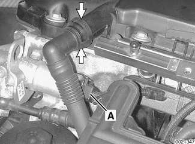

- Detach fuel injector electrical connectors from injectors:
    - Use small screwdriver to pry one corner of wire lock clip on fuel injector 1 connector.
    - Repeat for all injectors.
    - Lift off connector loom and lay aside.

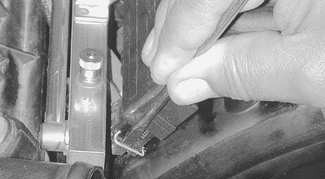

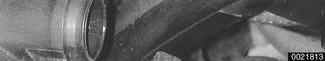

- Remove complete air filter housing:
    - Detach vacuum line at intake boot (A).
    - Disconnect electrical harness connector on mass air flow sensor (B).
    - Release mass air flow sensor clips (C).
    - Remove filter housing mounting screws (D).
    - Detach air duct connection (E) and lift complete air filter housing out of engine compartment, pulling it forward away from mass air flow sensor.

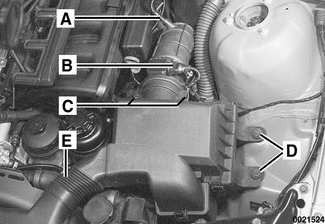

> **Note:**
> - In this step, mass air flow sensor remains attached to rubber air duct.

- Loosen clamps 2 and 8 and remove mass air flow sensor and air ducts.

1. Throttle assembly
2. Hose clamp 77 - 84 mm
3. Y-duct
4. Air duct
5. Hose clamp 83 - 90 mm
6. Mass air flow sensor
7. Idle control valve
8. Hose clamp 28 - 33 mm
9. Hose clamp 77 - 84 mm

- Where applicable: Pull throttle cable upwards out of rubber retainer (A) and unhook ball end of cable (B) from throttle actuator.

> **Note:**
> - Models equipped with M54 engines do not use a throttle cable mounted to throttle housing.

- Remove nuts and bolt (arrows) retaining wiring harness conduit to throttle body.

- Working at throttle housing: Turn harness plug (arrow) counterclockwise and remove.

- Disconnect electrical harness connector at idle speed control valve (arrow).

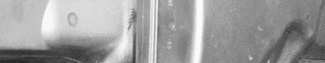

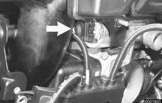

- Detach electrical harness connector at fuel tank venting valve (A). Disconnect hose at quick disconnect fitting (arrow).

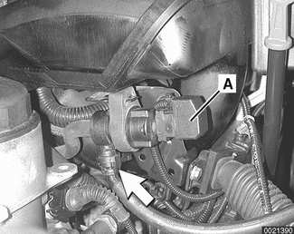

- Remove dipstick guide tube:
    - Detach wiring harness brackets from tube (A).
    - Detach fuel lines from tube (B).
    - Remove lower guide tube mounting bolt (C). Pull out dip stick guide tube.

- Remove schrader valve cap (arrow) from air connection on fuel rail. Using a tire chuck, blow fuel back through feed line using a brief burst of compressed air (maximum of 3 bar or 43.5 psi).

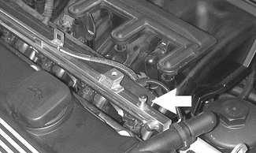

> **WARNING!**
> - Fuel in fuel line is under pressure (approx. 3 - 5 bar or 45 - 75 psi) and may be expelled under pressure. Do not smoke or work near heaters or other fire hazards. Keep a fire extinguisher handy. Before disconnecting fuel hoses, wrap a cloth around fuel hoses to absorb any leaking fuel. Catch and dispose of escaped fuel. Plug all open fuel lines.
> - Always unscrew the fuel tank cap to release pressure in the tank before working on the tank or lines.

- Raise car and support in a safe manner.

> **CAUTION!**
> - Make sure the car is stable and well supported at all times. Use a professional automotive lift or jack stands designed for the purpose. A floor jack is not adequate support.

- Remove protective engine splash guard.

- Working beneath car (on left side under driver seat), remove fuel filter cover and clamp fuel hose(s).

- Detach fuel hose(s) from fuel line(s) (arrows) using special fuel line removal tool 16 1 050 or equivalent. Seal off fuel line(s) with BMW special tools 13 5 281/13 5 282.

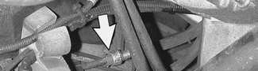

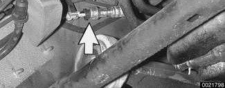

> **CAUTION!**
> - Fuel may be expelled under pressure. Do not smoke or work near heaters or other fire hazards. Keep a fire extinguisher handy. Before disconnecting fuel hoses, wrap a cloth around fuel hoses to absorb any leaking fuel. Plug all open fuel lines.

- Working underneath car, remove lower intake manifold support mounting bolt (arrow), located adjacent to left engine mount.

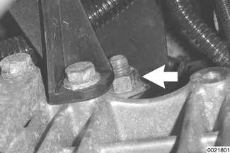

- Remove fuel rail mounting bolts (arrows).
- Carefully pry fuel rail off manifold.
- Separate fuel line support bracket at rear of intake manifold.
- Thread fuel line(s) out of rear of engine compartment while lifting fuel rail out.

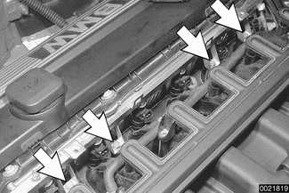

- Remove manifold mounting nuts (arrows).

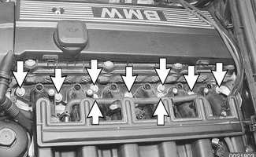

- Lift up manifold just enough to detach positive cables from starter motor terminal 50 (arrow).

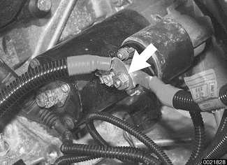

- Remove intake manifold from cylinder head while carefully checking for electrical connections or hoses.

> **CAUTION!**
> - Stuff clean rags into open intake ports to prevent any parts from falling into the engine intake.

- Intake manifold Installation is reverse of removal.
    - Use new fuel injector seals.
    - Carefully check intake manifold gasket and replace if necessary.
    - Inspect O-ring seal between mass air flow sensor and air filter housing. To facilitate reassembly, coat seal with acid-free grease.

> **CAUTION!**
> - When reattaching throttle assembly harness connector, connector is fully tightened when arrows on connector and plug line up.

Tightening torques

| Component | Tightening torque |
|---|---|
| Intake manifold to cylinder head M7 | 15 Nm (11 ft-lb) |
| Intake manifold to cylinder head M8 | 22 Nm (16 ft-lb) |

## Engine assembly, removing and installing

> **Note:**
> - The intake manifold must be removed as described earlier to facilitate engine assembly removal.

- Remove cylinder head top cover:
    - Remove plastic trim covers (arrows).
    - Remove cover hold down bolts and lift off cover.

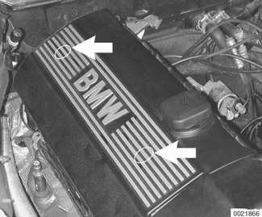

- Drain engine coolant and remove coolant hoses.
    - Remove expansion tank cap on radiator.
    - Place a 3-gallon pail beneath engine to capture coolant.
    - Remove coolant drain plug located on exhaust side of cylinder 2 of engine block (arrow).

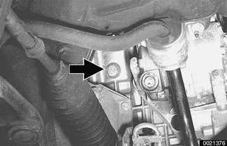

- Drain radiator into a 3-gallon pail by removing plastic drain plug completely (arrow).

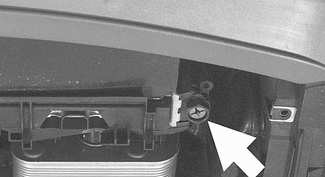

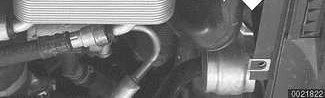

> **WARNING!**
> - Use extreme caution when draining and disposing of engine coolant. Coolant is poisonous and lethal to humans and pets. Pets are attracted to coolant because of its sweet smell and taste. Consult a veterinarian immediately if coolant is ingested by an animal.

> **Note:**
> - Catch and dispose of drained coolant according to local, state, and federal laws.

- Remove hoses from thermostat housing by releasing locks (arrows).

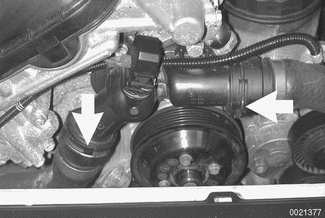

- On vehicles equipped with automatic transmissions: Remove radiator cooling fan and radiator as described in [170 Radiator and Cooling System].

> **CAUTION!**
> - 32 mm radiator fan mounting nut has left hand threads.

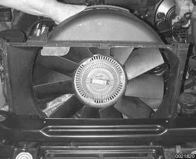

- Detach coolant hose at rear left side of engine above starter by releasing lock (arrow).

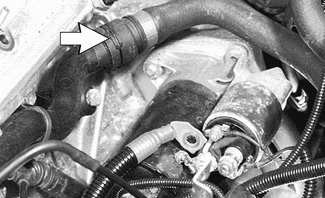

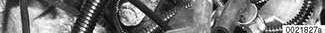

- Detach coolant hose at front left side of engine by engine mount by releasing lock (arrow).

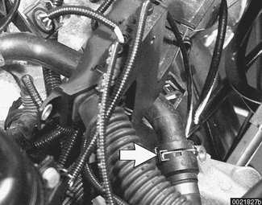

- Unbolt power steering fluid reservoir and pull aside without detaching hoses. Tie to fender with cord or stiff wire.

- Working at E-box at left rear of engine compartment:
    - Detach engine electrical harness connectors (arrows).
    - Lift off harness looms and lay over engine.

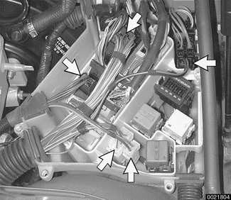

- Remove poly-ribbed drive belts. Mark belt direction of rotation if belts will be reused. See [020 Maintenance].
- All wheel drive models: Remove front axle differential and output shaft bearing pedestal. See [311 Front Axle Final Drive].
- Remove transmission from car. See [230 Manual Transmission] or [240 Automatic Transmission].

> **Note:**
> - Detach automatic transmission cooler lines from radiator, remove brackets holding lines to side of engine, and store lines in a clean environment.

- Remove power steering pump:
    - Remove steering pump pulley.
    - Remove front and rear pump mounting bolts (arrows).
    - Hang pump from body using stiff wire.

- Remove A/C compressor mounting bolts (arrows) and A/C compressor from its mounting bracket without disconnecting, distorting, or deforming any refrigerant lines. Hang from body using stiff wire.

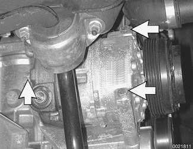

- Remove windshield and headlight washer reservoir:
    - Remove bolt on top of reservoir.
    - Lift tank and disconnect electrical connections to pump and to washer fluid level sensor.
    - Disconnect hoses to windshield washer and headlight washer. Tilt reservoir to prevent fluid from leaking out.

- Remove secondary air pump:
    - Remove hose at one-way valve (A).
    - Remove bolts at support bracket on strut tower (arrows).
    - Disconnect electrical harness from bottom of secondary air pump.
    - Remove bracket from strut tower.

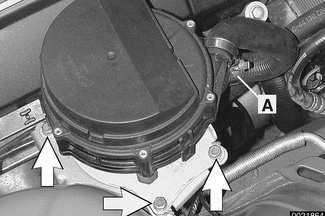

- Separate oxygen sensor electrical harness connectors (arrows) and mounting clip (A) on right side of engine.

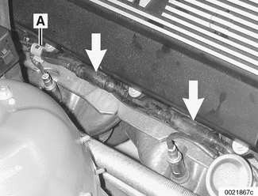

- Remove chassis ground strap (arrow) at right engine mounting pedestal.

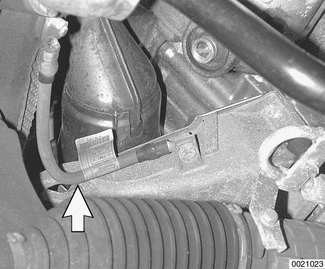

- Install an engine lifting device (BMW 11 0 000 or equivalent) to the front and rear engine supports and raise engine until its weight is supported. Detach left and right engine mounts.

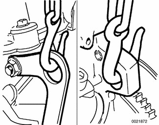

- Carefully raise engine out of car, checking for any wiring, fuel lines, or mechanical parts that might become snagged as engine is removed.

- When reinstalling, make sure locating pin on left engine mount (arrow) seats correctly in slot of subframe boss.

- Installation is reverse of removal, noting the following:
    - Replace all gaskets, O-rings and seals.
    - Change engine oil and filter and check all other fluid levels. See [020 Maintenance].
    - Refill and bleed cooling system. See [170 Radiator and Cooling System].
    - Use new fuel injector seals.
    - Carefully check intake manifold gasket and replace if necessary.
    - Inspect O-ring seal between mass air flow sensor and air filter housing. To facilitate reassembly, coat seal with acid-free grease.

> **CAUTION!**
> - When reattaching throttle assembly harness connector, connector is fully tightened when arrows on connector and plug line up.
> - Check that engine drive belts properly engage pulley grooves.
> - Install exhaust manifolds using new gaskets and self-locking nuts. Use copper paste on threads. See [180 Exhaust System].

Tightening torques

| Component | Tightening torque |
|---|---|
| Coolant drain plug to cylinder block | 25 Nm (18 ft-lb) |
| Engine mount to subframe M10 | 45 Nm (33 ft-lb) |
| Exhaust manifold to cylinder head M6 | 10 Nm (8 ft-lb) |
| Exhaust manifold to cylinder head M7 or M8 | 20 Nm (15 ft-lb) |
| Intake manifold to cylinder head M7 | 15 Nm (11 ft-lb) |
| Intake manifold to cylinder head M8 | 22 Nm (16 ft-lb) |
| Radiator cooling fan to coolant pump | 40 Nm (30 ft-lb) |
| Radiator drain screw to radiator | 2.5 Nm (22 in-lb) |
