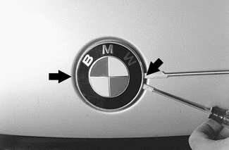
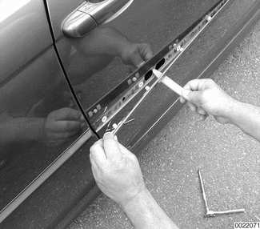
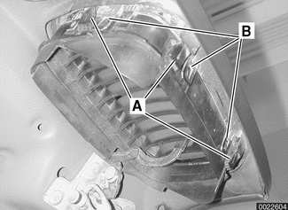
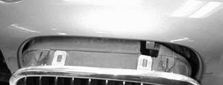
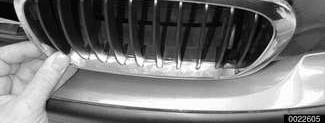
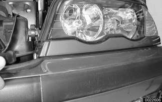

# Exterior Trim

> Source: BMW 3 Series (E46) Repair Manual, section 510-4, Exterior Trim, Bumpers chapter (PDF pages 794–796 of 1252).

Exterior trim is retained to the body by plastic clips and fasteners that may be damaged during removal. Be sure to have necessary fasteners on hand when reinstalling exterior trim pieces.

## BMW emblem, removing and installing

The procedure given below applies to both front and rear emblems.

- Wrap end of a screwdriver with tape.

> **CAUTION!**
> - Protect hood paint by covering area around emblem with tape.

- Carefully pry out emblem. Pry up emblem carefully on either side (**arrows**). Note tape on screwdriver tips.

- Installation is reverse of removal. Replace plastic inserts in body if damaged.

If emblem fits loosely, use a small amount of body molding tape or adhesive on rear of emblem before installing.

## Body side molding, replacing

To remove body side moldings, carefully pry moldings straight off.

- Installation is reverse of removal. Replace any clips or clip covering boots damaged during removal.

## Radiator grill, removing and installing

- Open hood.

- Gently pry out tab on left or right side of grill trim ring (**A**), as well as tabs on bottom.

- Feed grill out through opening. Be careful of hood lever on driver's side grill.

- Once grill is removed, pry remaining tabs (**B**) to separate inner grill from chrome trim ring.

- Before installation, assemble chrome trim ring and grill insert securely. Replace components if tabs or catches are broken or missing.

- To install align grill and trim ring in appropriate location in hood. Press on trim ring until grill snaps into place.

## Headlight housing trim panel, removing and installing

- Open hood.

- Remove spray nozzle of vehicles equipped with headlight cleaning systems. See [611 Wipers and Washers].

- Unclip inner tab at radiator support.

- Press pane downward, out of retaining brackets. Feed out retaining hook at fender.

- Installation is reverse of removal.
