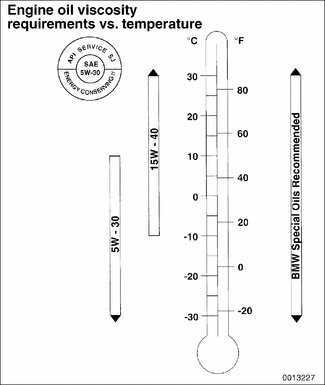

# Fluid and Lubricant Specifications

> Source: BMW 3 Series (E46) Repair Manual, section 020-3, Maintenance chapter (PDF pages 41–44 of 1252).

The illustration shows engine oil viscosity (SAE grade) vs. operating temperature range for the BMW engines covered in this manual.

Fluid and lubricant capacities and specifications for E46 cars are listed in Table d.

> **WARNING!**
> - The use of fluids that do not meet BMW's specifications may impair performance and reliability, and may void warranty coverage.

Table d. Fluids and lubricants

| Fluid | Approximate capacity | Specification |
|---|---|---|
| **Engine oil with filter change** | | |
| Rear wheel drive | 6.5 liters (6.9 US qt.) | Synthetic oil with API rating SH or higher |
| All wheel drive | 7.5 liters (8 US qt.) | Synthetic oil with API rating SH or higher |
| **Manual transmission oil** | | |
| Getrag S5D 250G | 1.1 liters (1.15 US qt.) | BMW 83 22 9 408 942 (MTF-LT-1) |
| ZF S5D 320Z | 1.3 liters (1.37 US qt.) | BMW 83 22 9 408 942 (MTF-LT-1) |
| ZF S5D 280Z | 1.35 liters (1.42 US qt.) | BMW 83 22 9 408 942 (MTF-LT-1) |
| **Automatic transmission fluid (ATF) (drain and fill) (additional fluid required when installing a dry torque converter)** | | |
| ZF A5S 325Z | Complete refill: 9.0 liters (9.5 US qt.); Oil and filter change: 4.0 liters (4.2 US qt.) | BMW 83 22 9 407 807 (Exxon LT 71141) |
| GM A5S 360R / GM A5S 390R | Complete refill: 9.0 liters (9.5 US qt.); Oil and filter change: 4.0 liters (4.2 US qt.) | BMW 83 22 0 024 359 (Texaco ETL 8072B) |
| **Differential, front or rear (drain and fill) (Lifetime fluid; no fluid change required)** | | |
| Front differential | Fill: 0.7 liter (0.74 US qt.); Refill: 0.6 liter (0.63 US qt.) | BMW SAF-XO synthetic oil |
| Rear differential, rear wheel drive | 0.9 liter (0.95 US qt.) | BMW SAF-XO synthetic oil |
| Rear differential, all wheel drive | 1.0 liter (1.06 US qt.) | BMW SAF-XO synthetic oil |
| **Power steering fluid** | | |
| All models | Permanently sealed (no drain plug) | Dexron III® ATF |
| **Brake fluid** | | |
| All models | | SAE DOT4 |
| **Engine coolant** | | |
| All models | 8.4 liters (8.9 US qt.) | 50% BMW anti-freeze / 50% distilled water |

> **CAUTION!**
> - Multi-viscosity engine oils should not be used in the manual transmission. Use of such an oil could shorten the service life of the transmission.

## Brake fluid

Brake fluid absorbs moisture easily, and moisture in the fluid affects brake performance and reliability. This is why brake fluid should be flushed from the system every two years. When replacing or adding brake fluid, use only new fluid from previously unopened containers. Do not use brake fluid that has been bled from the system, even if it is brand new. Use only DOT 4 brake fluid.

> **Note:**
> - See [340 Brakes] for more brake fluid information.

## Engine coolant (anti-freeze)

BMW recommends coolant that is a 50/50 mixture of distilled water and phosphate/nitrate free anti-freeze containing ethylene glycol. Anti-freeze raises the boiling point and lowers the freezing point of the coolant. It also contains additives that help prevent cooling system corrosion.

## Differential gear oil

BMW recommends using only a specially formulated synthetic gear oil (SAF-XO) that is available through an authorized BMW dealer parts department. For additional information on this lubricant and any other lubricants that may be compatible, contact an authorized BMW dealer service department.

## Power steering fluid

The power steering fluid is Dexron III® ATF, or equivalent. The system is permanently filled and does not have a drain. Routinely adding ATF is not required unless the system is leaking.

## Transmission fluid, automatic

The automatic transmissions installed in the E46 models are filled with special automatic transmission fluids, depending on transmission type and model year.

> **Note:**
> - The transmission lubricant type can be found on the "type-plate" on the side of the transmission. See [240 Automatic Transmission].
> - Consult an authorized BMW dealer for alternate fluid use and the most-up-to-date information regarding transmission operating fluids.

## Transmission fluid, manual

The manual transmissions installed in the E46 models are normally filled with a special lifetime fluid (MTF-LT-1). Consult [230 Manual Transmission] for further information.
