# Front Differential

> Source: BMW 3 Series (E46) Repair Manual, section 311-3, Front Axle Final Drive chapter (PDF pages 581–592 of 1252).

Procedures for replacement of O-ring seal between the engine oil pan and the front differential or right side bearing pedestal are covered in [Front axle differential, removing and installing] and [Right axle bearing pedestal, removing and installing].

## Front differential oil, checking and filling

> **Note:**
> - BMW supplies the E46 all wheel drive models with lifetime lubrication in the front differential.

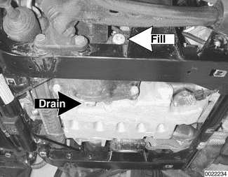

Front differential drain plug and fill plug (arrows).

> **Note:**
> - Use an Allen bit socket to remove drain plug. Alternatively, cut approximately 30 mm (1.2 in) from an Allen key and use a box end wrench on key stub.

- Remove oil filler plug.

> **Note:**
> - Differential fluid level is correct when fluid begins to spill from fill plug.

- Fill differential with appropriate type and quantity of lubricant to bottom of fill plug bore.
- Install and tighten fill plug.

## Final drive drain and fill

Oil specifications

| Front axle differential oil capacity | BMW SAF-XO synthetic oil, 0.7 liters (0.74 US qts.) |
|---|---|

Tightening torque

| Component | Tightening torque |
|---|---|
| Front axle differential drain / fill plug | 65 Nm (48 ft-lb) |

## Front axle differential, removing and installing

- Disconnect battery negative (-) ground at battery.

> **CAUTION!**
> - Prior to disconnecting battery, read battery disconnection cautions given at front of this manual on page viii.

- Lift vehicle and support safely.

> **WARNING!**
> - Make sure car is stable and well supported at all times. Use a professional automotive lift or jack stands designed for the purpose. A floor jack is not adequate support.

- Remove splash shield from below engine compartment.
- Support engine using appropriate lifting device.
- Release nut at top on right engine mount (arrow).

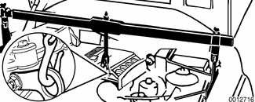

- Remove nut (arrow) at bottom on left engine mount.

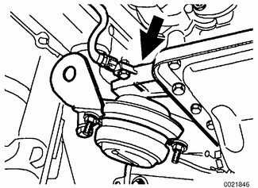

- Raise engine approximately 10 mm (0.4 in.).
- Remove front wheels. Unbolt brake calipers and suspend from body using stiff wire. See [340 Brakes].

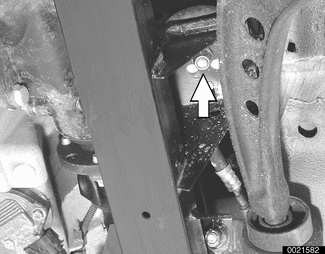

- Remove front driveshaft. See [260 Driveshaft].
- Remove left inner ball joint mounting bracket bolts (arrows) from subframe.

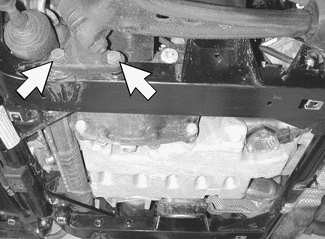

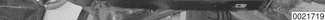

- Repeat for right side.
- Support left control arm. Working at rear of subframe, remove control arm rear bracket mounting bolts (arrows).

- Repeat for right side.
- Remove left tie rod outer end nut (arrow). Use BMW special tool 32 3 090 or equivalent to press tie rod end off steering arm.

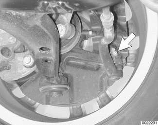

- Repeat for right side.
- Remove left ABS sensor (arrow) from steering arm.

- Repeat for right side.
- Unclip brake hoses and electrical harness wires from mounting brackets.
- Swing control arms and steering arms out of the way. Using BMW special tool 31 1 170 or equivalent pry bar, pry inner CV joints out of front differential and bearing pedestal.

> **Note:**
> - Be prepared to catch oil drips from differential or right side bearing pedestal.

- Working on left side of car:
    - Release pinch bolt (arrow) at top of steering arm.
    - Pull steering arm down from strut assembly.
    - Remove steering arm, drive axle, and control arm assembly as one unit.
- Repeat for right side.

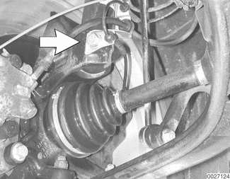

- Remove lower steering column. See [320 Steering and Wheel Alignment].
- Remove stabilizer bar anchors from front subframe.
- Working underneath car, remove fluid line banjo bolts (arrows) from steering rack.

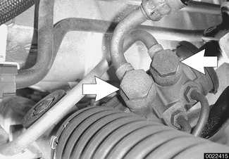

> **CAUTION!**
> - Plug off power steering lines and connections to keep out contamination.

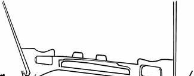

- Remove front axle subframe and steering rack from frame rails. See [310 Front Suspension]

> **Note:**
> - Make sure heat shields, wiring harnesses and other under body components are clear during removal.

- Detach vent tube from port (A) on front axle differential. Remove mounting bolts (B) and remove front axle differential.

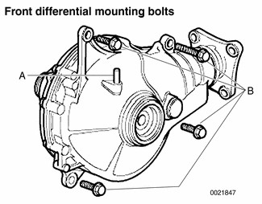

- Install new sealing ring, coating inside edge with assembly lubricant. Push assembly ring up to sealing ring.

> **Note:**
> - Sealing and assembly rings between oil pan and differential must be replaced before differential is installed.
> - Assembly ring prevents damage when front axle differential is installed.
> - When front axle differential is installed on oil pan, the assembly ring is forced over sealing ring and remains in place.

- Installation is reverse of removal, noting the following:
    - Always replace drive axle radial seal of differential before installing drive axles.
    - Top up differential fluid. See [Front differential oil, checking and filling]
    - Replace sealing rings when reinstalling banjo bolts to steering rack.

Tightening torques

| Component | Tightening torque |
|---|---|
| Brake caliper to steering arm | 110 Nm (81 ft-lb) |
| Control arm bracket to front suspension subframe (replace bolts) | 59 Nm (44 ft-lb) |
| Engine mount to subframe M10 self locking nut | 45 Nm (33 ft-lb) |
| Front axle differential to oil pan | 45 Nm (33 ft-lb) |
| Front axle differential fill plug | 65 Nm (48 ft-lb) |
| Hydraulic hoses to power steering pump, M14 banjo bolt | 35 Nm (26 ft-lb) |
| Hydraulic hoses to power steering pump, M16 banjo bolt | 40 Nm (30 ft-lb) |
| Inner ball joint to front suspension subframe | 77 Nm (57 ft-lb) |
| Stabilizer bar bushing brackets to subframe | 22 Nm (16 ft-lb) |
| Steering arm to lower ball joint | 65 Nm (48 ft-lb) |
| Steering arm clamping bolt at strut housing | 81 Nm (60 ft-lb) |
| Steering column to steering rack | 22 Nm (16 ft-lb) |
| Steering tie rod to steering arm | 65 Nm (48 ft-lb) |
| Subframe front to body, M12-8.8 bolt | 77 Nm (56 ft-lb) |
| Subframe front to body, M12-10.9 bolt | 110 Nm (81 ft-lb) |
| Subframe front to body, M12-12.9 bolt | 105 Nm (77 ft-lb) |
| Subframe rear to adapter M12 bolt (always replace) | 110 Nm (81 ft-lb) |

## Right axle bearing pedestal, removing and installing

- Lift vehicle and support safely.

> **WARNING!**
> - Make sure car is stable and well supported at all times. Use a professional automotive lift or jack stands designed for the purpose. A floor jack is not adequate support.

- Remove right front wheel.
- Release nut and remove tie rod end from right steering arm assembly.
- Remove ABS sensor from steering arm.
- Unclip brake hose from mounting bracket.
- Unbolt brake caliper and suspend from body using stiff wire.
- Remove inner ball joint mounting bracket bolts (arrows) from subframe.

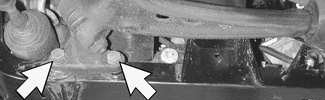

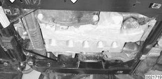

- Support control arm. Working at rear of subframe, remove control arm rear bracket mounting bolts (arrows).

- Using BMW special tool 31 1 170 or equivalent pry bar, pry inner CV joint out of bearing pedestal.
- Release pinch bolt at top of steering arm. Pull steering arm down from strut assembly and remove steering arm, drive axle, and control arm assembly.

- Remove grounding strap on bearing pedestal. Remove four bolts retaining bearing pedestal to oil pan, and remove pedestal.
- Install new sealing ring, coating inside edge with assembly lubricant. Push assembly ring up to sealing ring.

> **Note:**
> - Sealing and assembly rings between oil pan and differential must be replaced before differential is installed.
> - Assembly ring prevents damage when bearing pedestal is installed.
> - When bearing pedestal is installed on oil pan, the assembly ring is forced over sealing ring and remains in place.

- Installation is reverse of removal, noting the following:
    - Always replace drive axle radial seal before installing drive axle.
    - Top up differential fluid. See [Front differential oil, checking and filling]

Tightening torques

| Component | Tightening torque |
|---|---|
| Bearing pedestal to oil pan | 45 Nm (33 ft-lb) |
| Brake caliper to steering arm | 110 Nm (81 ft-lb) |
| Control arm bracket to front suspension subframe (replace bolts) | 59 Nm (44 ft-lb) |
| Inner ball joint to front suspension subframe | 77 Nm (57 ft-lb) |
| Steering arm to lower ball joint | 65 Nm (48 ft-lb) |
| Steering arm clamping bolt at strut housing | 81 Nm (60 ft-lb) |
| Steering tie rod to steering arm | 65 Nm (48 ft-lb) |

## Input flange radial seal, replacing

- Lift vehicle and support safely.

> **WARNING!**
> - Make sure car is stable and well supported at all times. Use a professional automotive lift or jack stands designed for the purpose. A floor jack is not adequate support.

- Remove front driveshaft. See [260 Driveshaft]
- Pry out input flange retaining nut lock plate.
- Using a centerpunch, mark relation of input flange retaining nut to output shaft.

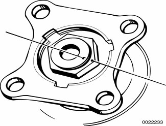

- Counterhold input flange in place using BMW special tool 23 0 020 and remove nut.

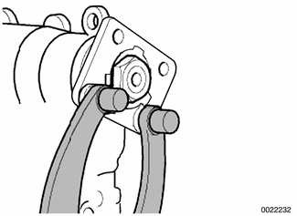

- Pull input flange out from differential using a hub puller.
- Remove input seal dust shields.
- Using a seal puller or flat screwdriver, pry radial seal out of differential housing.
- Coat sealing edges of radial seal with transmission fluid and drive into differential housing using BMW special tool 31 5 130 or equivalent drift.
- Replace dust shields.
- Clean input flange and install into differential housing. Tighten down nut until punch marks align.
- Install new input flange retaining nut locking plate.

> **CAUTION!**
> - Do not torque input flange retaining nut beyond matchmarks. Over-torquing can damage differential internals.
> - Do not replace input flange or input flange locking nut.

- Installation is reverse of removal.

Tightening torque

| Component | Tightening torque |
|---|---|
| Input flange collar nut to differential | until matchmarks align |
