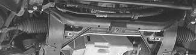
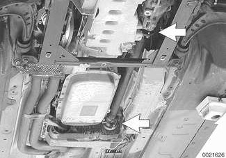

# Front Driveshaft Service

> Source: BMW 3 Series (E46) Repair Manual, section 260-3, Driveshafts chapter (PDF pages 468–469 of 1252).

Repair kits for the universal joints are not available for BMW driveshafts. Worn or damaged universal joints usually require replacement of the driveshaft.

## Front driveshaft, removing and installing

> **CAUTION!**
> - Do not move vehicle using engine power once front driveshaft has been removed.

- Raise vehicle and safely support to access front driveshaft.

> **WARNING!**
> - When raising the car using a floor jack or a hydraulic lift, carefully position the jack pad to prevent damaging the car body. A suitable liner (wood, rubber, etc.) should be placed between the jack and the car to prevent body damage.
> - Watch the jack closely. Make sure it stays stable and does not shift or tilt. As the car is raised, the car may roll slightly and the jack may shift.

- Remove underbody splash guard.
- Remove bolts holding driveshaft to transfer case output flange and front differential input flange (arrows).

- Installation is reverse of removal.

Tightening torques

| Component | Tightening torque |
|---|---|
| Driveshaft to drive flange (M10) | 70 Nm (52 ft-lb) |
