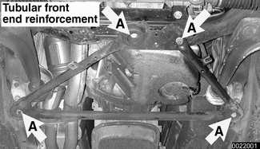
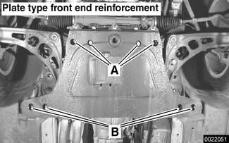

# Front End Reinforcement

> Source: BMW 3 Series (E46) Repair Manual, section 310-3, Front Suspension chapter (PDF pages 526–527 of 1252).

In rear wheel drive models, a front end reinforcement is bolted to the rear of the subframe and attached to the frame rails.

> **CAUTION!**
> - Do not drive vehicle without the front end reinforcement in place. Damage to the front suspension may result.

- The tubular front end reinforcement is installed with 4 bolts (A) in the following cars:
    - Rear wheel drive Sedan and Sport Wagon models manufactured until production date 12/2000.
    - Coupe models manufactured until production date 11/1999.

- The aluminum plate type front end reinforcement is installed in the following cars:
    - All Convertible models
    - Coupe models manufactured from production date 11/1999.
    - Rear wheel drive Sedan and Sport Wagon models manufactured from production date 12/2000.

> **CAUTION!**
> - After 2/2001, the front reinforcement plate was produced with larger cast depressions to accommodate the larger (66 mm) front control arm bushings. The difference in the early production and later plates can only be discerned by removing the plate.
> - In order to safely use an early production plate in a car with larger bushings, insert appropriate sized washers between frame rails and reinforcement plate at bolts B.

- When reinstalling front end reinforcement:
    - Replace mounting bolts.
    - Torque bolts in 2 stages, as shown below. Use BMW special tool 00 9 120 or equivalent torque angle protractor.

Tightening torque

| Component | Tightening torque |
|---|---|
| Front end reinforcement to front subframe or body frame rails: M10 bolt (A or B) (always replace), Stage 1 | 59 Nm (43 ft-lb) |
| Front end reinforcement to front subframe or body frame rails: M10 bolt (A or B) (always replace), Stage 2 | torque angle 90° + 30° |
