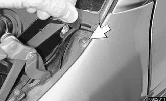
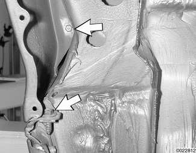
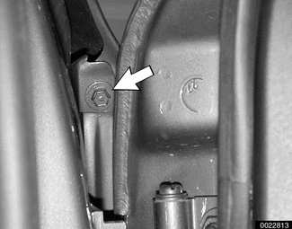
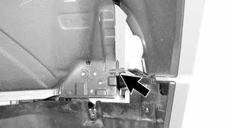
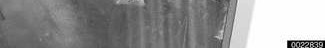
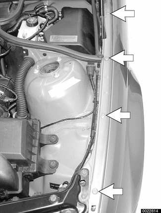

# Front Fenders

> Source: BMW 3 Series (E46) Repair Manual, section 410-2, Fenders, Engine Hood chapter (PDF pages 743–745 of 1252).

## Front fender, removing and installing

- Raise hood. Raise and safely support front of vehicle.

> **WARNING!**
> - When raising the car using a floor jack or a hydraulic lift, carefully position the jack pad to prevent damaging the car body. A suitable liner (wood, rubber, etc.) should be placed between the jack and the car to prevent body damage.
> - Watch the jack closely. Make sure it stays stable and does not shift or tilt. As the car is raised, the car may roll slightly and the jack may shift.

- Remove front wheel. Remove inner plastic liner from wheel housing.
- Remove front turn signal/lens assembly from applicable front corner. Carefully pry out side directional from fender and disconnect. See [630 Lights].
- Remove body colored trim panel underneath headlight assembly.

Working at cowl, feed corner of side trim panel cover out from side of fender. Gently lift panel cover upwards and remove retaining screw (arrow).

Remove lower fender attaching bolts (arrows) at rear of wheel housing.

With door open remove upper fender to door post attaching bolt (arrow).

Remove screw (arrow) at front of fender.

Remove bolts (arrows) along top edge of fender.

- Carefully remove fender from body.
- Installation is reverse of removal, noting the following:
    - Before installing new fender, clean old sealant and protective coating from mounting surfaces.
    - Position new fender and loosely install all mounting bolts. Align fender with door pillar and inner fender, then tighten bolts.
    - Repair any paint damage and paint any exposed metal.
    - Reseal and apply protective coating to mounting surfaces.

| Clearance specification |  |
|---|---|
| Fender to front hood or to door | 4.25 ± 0.75 mm (0.167 ± 0.03 in.) |
