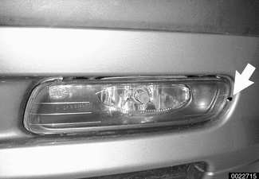
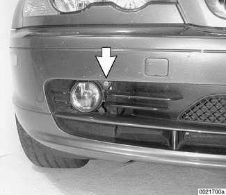
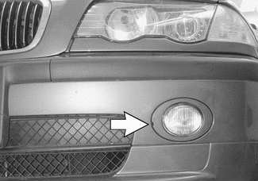
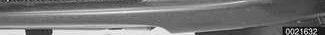
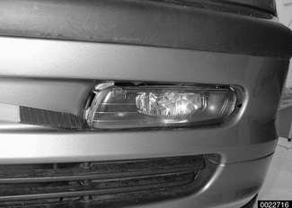
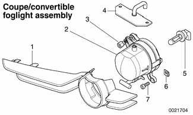

# Front Foglights

> Source: Bentley *BMW 3 Series (E46) 1999–2005 (M3) Repair Manual*, section 630-4 (PDF pages 1099–1101 of 1252).

## Foglight aim, adjusting

Sedan or Sport Wagon: Use 4 mm Allen wrench to turn plastic adjuster (arrow) on outer edge of foglight.

Coupe or Convertible: Use adjuster (arrow) on inside upper edge of foglight.

2001 models:

- Using plastic pry tool, pry off foglight cover at slot (arrow).
- Adjust using 6 mm Allen on outside upper corner of foglight.

## Foglight assembly, removing and installing

**Sedan or Sport Wagon:**

- Use plastic prying tool to lever out foglight assembly.
- Detach electrical harness connector.

**Coupe or Convertible:**

- Gently remove lower bumper trim.
- Working at foglight, detach grille and loosen mounting screws. Remove foglight assembly with grille attached.
- Detach electrical harness connector.

Unclip grille from foglight.

1 - Grille
2 - Foglight
3 - Adjuster
4 - Support with grommet
5 - Foglight bulb
6 - Body nut
7 - Self-tapping screw

- Installation is reverse of removal, noting the following:
    - Sedan/Sport Wagon: Foglight must be snapped firmly into bumper retainers.
    - Coupe/Convertible: Keep ventilation grommets unkinked and firmly seated.
- Adjust foglight aim as described earlier.

## Foglight bulb, replacing

- Remove foglight assembly as described earlier.
- Twist and remove bulb from rear of foglight assembly.

> **CAUTION!**
> - Do not touch halogen bulbs with your bare hands. If necessary wipe bulb using a clean cloth dampened with rubbing alcohol.

- Installation is reverse of removal. Check electrical connector for corrosion. Spray with contact cleaner, if necessary.

Foglight application

| Location | Type & rating |
|---|---|
| Front foglight bulb | HB4 |
