# Front Seat Belt Assembly

> Source: Bentley *BMW 3 Series (E46) 1999–2005 (M3) Repair Manual*, section 720-2 (PDF pages 1188–1197 of 1252).

## Front seat belt tensioner, removing and installing

The front seat belt locks are equipped with pyrotechnic (explosive charge) automatic tensioners. These tensioners are designed to automatically retract and tension the seat belt by 55 mm (approximately 2 inches) in the event of an accident.

> **WARNING!**
> - Pyrotechnic seat belt tensioners are powerful devices and should be handled with extreme care. Incorrect handling can trigger the tensioner and cause injury.
> - BMW recommends that all repair or replacement work on pyrotechnic devices must be carried out by a qualified BMW technician.
> - Be sure to disconnect the battery and wait 5 seconds before attempting to work on pyrotechnic devices.
> - Pyrotechnic devices cannot be repaired. Always replace them.
> - Never treat pyrotechnic components with cleaning agents or grease.
> - Do not expose pyrotechnic components to temperatures above 75°C (167°F).
> - Pyrotechnic components can only be tested electrically when installed, using BMW service tester DIS, MoDiC or equivalent scan tool.
> - Do not fire a pyrotechnic gas generator prior to disposal. It must be fired by a special disposal company or shipped back to BMW in the packaging of the new components.
> - During body straightening and welding with an electric arc welder, always disconnect the battery and the connection to the pyrotechnic gas generators.

- Detach battery negative (-) cable in luggage compartment.

> **CAUTION!**
> - Prior to disconnecting the battery, read the battery disconnection cautions given at the front of this manual on page viii.

- Remove front seat as described in [520 Seats].

Remove pyrotechnic belt tensioner:

- Detach tensioner harness connector from seat rail by cutting wire tie (**A**).

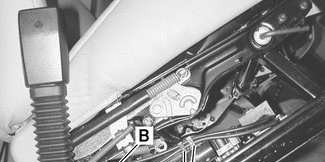

- Detach harness connection (**B**).
- Remove tensioner mounting bolt (**C**).

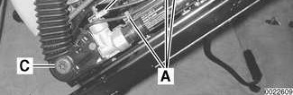

Check tensioner mounting bracket (arrow) for damage or bending. Replace if necessary.

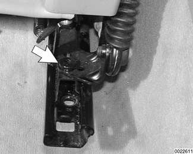

> **CAUTION!**
> - A bent tensioner mounting bracket may make it impossible to adjust seat height.

When reinstalling:

- Replace wire ties to relieve tension on the pyrotechnic belt tensioner harness connector.
- Make sure tensioner harness connector mounting bracket (arrow) is installed correctly.

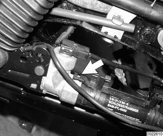

Tightening torques

| Component | Tightening torque |
|---|---|
| Front seat to floor (M10 fastener) | 45 Nm (33 ft-lb) |
| Seat belt to seat | 48 Nm (35 ft-lb) |
| Tensioner mounting bracket to seat rail | 24 Nm (18 ft-lb) |
| Tensioner to mounting bracket | 48 Nm (35 ft-lb) |

## Front seat belt assembly (Sedan, Coupe, Sport Wagon)

1 - Seat belt buckle
2 - Tensioner mounting bolt — tighten to 48 Nm (35 ft-lb)
3 - Seat belt lock with pyrotechnic tensioner
4 - Seat belt stop button
5 - Seat belt anchor bolt — tighten to 48 Nm (35 ft-lb)
6 - Seat belt reel assembly
    - 6a - Seat belt anchor end (Sedan/Sport Wagon models)
7 - Bolt M8
8 - B-pillar cross-brace
9 - Plastic cap
10 - Bolt M10 — tighten to 31 Nm (23 ft-lb)
11 - Spring washer
12 - Spacer
13 - Seat belt anchor bar (Coupe only)
14 - Cap
15 - Grommet
16 - Seat belt reel mounting bolt M10 — tighten to 31 Nm (23 ft-lb)
17 - Seat belt height adjuster

## Front seat belt reel, removing and installing (Sedan, Coupe or Sport Wagon models)

- Detach battery negative (-) cable in luggage compartment.

> **CAUTION!**
> - Prior to disconnecting the battery, read the battery disconnection cautions given at the front of this manual on page viii.

- Remove front seat as described in [520 Seats].
- **Coupe models:** Working just inside door sill.
    - Pry off plastic protective cap over end of seat belt anchor bar.
    - Remove anchor bar bolt and slip off end of seat belt from bar.

**Note:**

*Replace anchor bar if it is bent.*

Prying gently upward, remove plastic door sill protector strip.

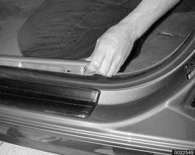

**Sedan or Sport Wagon models:** Remove lower B-pillar (door pillar) plastic trim.

- Pry gently along bottom of trim to disengage clips from pillar.
- Slide trim down and out.

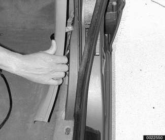

- **Coupe models:** Remove rear side panel as described in [411 Doors].

**Note:**

*Partially peel rubber door seal(s) away from B-pillar.*

Remove upper B-pillar (door pillar) plastic trim expansion rivets (arrows).

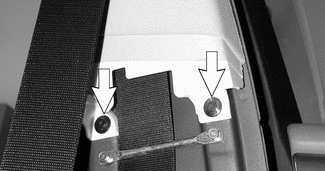

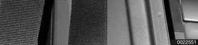

Pull B-pillar upper trim down to remove.

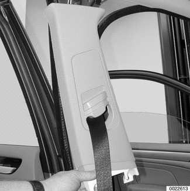

Remove automatic reel from B-pillar:

- Remove upper seat belt anchor bolt (**A**).
- Remove cross-brace mounting bolts (**B**).
- Remove sound insulation at base of B-pillar. Then remove automatic seat belt reel mounting bolt (**C**).
- Lift out reel.

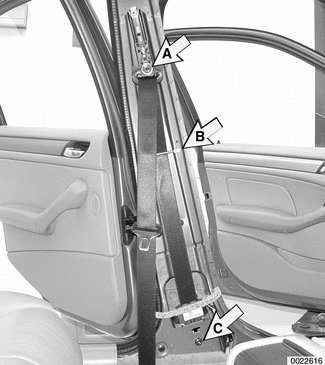

- If it is necessary to remove sliding seat belt height adjuster, unscrew mounting bolts from B-pillar.
- Installation is reverse of removal.
    - Install automatic reel housing to B-pillar by sliding tab into locating slot.

Tightening torques

| Component | Tightening torque |
|---|---|
| Front seat to floor (M10 fastener) | 45 Nm (33 ft-lb) |
| Seat belt anchor bar to door sill | 31 Nm (23 ft-lb) |
| Seat belt to seat | 48 Nm (35 ft-lb) |
| Seat belt to B-pillar sliding anchor | 31 Nm (23 ft-lb) |
| Seat belt reel to B-pillar bottom | 31 Nm (23 ft-lb) |
| Sliding seat height adjuster to B-pillar | 24 Nm (18 ft-lb) |

## Seat-integrated seat belt system (SGS) (Convertible models)

The front seats of E46 Convertible models are designed with integrated seat belts. In this way, the forces acting on a front seat occupant during a collision are channeled to the reinforced floor.

All belt fastening points move with the seat as it is adjusted. This ensures the best possible body strapping regardless of seat position or occupant size. With the shorter free belt length, the occupant is held more reliably with vehicle deceleration.

The fixed anchor point and the seat belt lock/tensioner are mounted on the seat frame. The upper seat belt guide is attached to the headrest. In this way the belt is optimally positioned regardless of headrest position.

The inertia reel is attached to the inside of the seat backrest. The mechanism is connected to the backrest hinge through a lever and a cable drive (coupler mechanism). As the angle of the backrest is adjusted, the cable drive will change the angle of the inertia lock. In this way the reel is in the proper position for locking at any seat back angle.

The seat belt lock and tensioner on the SGS system is a pyrotechnic device similar to that on other E46 models. When working on SGS belts, be sure to read the warnings and cautions in the procedure for front seat belt tensioner removal and installation, earlier in this group.

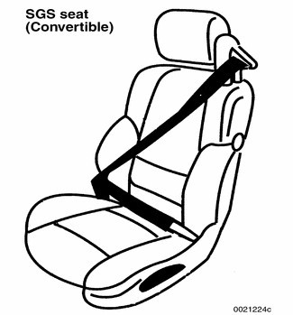

**Note:**

*SGS seat belt removal can only be carried out with the seat out of the car. See [520 Seats].*

Once the seat has been removed, the seat backrest must be partially disassembled. The accompanying illustration provides information on SGS component locations and fastener torques.

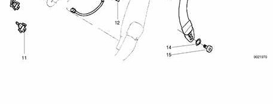

1 - Coupler mechanism
2 - Self-tapping screw M4.2 — tighten to 2.5 Nm (22 in-lb)
3 - Threaded pin
4 - Front seat backrest
5 - Support
6 - SGS belt reel mounting nut M10 — tighten to 39 Nm (29 ft-lb)
7 - SGS inertia reel assembly
8 - Torx bolt M6 — tighten to 4.5 Nm (40 in-lb)
9 - Seat belt guide cover, front
10 - Seat belt guide cover, rear
11 - Connector
12 - Clip
13 - Seat belt button
14 - Bushing
15 - Bolt M10 (selflocking, always replace) — tighten to 45 Nm (33 ft-lb)
