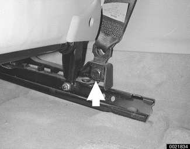
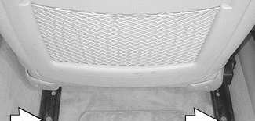
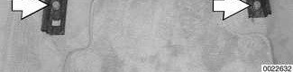
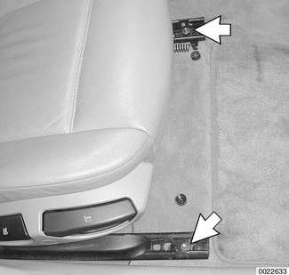
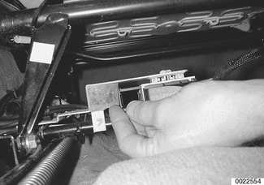

# Front Seats

> Source: BMW 3 Series (E46) Repair Manual, section 520-2, Seats chapter (PDF pages 905–908 of 1252).

Seat removal and installation is similar for all versions. Seat disassembly differs in detail among the many models of seats.

Seat repair and component replacement is possible once the seat has been removed from the vehicle.

## Front seat, removing and installing

> **WARNING!**
> - The front seats are equipped with pyrotechnic seat belt tensioners. These tensioners are powerful devices and should be handled with extreme care. Incorrect handling can trigger off the tensioner and cause injury.
> - BMW recommends that all repair or replacement work on pyrotechnic devices must be carried out by a qualified BMW technician.
> - Be sure to disconnect the battery and wait 5 seconds before attempting to work on pyrotechnic devices.
> - Pyrotechnic devices cannot be repaired. Always replace them.
> - Never treat pyrotechnic components with cleaning agents or grease.
> - Do not expose pyrotechnic components to temperatures above 75°C (167°F).
> - Pyrotechnic components can only be tested electrically when installed, using BMW service tester DIS, MoDiC or equivalent scan tool.
> - Do not fire a pyrotechnic gas generator prior to disposal. It must be fired by a special disposal company or shipped back to BMW in the packaging of the new components.
> - During body straightening and welding with an electric arc welder, always disconnect the battery and the connection to the pyrotechnic gas generators.

4-door models: raise seat and move to its forward position. Working at base of seat near doors, remove seat belt mounting bolt (arrow).

- Remove headrests (not convertible).

- Remove two mounting bolts (arrows) at rear of seat rails.

- Move seat to its rear most position, keeping it raised.

Remove plastic caps over front seat mounting nuts, then remove mounting nuts (arrows).

- Disconnect negative (-) cable from battery.

> **CAUTION!**
> - Prior to disconnecting the battery, read the battery disconnection cautions given at the front of this manual on page viii.

- Tilt seat back to access electrical harness connectors. Slide lock to release and disconnect. Cut or untwist wire ties as necessary.

- Remove seat from car. The headrests may be removed to provide additional clearance.

> **Note:**
> - Use a blanket to protect door sill from scuffing by seat rail during seat removal.

- Installation is reverse of removal. Use wire ties or equivalent means to keep seat harness wiring from fraying.

Tightening torque

| Component | Torque |
|---|---|
| Front seat to floor | 45 Nm (33 ft-lb) |
| Seat belt end to seat | 48 Nm (35 ft-lb) |
