# Front Subframe

> Source: BMW 3 Series (E46) Repair Manual, section 310-4, Front Suspension chapter (PDF pages 528–551 of 1252).

The front subframe provides rigid mounting points for the engine, suspension, and steering components. The subframe is not normally subject to wear and should only be replaced if structurally damaged.

Rear wheel drive and all wheel drive models differ significantly in the design of the front subframe.

Removing the front subframe requires engine lifting equipment to support the weight of the engine from above so that the subframe can be removed from below.

> **CAUTION!**
> - Removal or replacement of the subframe may affect suspension and steering geometry, including front wheel alignment. Make appropriate matching marks during removal and have the front end aligned once repairs are complete.

## Front subframe, removing and installing (rear wheel drive models)

- Using engine support equipment, raise engine until weight of engine is supported.

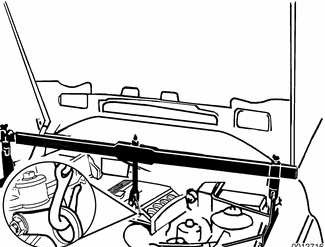

- Raise car and remove front wheels.

> **WARNING!**
> - Make sure that the car is firmly supported on jack stands designed for the purpose. Place the jack stands beneath a structural chassis point. Do not place jack stands under suspension parts.

- Remove splash shield under engine compartment.
- Remove front end reinforcement. See [Front End Reinforcement] earlier in this group.
- On cars equipped with xenon headlights: Remove front ride level sensor mounting fastener (arrow) and lay sensor aside.

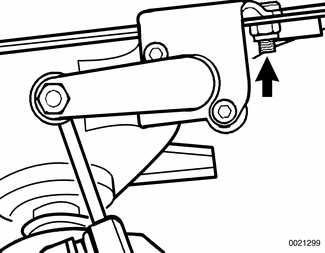

- Remove right front control arm bracket bolts (arrows) from frame rail.
- Repeat for left side.

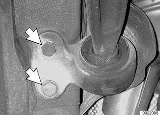

- Remove right inner control arm ball joint mounting nut (arrow) at subframe.
- Drive ball joint shaft out of subframe using soft hammer.
- Push control arm aside.

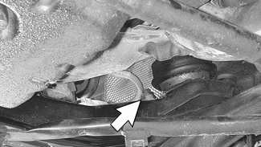

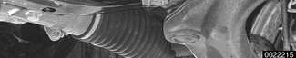

- Repeat for left side.
- Remove steering rack mounting bolts (arrows) at front of subframe. Suspend rack out of the way with stiff wire.

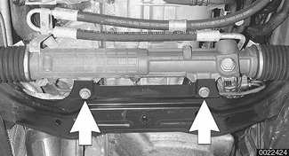

- Remove right lower engine mount fastener (arrow).
- Repeat on left side.

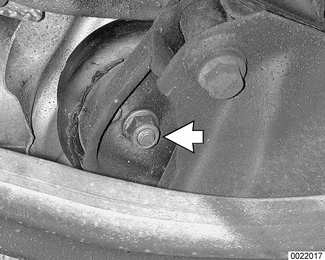

- Support suspension subframe from below using appropriate jacking equipment. Remove subframe mounting bolts (arrows). Remove subframe.

> **Note:**
> - Right side is shown in photo. Left is similar.

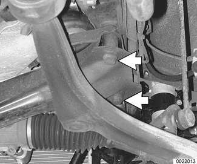

- Installation is reverse of removal, noting the following:
    - Make sure all bolts, bolt holes, and mating surfaces are clean to ensure proper tightening and alignment. Use new self-locking nuts or bolts, where applicable.
    - Lower engine onto engine mounts, allowing it to settle fully before tightening engine mount bolts.
    - When the job is completed, have front end professionally aligned.

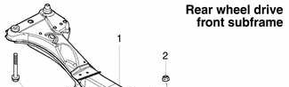

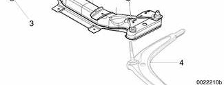

1. Front subframe
2. inner ball joint nut -tighten to 90 Nm (66 ft-lb)
3. Subframe mounting bolt (See torque table.)
4. Control arm

Tightening torques

| Component | Tightening torque |
|---|---|
| Control arm ball joint to subframe M14 self-locking nut (always replace) | 90 Nm (66 ft-lb) |
| Control arm bushing carrier to body M10 bolt (always replace) | 59 Nm (43 ft-lb) |
| Front end reinforcement to front subframe or body frame rails: M10 bolt (always replace), Stage 1 | 59 Nm (43 ft-lb) |
| Front end reinforcement to front subframe or body frame rails: M10 bolt (always replace), Stage 2 | torque angle 90° + 30° |
| Steering rack to subframe (M10 bolt) | 42 Nm (31 ft-lb) |
| Subframe to body, M12-8.8 bolts | 77 Nm (57 ft-lb) |
| Subframe to body, M12-10.9 bolts | 110 Nm (81 ft-lb) |
| Subframe to body, M12-12.9 bolts | 105 Nm (77 ft-lb) |

## Front subframe, removing and installing (all wheel drive models)

- Using engine support equipment, raise engine until weight of engine is supported.

- Raise car and remove front wheels.

> **WARNING!**
> - Make sure that the car is firmly supported on jack stands designed for the purpose. Place the jack stands beneath a structural chassis point. Do not place jack stands under suspension parts.

- Remove splash shield under engine compartment.
- On cars equipped with xenon headlights: Remove front ride level sensor mounting fastener (arrow) and lay sensor aside.

- Working at rear right corner of front subframe, unhook heatshield from subframe (arrow).

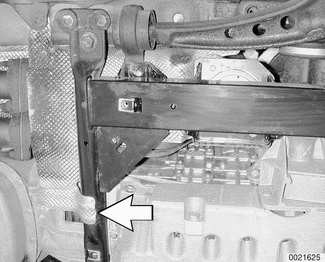

- Remove left engine mount fastener (arrow).
- Repeat for right side.

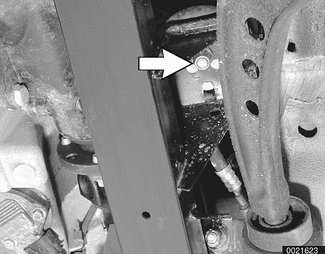

- Working at right front of subframe, detach power steering lines.
- Remove stabilizer bar anchor fasteners (arrows) from front corners of subframe. Suspend stabilizer bar from chassis using stiff wire.

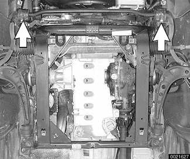

- Working at left rear corner of subframe, remove control arm rear bracket mounting bolts (arrows).

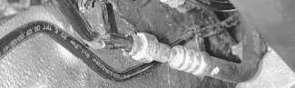

- Repeat for right side.
- Working at left side of subframe, remove inner control arm ball joint mounting bracket bolts (arrows) from subframe. Hang control arm using stiff wire.

> **WARNING!**
> - Do not allow the control arm to hang from the outer (steering arm) ball joint. This can damage the ball joint.

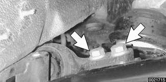

- Working underneath subframe, remove steering rack mounting bolts (arrows). Suspend rack with stiff wire.

- Support subframe from below. Remove subframe mounting bolts (arrows).

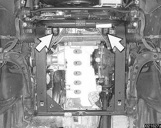

- Slowly lower subframe, making sure heat shields, wiring harnesses and other underbody components are clear during removal.

- Installation is reverse of removal, noting the following:
    - Make sure all bolts, bolt holes, and mating surfaces are clean to ensure proper tightening and alignment. Use new self-locking nuts or bolts, where applicable.
    - Lower engine onto engine mounts, making sure locating pin on left mount (arrow) seats correctly in slot of subframe boss.
    - Allow engine to settle fully on mounts before tightening engine mount fasteners.
    - When the job is completed have front end professionally aligned.

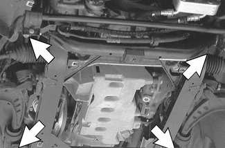

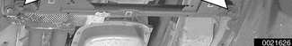

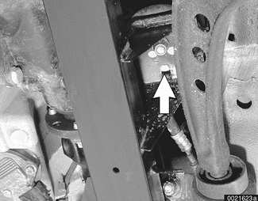

| No. | Part |
|---|---|
| 1 | Front subframe |
| 2 | Blind rivet nut |
| 3 | Engine mounting flange |
| 4 | Steering rack mounting flange |
| 5 | Stabilizer bar mounting |
| 6 | Subframe to body adapter |
| 7 | Bolt M10 (always replace), tighten to 59 Nm (44 ft-lb) |
| 8 | Bolt M10 (always replace), tighten to 59 Nm (44 ft-lb) |
| 9 | Control arm rear bracket |
| 10 | Bolt M12 (always replace), tighten to 110 Nm (81 ft-lb) |
| 11 | Jack point |
| 12 | Subframe mounting bolt M12 (see torque table) |
| 13 | Control arm inner ball joint |
| 14 | Bolt M12, tighten to 77 Nm (57 ft-lb) |
| 15 | Self locking nut M14 (always replace), tighten to 80 Nm (59 ft-lb) |

Tightening torques

| Component | Tightening torque |
|---|---|
| Control arm rear bracket to subframe M10 bolt (always replace) | 59 Nm (44 ft-lb) |
| Engine mount to subframe M10 self locking nut | 45 Nm (33 ft-lb) |
| Inner ball joint to control arm M14 self-locking nut (always replace) | 80 Nm (59 ft-lb) |
| Inner ball joint mount to subframe M12 bolt | 77 Nm (57 ft-lb) |
| Stabilizer anchor to subframe (M8) | 22 Nm (16 ft-lb) |
| Steering rack to subframe (M10 bolt) | 42 Nm (31 ft-lb) |
| Subframe adapter to body M10 bolt (always replace) | 59 Nm (44 ft-lb) |
| Subframe front to body, M12-8.8 bolt | 77 Nm (57 ft-lb) |
| Subframe front to body, M12-10.9 bolt | 110 Nm (81 ft-lb) |
| Subframe front to body, M12-12.9 bolt | 105 Nm (77 ft-lb) |
| Subframe rear to adapter M12 bolt (always replace) | 110 Nm (81 ft-lb) |

## Control Arms

In all models each front control arm has three attachment points:

- A Outer ball joint attached to steering arm
- B Inner ball joint attached to front subframe
- C Bushing and bracket attached to the frame rail (rear wheel drive models) or front subframe (all wheel drive models)

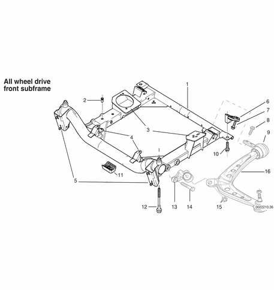

> **Note:**
> - Rear wheel drive front control arm is shown in the illustration.

On all models the rear bushing of the control arm is available as a replacement part.

On rear wheel drive models, both ball joints are pressed into the control arm at the factory. On all wheel drive models, the outer (steering arm) ball joint is pressed in. Because of the aluminum construction of the control arm, pressed-in ball joints are not removable. In case of pressed-in ball joint wear or damage, the complete control arm must be replaced. The control arm with ball joint(s) is available as a replacement unit from BMW.

E46 cars have been equipped with three different styles of control arm. Make sure a replacement control arm is identical to the original.

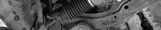

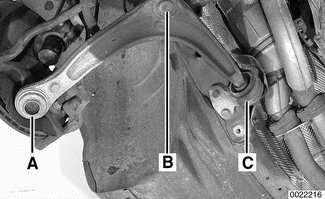

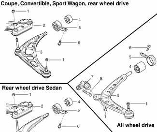

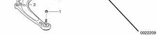

| No. | Part |
|---|---|
| 1 | Ball joint nut |
| 2 | Front subframe |
| 3 | Control arm |
| 4 | Bushing |
| 5 | Bushing bracket |
| 6 | Bracket mounting bolt |
| 7 | Inner ball joint (all wheel drive only) |
| 8 | Ball joint mounting bolt |

## Control arm, removing and installing (rear wheel drive models)

- Raise car and remove wheel.

> **WARNING!**
> - Make sure that the car is firmly supported on jack stands designed for the purpose. Place the jack stands beneath a structural chassis point. Do not place jack stands under suspension parts.

- Remove splash shield under engine compartment.
- Remove front end reinforcement.
- On cars equipped with xenon headlights: Remove self levelling headlight sensor mounting nuts (arrows) from right control arm.

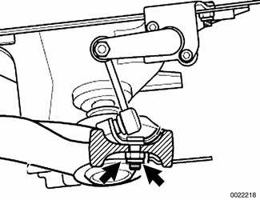

- Working at steering arm, remove outer ball joint nut (arrow). Use BMW special tool 32 3 090 or equivalent to separate steering arm from control arm.

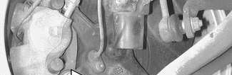

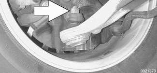

- Remove control arm inner ball joint mounting nut (arrow) at subframe.
- Drive ball joint shaft out of subframe using soft faced hammer.

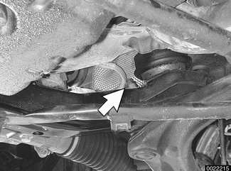

- Support control arm while removing control arm bracket bolts (arrows) from frame rail.

- Remove control arm.
- Inspect rear bracket rubber bushing for wear.
- Check ball joints for damage, looseness, or torn boots.
- Replace control arm if ball joints are damaged.

> **CAUTION!**
> - If a control arm is deformed due to an accident, inspect the inner ball joint mounting bore in the subframe for damage or eccentricity.

> **Note:**
> - If one control arm rear rubber bushing is damaged, bushings on both sides must be replaced.
> - Control arm rear bushing replacement is covered later in this group.

- Installation is reverse of removal, noting the following:
    - Make sure all thread bores, bolts, nuts and mating surfaces are clean. Use new self-locking nuts or bolts, where applicable.
    - Have vehicle alignment checked after assembly.

> **WARNING!**
> - Do not reuse self-locking nuts or bolts. They are designed to be used only once and may fail if reused.

Tightening torques

| Component | Tightening torque |
|---|---|
| Control arm rear bracket to frame rails M10 bolt (always replace) | 59 Nm (44 ft-lb) |
| Front end reinforcement to front subframe or body frame rails: M10 bolt (always replace), Stage 1 | 59 Nm (43 ft-lb) |
| Front end reinforcement to front subframe or body frame rails: M10 bolt (always replace), Stage 2 | torque angle 90° + 30° |
| Inner ball joint to subframe M14 self-locking nut (always replace) | 90 Nm (66 ft-lb) |
| Outer ball joint to steering arm M12 self-locking nut (always replace) | 65 Nm (48 ft-lb) |
| Road wheel to hub | 100 ± 10 Nm (74 ± 7 ft-lb) |

## Control arm, removing and installing (all wheel drive models)

- Raise car and remove wheel.

> **WARNING!**
> - Make sure that the car is firmly supported on jack stands designed for the purpose. Place the jack stands beneath a structural chassis point. Do not place jack stands under suspension parts.

- Remove splash shield under engine compartment.
- On cars equipped with xenon headlights: Remove headlight vertical aim sensor mounting nuts (arrows) from right control arm.

- Working at steering arm, remove outer ball joint nut (arrow). Use BMW special tool 32 3 090 or equivalent to separate steering arm from control arm.

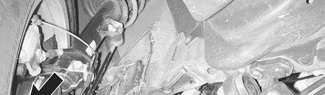

- Remove inner ball joint mounting bracket bolts (arrows) from subframe.

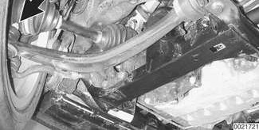

- Support control arm. Working at rear of subframe, remove control arm rear bracket mounting bolts (arrows).

- Remove control arm.

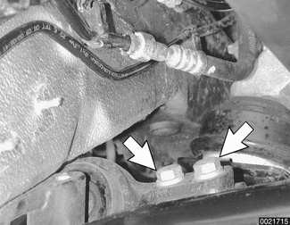

- Inspect rear bracket rubber bushing for wear.
- Check ball joints for damage, looseness, or torn boots.
- Replace control arm if outer (steering arm) ball joint is damaged.

> **CAUTION!**
> - If a control arm rear rubber bushing is damaged, both bushings must be replaced.

> **Note:**
> - Inner ball joint and control arm rear bushing replacement is covered later in this group.

- Installation is reverse of removal, noting the following:
    - Make sure all thread bores, bolts, nuts and mating surfaces are clean. Use new self-locking nuts or bolts, where applicable.
    - Have vehicle alignment checked after assembly.

> **WARNING!**
> - Do not reuse self-locking nuts or bolts. They are designed to be used only once and may fail if reused.

Tightening torques

| Component | Tightening torque |
|---|---|
| Control arm rear bracket to subframe M10 bolt (always replace) | 59 Nm (44 ft-lb) |
| Inner ball joint mount to subframe M12 bolt | 77 Nm (57 ft-lb) |
| Outer ball joint to steering arm M12 self-locking nut (always replace) | 65 Nm (48 ft-lb) |
| Road wheel to hub | 100 ± 10 N (74 ± 7 ft-lb) |

## Inner ball joint, replacing (all wheel drive models)

- Raise car and support safely.

> **WARNING!**
> - Make sure that the car is firmly supported on jack stands designed for the purpose. Place the jack stands beneath a structural chassis point. Do not place jack stands under suspension parts.

- Remove splash shield under engine compartment.
- Remove inner ball joint fasteners from control arm and subframe.
    - Remove nut (A) from ball joint shaft.
    - Remove bolts (B) from subframe.

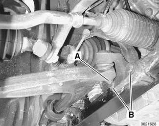

- Use BMW special tool 32 2 040 or equivalent to separate ball joint from control arm.

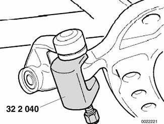

- Installation is reverse of removal, noting the following:
    - Make sure thread bores, bolts, nuts and mating surfaces are clean.
    - Use new self-locking nuts or bolts.

Tightening torques

| Component | Tightening torque |
|---|---|
| Inner ball joint mount to subframe M12 bolt | 77 Nm (57 ft-lb) |
| Inner ball joint to control arm M14 self-locking nut (always replace) | 80 Nm (59 ft-lb) |

## Control arm bushings, rear wheel drive

> **CAUTION!**
> - Never reuse a rubber bushing that has been pulled off the control arm. The rubber coated inner sleeve is destroyed when it is pulled off dry.

- Check with an authorized BMW parts dealer for the latest information about control arm bushing applications on E46 cars.

Control arm bushings should always be replaced in pairs. The two bushings and bushing carriers should have the same markings, indicating same manufacturer.

- To gain access to bushing, remove control arm as described earlier.
- Use puller to remove rear bracket and bushing from control arm.
- Inspect pin (rubber bushing) end of control arm. Replace control arm with end A.

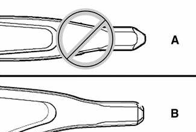

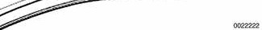

> **Note:**
> - Control arms with pin shape A have been superseded by parts with pin shape B.

- Inspect bushing bracket. Replace bracket if there is a center punch mark at boss A.

> **WARNING!**
> - If a bushing bracket with the center punch mark is reused with a new bushing, the bushing may fall out.

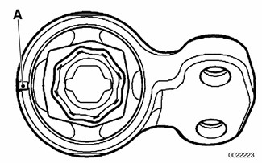

- Use press tools to remove old bushing and press in new. Be sure to line up marks on new bushing with boss on bracket. Depending on manufacturer, mark on bushing may consist of:
    - Extra buffer on inner part of bushing (A)
    - Arrow on rubber webbing of bushing (B)
    - Indent on outer casing of bushing (C)

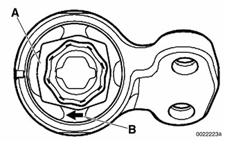

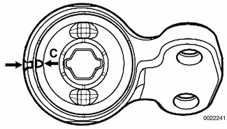

- New bushing must be pressed in so that it protrudes the correct distance from edges of bracket. See [Table a].

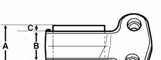

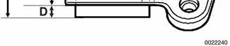

Table a. Control arm bushing protrusion (rear wheel drive models)

| Dimension | 60 mm bushing | 66 mm bushing |
|---|---|---|
| A = Total bushing length (nominal) | 50.5 mm (1.99 in.) | 53.5 mm (2.11 in.) |
| B = Bracket width (nominal) | 34.0 mm (1.36 in.) | 34.0 mm (1.36 in.) |
| C = Fixed measurement | 8.5 mm (0.33 in.) | 12.0 mm (0.47 in.) |
| D = Protrusion | 8.0 mm (0.31 in.) | 7.5 mm (0.29 in.) |

- When installing bushing on control arm:
    - Use soapy water on control pin and rubber bushing to facilitate assembly.
    - Make sure dimension A (distance from inner ball joint to edge of control arm bushing) is correct after assembly. See [Table b].

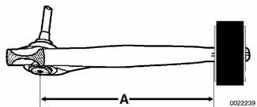

Table b. Rear wheel drive models

| Bushing diameter or model | Bushing distance A |
|---|---|
| 60 mm | 289 ± 1 mm (11.38 ± 0.04 in.) |
| 66 mm | 290.9 ± 1 mm (11.45 ± 0.04 in.) |

- Be sure to reinstall bushing bracket to frame rail correctly, with larger centering bores facing up toward body.

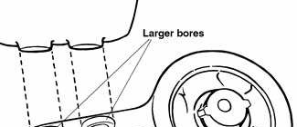

Tightening torque

| Component | Tightening torque |
|---|---|
| Control arm rear bracket to frame rail M10 bolt (always replace) | 59 Nm (44 ft-lb) |

## Control arm bushings, all wheel drive

> **CAUTION!**
> - Never reuse a rubber bushing that has been pulled off the control arm. The rubber coated inner sleeve is destroyed when it is pulled off dry.

- Check with an authorized BMW parts dealer for the latest information about control arm bushing applications on E46 cars.

Control arm bushings should always be replaced in pairs. The two bushings and bushing carriers should have the same markings, indicating same manufacturer.

- To gain access to bushing, remove control arm as described earlier.
- Use puller to remove rear bracket and bushing from control arm.

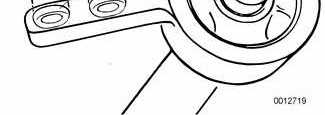

- Use press tools to remove old bushing and press in new.
- Align bushing with bracket as shown in accompanying illustration.

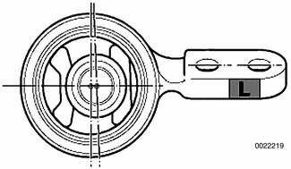

> **Note:**
> - Brackets are marked L or R for left or right.

> **CAUTION!**
> - Never reuse a rubber bushing that has been pulled off the control arm. The rubber coated inner sleeve is destroyed when it is pulled off dry.

- When installing bushing on control arm:
    - Coat control arm pin and rubber mount with appropriate lubricant to facilitate installation.
    - Make sure dimension A (distance from first bore in control arm to outer edge of control arm bushing) is correct after assembly. See [Table c].

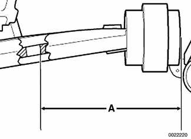

> **Note:**
> - Slacken pressing tool when measuring installation distance. Rubber bushing must be allowed to relax for measurement to be accurate.

Table c. Control arm bracket installation distance (all wheel drive models)

| Measurement A | 170 ± 1 mm (6.69 ± 0.04 in.) |
|---|---|

- Bolt bracket and control arm to front subframe and steering arm immediately after pressing on bushing. Be sure to reinstall bushing bracket to subframe correctly, with larger centering bores facing subframe surface.

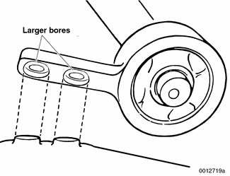

Tightening torque

| Component | Tightening torque |
|---|---|
| Control arm rear bracket to subframe M10 bolt (always replace) | 59 Nm (44 ft-lb) |

> **WARNING!**
> - After installation, the car must be left undisturbed for a minimum of 30 minutes. Leave car on the ground but avoid major movement.
> - After approx. 30 minutes, the lubricant used to slide on the bushing will have evaporated and the control arm will be correctly seated in the rubber.
> - Serious handling problems could result if these instructions are not carried out.
