# Front Wheel Bearings

> Source: BMW 3 Series (E46) Repair Manual, section 310-6, Front Suspension chapter (PDF pages 554–562 of 1252).

The front wheel bearings are permanently sealed and require no maintenance.

On rear wheel drive models, the bearing is integral with the wheel hub and ABS pulse wheel and pressed on the steering arm stub axle.

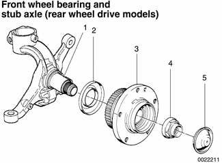

| No. | Part |
|---|---|
| 1 | Steering arm and stub axle |
| 2 | Dust guard |
| 3 | Wheel hub, bearing and ABS pulse wheel |
| 4 | Stub axle collar nut -tighten to 290 Nm (214 ft-lb) |
| 5 | Dust cap |

On all wheel drive models, the front wheel bearing is pressed into the steering arm. The wheel hub is pressed into the bearing and the outer CV joint stub axle is pressed into the hub.

The ABS front pulse wheel in all wheel drive models is the inner (ridged) seal of the front wheel bearing.

Special press tools are required to replace the front wheel bearings. Read the procedures through before beginning the job.

## Front wheel bearing, replacing (rear wheel drive models)

- Raise car and remove front wheel.

> **WARNING!**
> - Make sure that the car is firmly supported on jack stands designed for the purpose. Place the jack stands beneath a structural chassis point. Do not place jack stands under suspension parts.

- Pry off dust cap from center of wheel hub. Bend back staked part (arrow) of wheel hub (axle) collar nut.

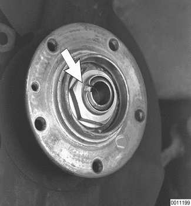

- Remount wheel and lug bolts.
- Lower car to ground. With an assistant applying brakes, loosen collar nut. Do not remove completely.

> **CAUTION!**
> - The wheel hub collar nut is tightened to a torque of 290 Nm (214 ft-lb). Make sure the car is firmly on the ground.

- Raise car and remove wheel.
- Remove ABS wheel speed sensor (arrow).

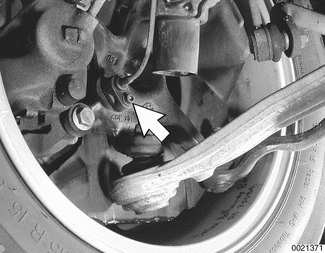

- Remove brake caliper assembly and brake rotor as described in [340 Brakes]. Leave brake hose connected to caliper. Suspend caliper assembly from chassis using stiff wire.
- Remove wheel hub collar nut.
- Remove wheel hub with integral wheel bearing from steering arm using a slide hammer puller (BMW special tools 33 4 201, 33 4 202, 33 4 203 and 33 2 116) or conventional puller as illustrated.

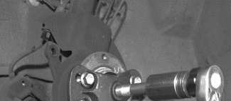

- If outermost bearing inner race stays on steering arm stub axle, use BMW special tool set 33 4 400 or two-jaw puller to remove race.

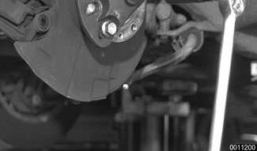

> **CAUTION!**
> - Do not reuse a wheel bearing assembly once it has been removed. The removal process destroys the bearing.

- To remove innermost inner race:
    - Unbolt brake rotor dust shield.
    - Bend back wheel bearing dust guard.
    - Use BMW special tools 00 7 500 and 31 2 106 to pull race off stub axle.

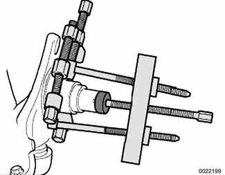

- Install splash guard and new dust shield behind bearing. Press new wheel hub/bearing assembly on stub axle using BMW special tool 31 2 110 or equivalent.

> **CAUTION!**
> - The BMW special tool insures that only the inner bearing race is used to press on the hub and bearing assembly. The bearing is damaged if it is not pressed on using the inner race.

- Install new collar nut. Do not tighten nut to its final torque at this time.
- Install brake rotor and brake caliper. See [340 Brakes].
- Mount wheel and lug bolts. Lower car to ground to gain leverage.

Tightening torques

| Component | Tightening torque |
|---|---|
| Brake caliper to steering arm | 110 Nm (81 ft-lb) |
| Brake rotor to wheel hub | 16 Nm (12 ft-lb) |
| Road wheel to hub | 100 ± 10 Nm (74 ± 7 ft-lb) |

- With an assistant applying brakes, tighten collar nut.

Tightening torque

| Component | Tightening torque |
|---|---|
| Collar nut to stub axle | 290 Nm (214 ft-lb) |

- Raise car and remove wheel.
- Stake axle nut and caulk threads of stub axle.
- Install a new grease cap, using Loctite® 638 sealant or equivalent.
- Install ABS pulse sensor.
- Install wheel and lower car.

Tightening torques

| Component | Tightening torque |
|---|---|
| ABS pulse sensor to steering arm | 8 Nm (71 in-lb) |

## Front wheel bearing, replacing (all wheel drive models)

Removal and installation of the all wheel drive front wheel bearing is best accomplished by removing the steering arm and wheel hub from the car and separating the components on the bench.

- Raise car and remove front wheel.

> **WARNING!**
> - Make sure that the car is firmly supported on jack stands designed for the purpose. Place the jack stands beneath a structural chassis point. Do not place jack stands under suspension parts.

- Bend back staked part of wheel hub (axle) collar nut (arrow).

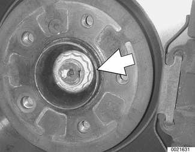

- Remount wheel and lug bolts.
- Lower car to ground. With an assistant applying brakes, loosen collar nut. Do not remove completely.

> **CAUTION!**
> - The wheel hub collar nut is tightened to a torque of 420 Nm (310 ft-lb). Make sure the car is firmly on the ground.

- Raise car and remove front wheel.
- Remove ABS wheel speed sensor (arrow).

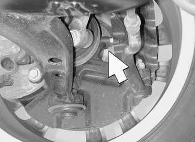

- Remove brake caliper assembly and brake rotor as described in [340 Brakes]. Leave brake hose connected to caliper. Suspend caliper assembly from chassis using stiff wire.
- Remove tie rod outer end nut. Use BMW special tool 32 3 090 or equivalent to press tie rod end off steering arm.

- Detach control arm from front axle subframe as described earlier.
- Remove outer ball joint nut. Use BMW special tool 32 3 090 or equivalent to separate steering arm and strut assembly from control arm.
- Attach BMW special tool 33 2 111 /116 /117, or equivalent puller, to steering arm using five lug bolts and press outer CV joint stub axle inward, out of steering arm.
- Support steering arm from below. Loosen pinch bolt (arrow) at top of steering arm. Spread clamping collar at slot A, if necessary, to slide steering arm off strut assembly.

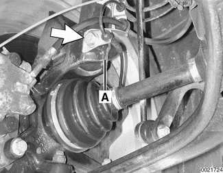

- Working at bench, clamp steering arm in a vise.

> **CAUTION!**
> - Use a vise with aluminum jaws, or protect steering arm from damage when clamping in vise.

- Remove wheel hub with integral wheel bearing from steering arm using a slide hammer puller (BMW special tools 33 4 201, 33 4 202, 33 4 203 and 33 2 116).

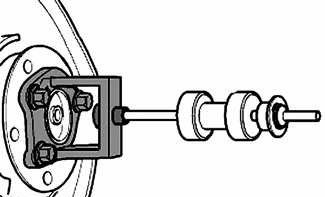

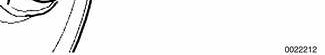

- If bearing inner race stays on wheel hub, use BMW special tool set 33 4 400 or two-jaw puller to remove race.
- Remove circlip (3) from steering arm.

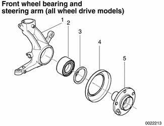

| No. | Part |
|---|---|
| 1 | Steering arm |
| 2 | Wheel bearing |
| 3 | Circlip (always replace) |
| 4 | Dust guard |
| 5 | Wheel hub |

- Drive wheel bearing out of steering arm using a press with appropriate adapters.

> **CAUTION!**
> - Do not reuse a wheel bearing assembly once it has been removed. The removal process destroys the bearing.

- Press in bearing using a press with appropriate adapters.

> **Note:**
> - When installing the front wheel bearing into the steering arm, be sure that the ridged bearing seal (ABS impulse wheel) is facing inboard. Start the bevelled edge of the bearing into the bore first.
> - Coat bearing seat in steering arm over 50% of its length with Loctite® 648.
> - Make sure press fit surfaces are clean and free of grease.

- Replace circlip, making sure ring is correctly seated.
- Place dust guard over steering arm hub.
- Drive wheel hub into bearing using a shop press.

> **CAUTION!**
> - Press only on the inner race. The bearing is damaged if it is not pressed on using the inner race.

- Installation of steering arm to car is reverse of removal, noting the following:
    - Replace control arm bracket bolts.
    - Torque stub axle collar nut with vehicle on the ground. Stake nut and caulk stub axle threads.
    - Have vehicle professionally aligned.

Tightening torques

| Component | Tightening torque |
|---|---|
| Ball joint to steering arm | 65 Nm (48 ft-lb) |
| Brake caliper to steering arm | 110 Nm (81 ft-lb) |
| Brake rotor to wheel hub | 16 Nm (12 ft-lb) |
| Collar nut to wheel hub | 420 Nm (310 ft-lb) |
| Control arm bracket to subframe | 59 Nm (44 ft-lb) |
| Steering arm pinch bolt at strut housing | 81 Nm (60 ft-lb) |
| Road wheel to hub | 100 ± 10 Nm (74 ± 7 ft-lb) |
| Tie rod to steering arm | 65 Nm (48 ft-lb) |
