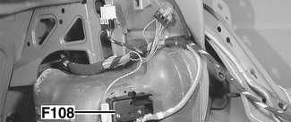
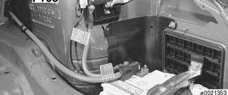
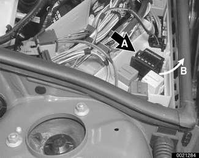
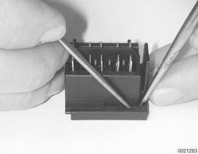
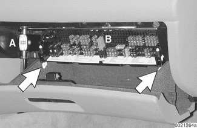
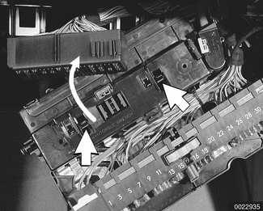
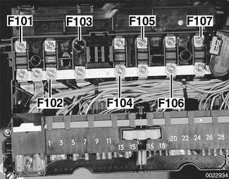
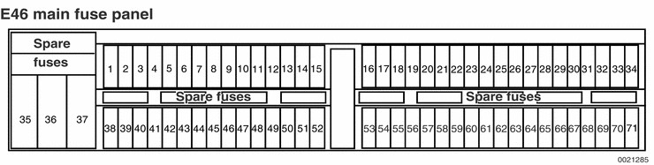

# Fuse Positions

> Source: Bentley *BMW 3 Series (E46) 1999–2005 (M3) Repair Manual*, section 610-2 (PDF pages 969–982 of 1252).

There are three locations for fuses in E46 cars:

- Main harness fuse in trunk
- Fuse panel above glove compartment
- E-box in engine compartment left side

> **Note:**
>
> - In BMW repair information, fuses are numbered F1 through F108. There are two fuses with the same designation: F5 in the main fuse panel is rated 5A and protects the horn circuit. F5 in the E-box fuse carrier is rated 30A and protects the unloader relay circuit in 1999 - 2000 models, and fuel injector relay in 2001 models.
> - In a few cases, a fuse may have two different amperage ratings depending on equipment in the vehicle. In such cases the second rating is put in parenthesis in the fuse rating tables.

## Main harness fuse

Fig. 1 Main harness fuse in trunk:

- Working ahead of battery in trunk, remove trim liner clips.
- Peel back liner to access F108 (200 amp) fuse (arrow) in main power distribution circuit.

## Electronics box (E-box) fuse carrier

Fig. 2 Engine electronics fuse pack in E-box:

- Working in left rear of engine compartment, remove E-box plastic cover.
- Push on hold-down lock clip (A) to release fuse pack carrier.
- Pull up on fuse pack lock clip (B) to release fuse pack.

To remove an individual defective fuse inside fuse pack carrier, slide cover off by prying gently while you use pin tool to squeeze lock tabs.

> **CAUTION!**
>
> - Once cover is off, fuses can fall out easily. Be sure to keep them in order while replacing defective fuse.

Table a. E-box fuse pack

| Fuse | Rating | Protected circuits |
|---|---|---|
| 1 | 30A | Not used (1999 - 2000 models) DME main relay (2001 models) Ignition coils |
| 2 | 30A | DME control module (ECM) Evaporative emissions valve Fuel injectors Idle speed control valve Resonance valve, intake manifold Secondary air injection pump Suction jet pump valve, LDP system Vanos solenoids |
| 3 | 20A | A/C compressor clutch relay Camshaft position sensors Crankshaft position sensor DME main relay Fuel pump relay Leakage diagnosis pump (fuel tank) Mass air flow sensor Secondary air injection pump relay Thermostat |
| 4 | 30A | Changeover valve, running losses (3/2 valve) Oxygen sensors |
| 5 | 30A | Fuel injector relay (2001 models) Unloader relay to ignition coils (1999 - 2000 models) |

## Main fuse panel

Fig. 3 Fuse panel above glove compartment:

- Open glove compartment door.
- Working inside compartment, twist each plastic lock tab (arrows) at top of compartment 90°.
- Pull down on fuse panel to swing it down.

> **Note:**
>
> - When the fuse box is up in locked position, the plastic tabs should point toward each other. When unlocked, they point to the back of the car.
> - A small built in flashlight (A) is in the glove compartment next to the fuse box.
> - A red plastic fuse puller (B) is in the center of the fuse box.
> - The sheet of paper with the fuse assignments, below the fuses, can be slid out for reference.
> - Vertical fuses are active.
> - Horizontal fuses are spares.

Fuse locations in the main panel are detailed in Table c. 1999 fuse positions and Table d. 2000-2001 fuse positions.

Additional high amperage fuses are found on top of the glove compartment fuse panel beneath an access panel.

- Lower glove compartment fuse panel fully.
- Slide harness connector block off top of panel (curved arrow).
- Detach access panel by squeezing retaining clips (arrows).

Fig. 4 High amperage fuses above main fuse panel:

- Fuses F101 through F107 are mounted in this location.

Table b. High amperage fuse positions

| Fuse | Rating | Protected circuits |
|---|---|---|
| 101 | 50A | Engine cooling fan (1999 - 2000 models) |
| 102 | 80A | B+ terminal DME main relay Engine control module Fuse 5 E-box fuse pack Transmission control module (TCM) |
| 103 | 80A | not used |
| 104 | 100A | Preheater relay |
| 105 | 50A | Ignition switch DLC |
| 106 | 50A | Light switching center control module |
| 107 | 50A | Light switching center control module Trailer module |
| 108 | 200A | Main harness fuse (in trunk, see Fig. 1) |

E46 main fuse panel

Table c. 1999 fuse positions

| Fuse | Rating | Protected circuit |
|---|---|---|
| 1 | not used | |
| 2 | not used | |
| 3 | not used | |
| 4 | 5A | Horn (see also fuse 55) |
| 5 | 5A | Horn (see also fuse 55) |
| 6 | 5A | Make-up mirror light |
| 7 | 5A | Navigation (see also fuse 41) On-board monitor (see also fuse 41) Radio (see also fuse 41) Telephone (see also fuse 39) |
| 8 | not used | |
| 9 | 5A | Brake light Light module (see also fuse 32) On-board computer Speed control |
| 10 | 5A | Instrument cluster (see also fuses 34, 43) |
| 11 | 5A | Airbag Side-impact airbag |
| 12 | 7.5A | Roller sun blind |
| 13 | not used | |
| 14 | 5A | Electronic immobilizer (EWS) (see also fuse 67) Starter interlock |
| 15 | 5A | Rain sensor |
| 16 | not used | |
| 17 | not used | |
| 18 | not used | |
| 19 | not used | |
| 20 | not used | |
| 21 | 5A | Electrochromic rear view mirror (see also fuse 67) Parking distance control |
| 22 | 5A | Electrochromic rear view mirror (see also fuse 67) Parking distance control |
| 23 | 5A | Electrochromic rear view mirror (see also fuse 67) Parking distance control |
| 24 | 5A | Electrochromic rear view mirror (see also fuse 67) Parking distance control |
| 25 | 5A | Heated outside mirror, passenger Heated spray nozzles |
| 26 | 5A | Garage door opener Overheat JP |
| 27 | 10A | Back-up lights |
| 28 | 5A | Heater-A/C (see also fuses 62, 63) Heater-A/C blower (see also fuse 37) |
| 29 | 5A | Engine control (see also fuse 30) |
| 30 | 7.5A | Engine control (see also fuse 29) OBD II system |
| 31 | 5A | Outside mirror Tire pressure control (see also fuse 69) |
| 32 | 5A | Light module (see also fuse 9) |
| 33 | 5A | ABS/ASC (see also fuses 53, 56) ABS/DSC (see also fuses 40, 53, 56, 61) |
| 34 | 5A | Instrument cluster (see also fuses 10, 43) |
| 35 | not used | |
| 36 | 50A | Secondary air pump |
| 37 | 50A | Heater-A/C blower (see also fuse 28) |
| 38 | 10A (15A) | Front fog lights |
| 39 | 5A | Telephone (see also fuse 7) |
| 40 | 5A | ABS/DSC (see also fuses 33, 53, 56, 61) Shift gate illumination |
| 41 | 30A | Navigation (see also fuse 7) On-board monitor (see also fuse 7) Radio (see also fuse 7) |
| 42 | not used | |
| 43 | 5A | Clock Instrument cluster (see also fuses 10, 34) OBD II system |
| 44 | 20A | Trailer module |
| 45 | not used | |
| 46 | 30A | Sunroof |
| 47 | 15A (20A) | Cigarette lighter / power outlet |
| 48 | 30A | Window, front (see also fuse 49) |
| 49 | 5A | Anti-theft (see also fuse 67) Central locking system (see also fuse 60) Interior light (see also fuse 52) Power window, front (see also fuse 48) Windshield washer system (see also fuses 52, 59) |
| 50 | 25A | Seat heating |
| 51 | 30A | Headlight cleaning system |
| 52 | 30A | Central locking system, trunk Glove box light Interior light (see also fuse 49) Passenger compartment/trunk lighting Windshield washer system (see also fuses 49, 59) |
| 53 | 30A | ABS/ASC (see also fuses 33, 56) ABS/DSC (see also fuses 33, 40, 56, 61) |
| 54 | 15A | Fuel pump |
| 55 | 15A | Horn (see also fuse 5) |
| 56 | 30A | ABS/ASC (see also fuses 33, 53) ABS/DSC (see also fuses 33, 40, 53, 61) |
| 57 | 5A | Outside mirror |
| 58 | not used | |
| 59 | 30A | Windshield washer system (see also fuses 49, 52) |
| 60 | 25A | Central locking (see also fuse 49) |
| 61 | 30A | ABS/DSC (see also fuses 33, 40, 53, 56) |
| 62 | 7.5A | A/C (see also fuses 28, 63) |
| 63 | 7.5A | A/C (see also fuses 28, 62) |
| 64 | 20A | Auxiliary heater (diesel) |
| 65 | 30A | Driver seat adjustment |
| 66 | not used | |
| 67 | 5A | Anti-theft (see also fuse 49) Electrochromic rear view mirror (see also fuse 24) Electronic immobilizer (EWS) (see also fuse 14) |
| 68 | 30A | Heated rear window |
| 69 | 5A | Tire pressure control (see also fuse 31) |
| 70 | 30A | Passenger seat adjustment |
| 71 | 30A (10A Coupe) | Hinged window (Coupe) Window, rear |

Table d. 2000-2001 fuse positions

| Fuse | Rating | Protected circuit |
|---|---|---|
| 1 | not used | |
| 2 | not used | |
| 3 | not used | |
| 4 | 5A | Horn (see also fuse 55) |
| 5 | 5A | Horn (see also fuse 55) |
| 6 | 5A | Make-up mirror light Power top (Convertible, see also fuses 12, 35, 42, 46) |
| 7 | 5A | Heated rear window (Convertible, see also fuse 68) Navigation system (see also fuse 41) On-board monitor (see also fuse 41) Radio (see also fuse 41) Telephone (see also fuse 39) |
| 8 | 5A | Sequential transmission (M3, see also fuse 22) |
| 9 | 5A | Brake light Light module (see also fuse 32) On-board computer Speed control |
| 10 | 5A | Instrument cluster (see also fuses 34, 43) |
| 11 | 5A | Airbag Side-impact airbag |
| 12 | 7.5A | ABS/ASC (see also fuses 33, 42, 53, 56) ABS/DSC (see also fuses 33, 40, 42, 53, 56, 61) ABS/DSC all-wheel drive (see also fuses 33, 35, 40, 42, 53) Manual top (Convertible, see also fuses 42, 46) Power top (Convertible, see also fuses 6, 35, 42, 46) Seat heating (see also fuse 42) Roller sun blind (see also fuse 42) Tire pressure control (see also fuses 31, 42, 69) |
| 13 | 7.5A | Roll-over protection system (Convertible) |
| 14 | 5A | Electronic immobilizer (EWS) (see also fuse 67) Starter interlock |
| 15 | 5A | Rain sensor Rear wiper (Sport Wagon, see also fuse 45) |
| 16 | not used | |
| 17 | not used | |
| 18 | not used | |
| 19 | not used | |
| 20 | 5A | Engine control (M3, see also fuses 29, 30) Sequential transmission (M3, see also fuse 22) |
| 21 | 5A | Engine control (M3, see also fuses 29, 30) Sequential transmission (M3, see also fuse 22) |
| 22 | 5A | Engine control (M3, see also fuses 29, 30) Sequential transmission (M3, see also fuse 22) |
| 23 | 5A | Heater (see also fuses 28, 62) |
| 24 | 5A | Electrochromic rear view mirror (see also fuse 67) Park distance control |
| 25 | 5A | Heated outside mirror, passenger Heated spray nozzles |
| 26 | 5A | Cigarette lighter (Australia, see also fuse 47) Garage door opener |
| 27 | 10A | Engine control (see also fuses 29, 30) Back-up light |
| 28 | 5A | Air conditioner (see also fuses 62, 63) Blower (see also fuse 50) Heater (see also fuses 23, 62) |
| 29 | 5A | Engine control (see also fuses 27, 30) Engine control (M3, see also fuses 22, 30) |
| 30 | 7.5A | Engine control (see also fuses 27, 29) Engine control (M3, see also fuses 22, 29) OBD II system (see also fuse 43) |
| 31 | 5A | Outside mirror (see also fuse 57) Tire pressure control (see also fuses 12, 42, 69) |
| 32 | 5A | Light module (see also fuse 9) |
| 33 | 5A | ABS/ASC (see also fuses 12, 42, 53, 56) ABS/DSC (see also fuses 12, 40, 42, 53, 56, 61) ABS/DSC all-wheel drive (see also fuses 12, 35, 40, 42, 53) |
| 34 | 5A | Instrument cluster (see also fuses 10, 43) |
| 35 | 50A | Power top (Convertible, see also fuses 6, 12, 42, 46) ABS/DSC all-wheel drive (see also fuses 12, 33, 40, 42, 53) |
| 36 | 50A | Secondary air pump |
| 37 | 50A | Engine cooling fan |
| 38 | 10A (15A) | Front foglights |
| 39 | 5A | Telephone (see also fuse 7) |
| 40 | 5A | ABS/DSC (see also fuses 12, 33, 42, 53, 56, 61) ABS/DSC all-wheel drive (see also fuses 12, 33, 35, 42, 53) Shift gate illumination |
| 41 | 30A | Navigation system (see also fuse 7) On-board monitor (see also fuse 7) Radio (see also fuse 7) |
| 42 | 30A | ABS/ASC (see also fuses 12, 33, 53, 56) ABS/DSC (see also fuses 12, 33, 40, 53, 56, 61) ABS/DSC all-wheel drive (see also fuses 12, 33, 35, 40, 53) Manual top (Convertible, see also fuses 12, 46) Power top (Convertible, see also fuses 6, 12, 35, 46) Seat heating (see also fuse 12) Roller sun blind (see also fuse 12) Tire pressure control (see also fuses 12, 31, 69) |
| 43 | 5A | Instrument cluster (see also fuses 10, 34) OBD II system (see also fuse 30) |
| 44 | 20A | Trailer module |
| 45 | 20A | Rear wiper (Sport Wagon, see also fuse 15) |
| 46 | 30A (20A convertible) | Power top (Convertible, see also fuses 6, 12, 35, 42) Manual top (Convertible, see also fuses 12, 42) Sunroof |
| 47 | 15A (20A) | Cigarette lighter / power outlet (Australia, see also fuse 26) |
| 48 | 30A | Power window, front (see also fuse 49) |
| 49 | 5A | Anti-theft (see also fuse 67) Central locking system (see also fuses 52, 60, Sport Wagon, see fuse 58) Interior light (see also fuse 52) Windshield washer system (see also fuses 52, 59) Window, front (see also fuse 48) |
| 50 | 40A | Heater-A/C blower (see also fuse 28) |
| 51 | 30A | Headlight washer system |
| 52 | 30A | Central locking system (see also fuses 49, 60, Sport Wagon see fuse 58) Glove compartment light Hand lamp Interior lights (see also fuse 49) Passenger compartment/trunk lighting Windshield washer system (see also fuses 49, 59) |
| 53 | 30A | ABS/ASC (see also fuses 12, 33, 42, 56) ABS/DSC (see also fuses 12, 33, 40, 42, 56, 61) ABS/DSC all-wheel drive (see also fuses 12, 33, 35, 40, 42) |
| 54 | 15A | Fuel pump |
| 55 | 15A | Horn (see also fuse 5) |
| 56 | 30A | ABS/ASC (see also fuses 12, 33, 42, 53) ABS/DSC (see also fuses 12, 33, 40, 42, 53, 61) |
| 57 | 5A | Outside mirror (see also fuse 31) |
| 58 | 7.5 | Central locking (Sport Wagon, see also fuses 49, 52, 60) |
| 59 | 30A | Windshield washer system (see also fuses 49, 52) |
| 60 | 25A | Central locking (see also fuses 49, 52, Sport Wagon, see fuse 58) |
| 61 | 30A | ABS/DSC (see also fuses 12, 33, 40, 42, 53, 56, 61) |
| 62 | 7.5A | Heater-A/C (see also fuses 28, 63) Heater (see also fuses 23, 28) |
| 63 | 7.5A | Heater-A/C (see also fuses 28, 62) |
| 64 | not used | |
| 65 | 30A | Driver seat adjustment |
| 66 | not used | |
| 67 | 5A | Anti-theft (DWA) (see also fuse 49) Electrochromic rear view mirror (see also fuse 24) Electronic immobilizer (EWS) (see also fuse 14) |
| 68 | 30A | Heated rear window (Convertible, see also fuse 7) |
| 69 | 5A | Tire pressure control (see also fuses 12, 31, 42) |
| 70 | 30A | Passenger seat adjustment |
| 71 | 30A (10A Coupe) | Hinged window (Coupe) Window, rear |
