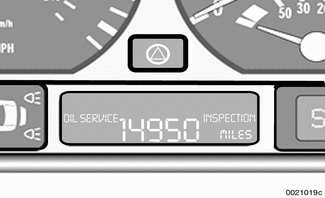
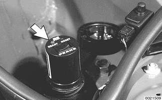

# General

> Source: BMW 3 Series (E46) Repair Manual, section 020-1, Maintenance chapter (PDF pages 28–40 of 1252).

The information given in this repair group includes the routine checks and maintenance steps that are both required by BMW under the terms of the vehicle warranty protection and recommended by BMW to ensure long and reliable vehicle operation.

> **Note:**
> - Aside from keeping your car in the best possible condition, proper maintenance plays a role in maintaining full protection under BMW's new-car warranty coverage. If in doubt about the terms and conditions of your car's warranty, an authorized BMW dealer should be able to explain them.

## Service Interval Indicator (SII)

For the 1999 and later 3 Series (E46), BMW introduced an extended oil change interval of approximately 15,000 miles depending on engine operating conditions. The introduction of BMW High Performance Synthetic Oil has made this longer interval possible.

**1999 to 6/2000 models.** BMW uses a unique system to determine maintenance intervals. BMW's Service Interval Indicator (SII), calculates maintenance intervals based not only on elapsed mileage, but also on such inputs as engine speed, engine temperature, number of starts, length of trips, and the amount of fuel used. At the appropriate time, the system indicates, through lights in the instrument cluster, when the next routine maintenance is due.

**6/2000 and later models.** For the mid-2000 models BMW introduced new service interval software which calculates service based on the amount of fuel used. When SII detects total fuel consumption that equals the preset limits (in gallons), the instrument cluster indicates that service is required.

Using a 328i as an example:

- Standard transmission model: SII illuminates after consumption of 601 gallons of fuel.
- Automatic transmission model: SII illuminates after consumption of 667 gallons.

After the service is performed the SII can be reset to zero.

The SII displays the mileage remaining before service is due. The type of service (OIL SERVICE or INSPECTION) is also illuminated in the display.

> **Note:**
> - An OIL SERVICE interval will always be followed by an INSPECTION interval, which will then be followed by an OIL SERVICE interval, and so on.

When the ignition is turned on, the service recommendation and miles remaining are displayed for a few seconds. A flashing message and a negative (-) symbol in front of the number indicate that the service interval has been exceeded by the distance displayed.

The On-Board Computer uses the rate of fuel consumption in the period immediately preceding to calculate the mileage before the next service is due.

## Service Interval Indicator (SII), resetting

The SII signals the need for basic routine maintenance:

- Engine oil and oil filter change, after the engine has been warmed up.
- BMW-recommended additional maintenance as listed in [Table a].

> **Note:**
> - For reference, the BMW oil service requirements are approximately equivalent to the maintenance that other European manufacturers specify at intervals with a maximum of every 15,000 miles or 12 months.

When the specified maintenance has been carried out, the SII memory should be reset.

### 1999 to 6/2000 models

In vehicles equipped with the DLC in the right side engine compartment, the SII may be reset using BMW service and scan tool DIS or MoDiC, or a specialty tool from another manufacturer. Plug the tool (arrow) into the DLC.

> **CAUTION!**
> - Follow the manufacturer's directions when resetting the SII. If the reset procedures are done incorrectly, the reset tool or the electronic Service Interval Indicator may be damaged.

Aftermarket reset tools that can reset all models with the DLC can be purchased from one of the following suppliers:

- Assenmacher Specialty Tools — 6440 Odell Place, Boulder, CO 80301, 303-530-2424, http://www.asttool.com
- Baum Tools Unlimited, Inc. — P.O. Box 5867, Sarasota, FL 34277-5867, 800-848-6657, http://www.baumtools.com
- Peake Research, Automotive Products Division — P.O. Box 28776, San Jose, CA 95159, 408-369-0406, http://www.peakeresearch.com

### 6/2000 and later models

On vehicles without the data link connector (DLC) in the engine compartment the reset tool can no longer be used. Instead, the SII can be reset with the trip odometer reset button in the instrument cluster: The ignition key must be in OFF position.

- Press and hold trip odometer button in instrument cluster, and turn ignition key to ACCESSORY position.
- Keep button pressed for approx. 5 more seconds until any of the following appear in the display: "Oil Service" or "Inspection", with "Reset" or "Re".
- Press button again and hold for approx. 5 seconds until "Reset" or "Re" flash.
- While display is flashing, press button briefly to reset SII.
- After display has shown new interval, the following will appear in display for approx. 2 seconds: "End SIA".

The system can only be reset again after the vehicle has been driven approx. 50 to 75 miles (consumes at least 2.5 gal. fuel). If the display shows "Reset" or "Re" when resetting, the minimum driving distance has been fulfilled and the system can be reset again. It is possible to interrupt and end the reset procedure by changing the position of the ignition key.

## Inspection I and Inspection II

The Service Interval Indicator signals the need for more comprehensive maintenance and inspection. There are two sets of inspection requirements. These inspections alternate throughout a car's maintenance history. If the last inspection interval was Inspection I, the next inspection interval (following an oil service) will be Inspection II, the next after that will be Inspection I, and so on.

Inspection I tasks are listed in [Table b]. Inspection II includes most of the tasks from Inspection I with additional Inspection II tasks. A complete listing of Inspection II tasks is in [Table c].

> **Note:**
> - For reference, the BMW Inspection I and Inspection II requirements are approximately equivalent to the maintenance requirements that other European manufacturers specify. Inspection I is normally due at intervals with a maximum of 30,000 miles or 24 months. Inspection II is normally due at intervals with a maximum of 60,000 miles or 48 months.

## Maintenance Tables

The intervals for most tasks listed in the maintenance table below are determined by the SII. Except where noted, the maintenance items listed apply to all models and model years covered by this manual. The columns on the right side of each table give quick-reference information about the job. The text in the "additional repair information" column refers to repair groups.

Table a. Oil service

| Maintenance item | Tools required | New parts required | Warm engine required | Dealer service recommended | Additional repair information |
|---|:-:|:-:|:-:|:-:|:-:|
| **Engine compartment maintenance** | | | | | |
| Change oil and oil filter | ✓ | ✓ | | ✓ | [020] |
| Reset Service Interval Indicator (SII). | ✓ | | | | [020] |
| Replace interior ventilation microfilter. | | ✓ | | | [020] |
| **Under car maintenance** | | | | | |
| Check overall thickness of front and rear brake pads. If replacement is necessary: Examine brake disc surfaces. Clean brake pad contact points in calipers. Grease wheel centering hubs (alloy wheels only). Check thickness of parking brake linings only when replacing rear brake pads. Check operation of parking brake and adjust as necessary. | ✓ | | | ✓ | [340] |
| Check and adjust tire pressures, including spare | ✓ | | | | [020] |

Table b. Inspection I service

| Maintenance item | Tools required | New parts required | Warm engine required | Dealer service recommended | Additional repair information |
|---|:-:|:-:|:-:|:-:|:-:|
| **Under car maintenance** | | | | | |
| Change engine oil and filter. | ✓ | ✓ | | ✓ | [020] |
| Check transmission and differential(s) for external leaks. | | | | | [230], [240] |
| Check CV joint boots for damage or leaks. | | | | | [311], [331] |
| Visually check fuel tank, fuel lines and connections for leaks. | | | | | [160] |
| Check condition, positioning, and mounting of exhaust system. Visually check for leaks. | | | | | [180] |
| Check power steering system for leaks. Check power steering fluid level and adjust if necessary. | | | | | [320] |
| Check steering rack and tie rods for tightness. Check condition of front axle joints, steering linkage and steering shaft joints. | | | | | [320] |
| Check overall thickness of front and rear brake pads using special BMW tool. If replacement is necessary: Examine brake disc surfaces. Clean brake pad contact points in calipers. Grease wheel centering hubs (alloy wheels only). Check thickness of parking brake linings only when replacing rear brake pads. Check operation of parking brake and adjust as necessary. | ✓ | | | | [340] |
| Check front control arm bushings for damage or wear. | | | | | [310] |
| Check brake system connections and lines for leaks, damage and incorrect positioning. | | | | | [340] |
| Check parking brake actuator. Adjust if necessary. | ✓ | | | | [340] |
| Check all tire pressures (including spare) and correct if necessary. Check condition of tires (outer tread surfaces), tread wear pattern; in case of uneven tread wear, perform a wheel alignment if requested. | ✓ | | | | [020] |
| Inspect entire body according to terms of rust perforation limited warranty. (Must be performed at least every two years.) | | | | | |
| **Engine compartment maintenance** | | | | | |
| Read out on-board diagnostic (OBD II) system. | ✓ | | | | [100], [130] |
| Check engine coolant system/heater hose connections for leaks. Check coolant level and antifreeze protection level. Add coolant as necessary. | ✓ | | | | [170] |
| Check windshield washer fluid level and antifreeze protection. Add washer fluid as necessary. | | | | | [611] |
| Replace ventilation microfilter. (Note: reduce replacement intervals in dusty operating conditions). | | ✓ | | | [020] |
| Reset service interval indicator. | ✓ | | | | [020] |
| **Body/electrical** | | | | | |
| Check operation of air conditioner. | | | | | [640] |
| Check operation of headlights, parking lights, back-up lights, license plate lights, interior lights, glove box light, engine compartment light, trunk light, turn signals, emergency flashers, stop lights, horns, headlight flasher and dimmer switch | | | | | [630] |
| Check instrument panel and dashboard lights. | | | | | [620] |
| Check wipers and windshield washer system. Check aim of washer jets and adjust if necessary. | | | | | [611] |
| Check condition and function of seat belts. | | | | | [720] |
| Visually examine all airbag units for torn covers, obvious damage or attachment of decals, decorations or accessories. | | | | | [721] |
| Check central locking system and double lock. | | | | | [515] |
| Replace batteries for alarm remote controls in all master keys. | ✓ | ✓ | | | [515] |
| Check operation and condition of all door, hood and trunk latches. | | | | | [410], [515] |
| Check heater, air conditioner blower, and rear window defogger operation. | | | | | [640] |
| Convertible models: Activate automatic roll-over protection system via diagnostic link. Note: first remove hardtop or lower convertible top. | ✓ | | | ✓ | [541] |
| Check all warning/indicator lights, check control. | | | | | [620] |
| Check operation of rear view mirrors. | | | | | |
| **Road test** | | | | | |
| Check braking performance, steering, heating, air conditioner operation. Check manual transmission and clutch operation or automatic transmission operation. | | | | | |

Table c. Inspection II service

| Maintenance item | Tools required | New parts required | Warm engine required | Dealer service recommended | Additional repair information |
|---|:-:|:-:|:-:|:-:|:-:|
| **Engine compartment maintenance** | | | | | |
| Replace air filter element. (Note: reduce replacement intervals in dusty operating conditions). | ✓ | ✓ | | | [020] |
| **Brake system service** | | | | | |
| Replace brake fluid every 2 years (time interval begins from vehicle production date). | ✓ | ✓ | | ✓ | [340] |
| **Cooling system service** | | | | | |
| Replace coolant every 4 years (time interval begins from vehicle production date). | ✓ | ✓ | | | [170] |
| **Oxygen sensor service** | | | | | |
| Replace oxygen sensor every 100,000 miles. | ✓ | ✓ | | | [180] |
| **Spark plug service** | | | | | |
| Replace spark plugs every 100,000 miles. | ✓ | ✓ | | | [020] |
