# General (Engine)

> Source: BMW 3 Series (E46) Repair Manual, section 100-1, Engine–General chapter (PDF pages 109–127 of 1252).

This section covers system descriptions and general information on engines and engine management systems. Also covered is basic engine troubleshooting.

For specific repair procedures, refer to the appropriate repair group:

- [110 Engine Removal and Installation]
- [113 Cylinder Head Removal and Installation]
- [116 Cylinder Head and Valvetrain]
- [117 Camshaft Timing Chains]
- [119 Lubrication System]
- [120 Ignition System]
- [130 Fuel Injection]
- [170 Radiator and Cooling System]

## Engine

M52 TU 6-cylinder engine is a technical update (hence the designation TU) of the earlier 2.8 liter M52 engine. The main 'technical update' for M52 TU was the addition of double VANOS.

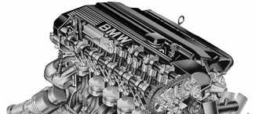

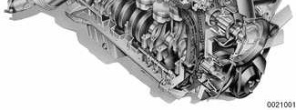

In model year 2001, the M54 (2.5 and 3.0 liter) engines were introduced. This engine incorporates all the technical features of the M52 TU engines with addition of fully electronic throttle control and enhanced emission controls.

Table a. Engine specifications lists engine specifications for the vehicles covered by this manual.

**Table a.** Engine specifications

| Model year | Engine code | No. of cylinders | Displacement cc (cu. in.) | Bore/stroke | Compression ratio | Torque lb-ft/rpm | Horsepower Hp/rpm |
|---|---|---|---|---|---|---|---|
| 323i 1999 - 2000 | M52 TU B25 | 6 | 2494 (152.2) | 84 mm (3.307 in.) / 75 mm (2.953 in.) | 10.5: 1 | 181/3,500 | 170/5,500 |
| 325i/Ci/xi 2001 | M54 B25 | 6 | 2494 (152.2) | 84 mm (3.307 in.) / 75 mm (2.953 in.) | 10.5: 1 | 175/3,500 | 184/6,000 |
| 328i/Ci 1999 - 2000 | M52 TU B28 | 6 | 2793 (170.4) | 84 mm (3.307 in.) / 84 mm (3.307 in.) | 10.2: 1 | 206/3,500 | 193/5,500 |
| 330i/Ci/xi 2001 | M54 B30 | 6 | 2979.3 (181.8) | 84 mm (3.307 in.) / 89.6 mm (3.528 in.) | 10.2: 1 | 214/3,500 | 225/5,900 |

## Torque/power graphs

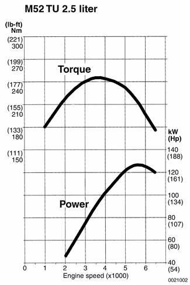

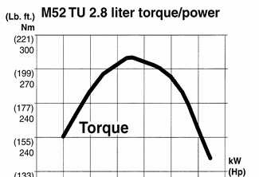

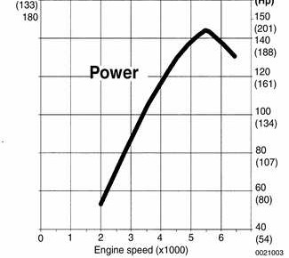

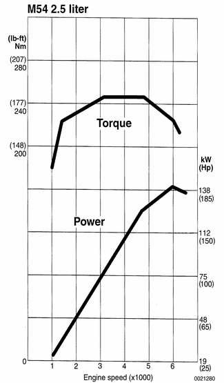

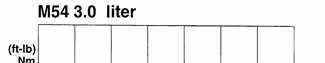

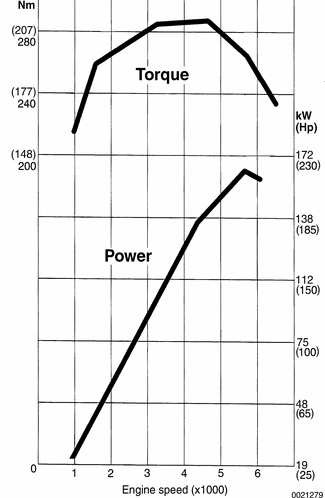

## Cylinder block and crankshaft

The cylinder block is cast aluminum alloy (AlSi9Cu3) with cast iron cylinder liners. The cylinders are exposed on all sides to circulating coolant.

The counterweighted crankshaft rotates in replaceable split-shell main bearings. Oilways drilled into the crankshaft provide bearing lubrication. Oil seals pressed into alloy seal housings are installed at both ends of the crankshaft.

The 2.5 liter crankshaft is cast iron. The 2.8 and 3.0 liter engines use a forged steel crankshaft to accommodate the higher torque. The crankshaft for the 3.0 liter engine is adapted from the S52 M3 engine.

## Connecting rods and pistons

The forged steel connecting rods use replaceable split-shell bearings at the crankshaft end and solid bushings at the piston pin end.

The pistons are of the three-ring type with two upper compression rings and a lower one-piece oil scraper ring. Full-floating piston pins are retained with circlips.

The 2.8 and 3.0 liter engines use a graphite coating on the piston skirts to reduce friction and noise.

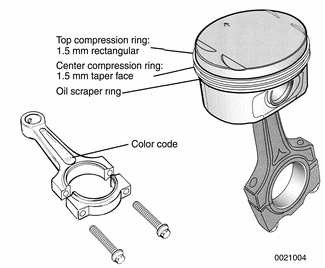

## Cylinder head and valvetrain

Cooling passages in the cylinder head are designed for optimum coolant circulation, allowing the head to operate at lower temperatures than the cylinder block.

The aluminum cylinder head uses chain-driven double overhead camshafts and four valves per cylinder. The cylinder head employs a crossflow design for greater power and efficiency. Intake air enters the combustion chamber from one side while exhaust gasses exit from the other.

Oilways in the head provide lubrication for the camshafts and valvetrain. Valve clearance is set by self-adjusting (zero-lash) hydraulic lifters for reduced valve noise and the elimination of routine valve adjustment.

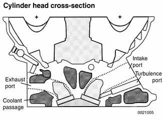

## Exhaust manifolds

Each exhaust manifold assembly incorporates a catalytic converter. The converters are mounted close to the engine for faster heat up. Pre- and post-catalyst oxygen sensors are mounted in each exhaust manifold.

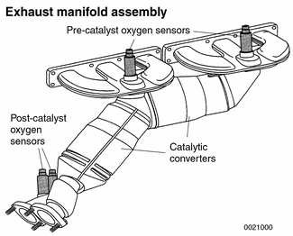

## Cooling system

The cooling system circulation is designed so that coolant flows directly from the coolant pump to the cylinder head. The coolant is fed from the coolant pump through a cast coolant feed passage to the rear of the cylinder head. From there it flows forward to the thermostat housing, radiator and heater valve.

The coolant passages in the cylinder block are only connected to the coolant supply through the holes in the head gasket. A reduced volume of the coolant flows through the cylinder block.

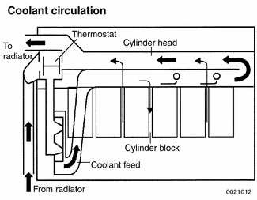

All models are equipped with a DME-controlled electric cooling fan. On some models, a supplemental cooling fan is used. See [170 Radiator and Cooling System] for specific configuration and application information.

An electrically heated thermostat controls the flow of coolant through the radiator based on coolant and outside temperature, engine load, and driving speed, rather than just coolant temperature.

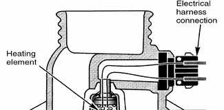

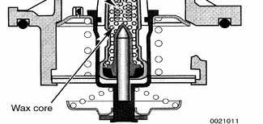

The DME-controlled heated thermostat allows the engine to be operated at higher controlled temperatures during low and part throttle. This optimizes operating temperatures in both cylinder head and block, reduces friction and thereby fuel consumption.

The cooling system is designed to:

- Reduce operating temperatures of cylinder head. The result of lower temperatures is increased torque due to improved volumetric efficiency.
- Increase operating temperature of cylinder block.

## Lubrication system

The lubrication system is pressurized whenever the engine is running. The oil pump draws oil through a pickup in the bottom of the oil pan, then forces it through a replaceable oil filter and into the engine oil passages.

The chain-driven oil pump is bolted to the bottom of the cylinder block inside the oil pan. A pressure relief valve limits the maximum system pressure. A bypass valve prevents the oil filter from bursting and insures engine lubrication should the filter become plugged. See [119 Lubrication System] for additional information.

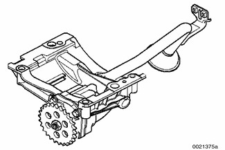

## Resonance/turbulence intake system

The intake manifold, made of molded plastic, is configured as two sets of three runners. This design enhances low end torque by changing the intake air flow configuration for varying engine speeds. This helps achieve optimum torque throughout the entire RPM range.

During engine operation, a closed resonance valve gives the intake air charge the dynamic effect of long intake runners at low to mid-range RPM (up to 3750 rpm). This helps increase torque.

During mid-range to high rpm operation (above 4100 rpm), the solenoid is de-energized and the resonance valve is sprung open. This allows intake air to be drawn through both resonance tubes, providing the air volume necessary for additional power at the upper rpm range.

> **Note:**
> - The rpm for resonance valve activation may vary slightly depending on temperature.

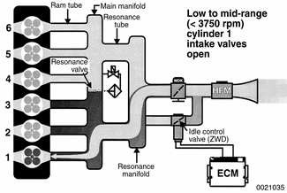

In addition, when the valve is closed, a dynamic effect is produced. For example, as intake air is flowing into cylinder 1, the intake valves will close. This blocks the onrushing air. The cylinder 1 air flow will stop and expand backward (resonance back pulse) to fill cylinder 5. The resonance wave along with the intake velocity enhances cylinder filling.

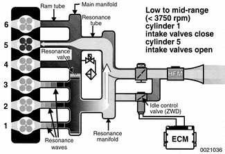

The intake manifold includes intake turbulence ports. The 5.5 mm (0.217 in.) turbulence ports channel idle and low speed air directly from the idle speed control valve to one intake valve of each cylinder.

Routing intake air to one intake valve per cylinder causes the air charge to swirl in the cylinder. Together with the high flow rate of intake air across the small (5.5 mm) port, intake fluctuations are reduced for more stable combustion.

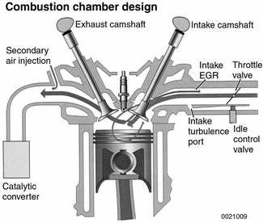

## VANOS (Variable Camshaft Timing)

A double VANOS system is used on both the M52 TU and the M54 engines. VANOS is fully variable and operates independently on both intake and exhaust sides.

When the VANOS solenoid is actuated, engine oil pressure is applied to the front side of the gear cup piston. This forces the gear cup into the camshaft helical gears to change camshaft timing.

In addition to offering increased power, the double VANOS system offers the following advantages:

- Increased torque at lower and medium RPM ranges
- More efficient combustion and improved idle quality
- Internal EGR in part-load range for lower NOx emissions.
- Quicker warm-up cycle for catalytic converter and faster reduction in emissions.
- Overall improved fuel economy.

See [117 Camshaft Timing Chains] for VANOS system testing and repair information.

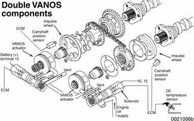

## Engine management system

The Siemens engine management systems used in E46 cars combine fuel injection, ignition and other functions under the control of the engine control module (ECM). They are compliant with second generation on-board diagnostics (OBD II) standards. See [OBD On Board Diagnostics] at the back of this manual for additional information.

**Table b.** Engine management systems

| Year: Engine | DME system |
|---|---|
| 1999 - 2000: M52 TU B25, M52 TU B28 | Siemens MS 42.0 |
| 2001: M54 B25, M54 B30 | Siemens MS 43.0 |

## Engine control module (ECM)

The engine control module (ECM) is mounted in the electronics box (E-box) next to the brake master cylinder.

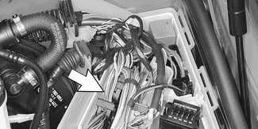

- The ECM is flash-programmable and features 5 electrical harness connectors with a total of 134 pins.
    - Connector 1: Voltages and grounds
    - Connector 2: Ancillary signals (oxygen sensors, CAN, etc.)
    - Connector 3: Engine signals
    - Connector 4: Vehicle signals
    - Connector 5: Ignition signals

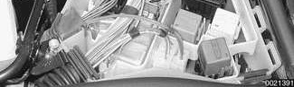

> **Note:**
> - The flash EEPROM (chip) is specifically 'programmed' to the vehicle. It has the capability to be programmed up to 13 times.

ECM inputs:

- Hot film mass air flow (MAF) sensor monitors intake air with no moving parts.
- Pre- and post-catalytic converter oxygen sensors monitor engine emissions and catalyst efficiency.
- MS 42.0: Static Hall-effect sensors are used to detect camshaft position as soon as the ignition is turned ON, before the engine is started.
- Dynamic Hall-effect crankshaft position sensor is mounted at the flywheel end of the engine block and is integral to misfire detection.
- Engine coolant temperature sensor (ECT) in cylinder head supplies coolant temperature information to the ECM.

ECM outputs:

- Fuel injector opening duration.
- Intake and exhaust valve timing via the VANOS system.
- The radiator cooling fan and the heated coolant thermostat.
- Motor-driven throttle valve: MDK in MS 42.0 or EDK in MS 43.0.
- Idle speed control valve (MS 42.0)
- Resonance valve in the intake manifold.

ECM outputs (cont.):

- MS 42.0: Fuel pressure via 3/2 way valve monitors running losses (evaporative losses during engine operation).
- Secondary air injection (if applicable) to reduce HC and CO.
- Multiple spark ignition system.
- Maximum vehicle speed and cruise control.
- Brake booster vacuum pump.
- Fuel purge valve and fuel tank leakage diagnosis pump (LDP or DM-TL).

## Fuel metering

The ECM meters pressurized fuel by changing the opening time (pulse width) of the fuel injectors. The exact amount of fuel injected is determined by the amount of time the injectors are open. To ensure that injector pulse width is the only factor that determines fuel metering, fuel pump pressure is maintained by a pressure regulator. The injectors are mounted to a common fuel rail.

The ECM monitors engine operating conditions to determine injector opening duration. Each injector can be individually controlled for cylinder selective fuel trim. The fuel-injectors inject fuel at an angle in a dual cone spray pattern.

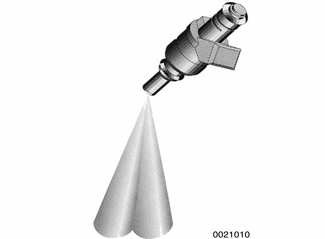

## Air intake

Air entering the engine passes through a pleated paper air filter in the air cleaner. Intake air mass is then measured by a mass air flow (MAF) sensor. A reference current is used to heat a thin film in the sensor when the engine is running. The current needed to hold the temperature of the film constant is the basis of the electronically converted voltage measurement corresponding to the mass of the intake air.

## Idle speed control

Idle speed is electronically controlled via the idle speed control valve by bypassing varying amounts of air around the closed throttle valve. Idle speed is not adjustable. The ECM determines idle speed by controlling a dual-winding rotary idle control valve. The basic functions and parameters of idle speed control are as follows:

- Control of cold air intake volume. For example, at air temperatures below 0°C (32°F), electronic throttle control (MDK/EDK) is also opened during idle.
- Smooth idle speeds regardless of load and inputs
- Lower rpm range
- Smooth transition from acceleration to deceleration

Idle speed stabilization is active during the following conditions:

- Engine warm up
- A/C activation
- Drive gear selected (auto. transmission)
- During passenger compartment heating
- During different cooling fan speeds

If the ECM detects a fault in the idle control valve, it will increase or decrease air flow, depending on the nature of the fault:

- If the fault causes decreased air flow (idle control valve closed), the electronic throttle control (MDK or EDK) will compensate to maintain idle. The EML lamp will illuminate to inform the driver of a fault.
- If the fault causes increased air flow (actuator failed open), VANOS and knock control are deactivated. This reduces engine performance noticeably.

## Throttle control

The throttle valve plate is electronically operated for precise throttle operation, OBD II compliant for fault monitoring, and ASC/DSC and cruise control. This integrated electronic throttle reduces additional control modules, wiring and sensors. Adjusting electronic throttles is not permitted and the throttle assembly must be replaced as a unit if found to be faulty.

The throttle assembly for the MS 42.0 system is referred to as the MDK (Motor Driven Throttle Valve). The MDK is identified as follows:

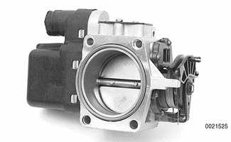

- A throttle cable is used to actuate the accelerator pedal position potentiometers and also serves as a backup to open the throttle plate (full control) when the MDK system is in the failsafe mode.

The throttle assembly for the MS 43.0 system is referred to as the EDK (Electronic Throttle Valve). The EDK is identified as follows:

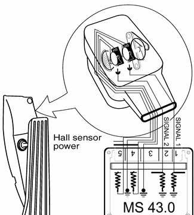

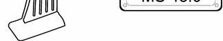

- The accelerator position potentiometers (PWG) are located in the accelerator pedal assembly.
- The EDK is fully electronic. The accelerator pedal is not mechanically linked to the EDK.

## Ignition function

A distributorless ignition system with individual ignition coils for each cylinder is employed. The coils are mounted over the spark plugs and connect to the plugs via a short lead. The Siemens systems use multiple spark ignition to reduce emissions and extend spark plug life.

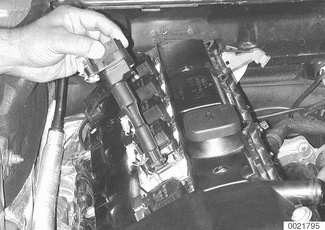

## Knock control

Knock (detonation) sensors monitor and control potentially damaging ignition knock through the ECM. The knock sensors function like microphones and are able to convert mechanical vibration (knock) into electrical signals. The ECM is programmed to react to frequencies that are characteristic of engine knock and adapt the ignition timing point accordingly. See [120 Ignition System] for further details.

> **Note:**
> - M52 TU and M54 engines are designed to operate best with fuel octane of at least 91 anti-knock index (AKI). The adaptive engine management system, however, will allow use of fuel rated 87 AKI.

## Siemens DME MS 42.0

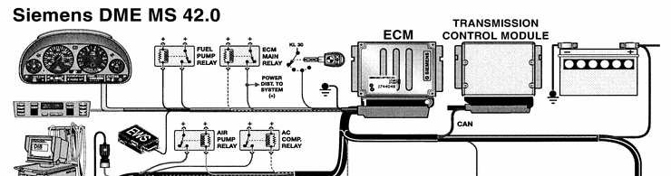

## Siemens DME MS 43.0

![Siemens DME MS 43.0 system diagram, upper part: DME MS 43.0 control unit center column with inputs — KL 15, memory power, RJUX KL 31, main relay, operating power & monitor temperature sensor, A/C & monitor temperature sensor, position sensor, knock sensors, camshaft position sensors (2), MFL button pad, EML button, throttle position, accelerator pedal position; outputs — ECM relay control, fuel pump relay control, secondary air injection relay pump control, resonance turbulence intake system, air jet pump, intake VANOS solenoid (earlier engines), idle control valve, sequential fuel injector control (6X), ignition sets cylinder control (6X), oxygen sensor heating.](e46_100-1_fig29.jpg)

![Siemens DME MS 43.0 system diagram, lower part: clutch switch, brake light switch, brake light test switch, engine temperature sensor, oil temp sensor, ignition monitor, E46 IHKA (K-bus), ABS/ASC/DSC, vehicle speed input, EWS III, DMTL, oxygen sensor monitoring, output stage, electric cooling fan, intake jet pump solenoid valve, purge valve control, CAN-bus, instrument cluster (Service Engine Soon), TCM, throttle position (DK), ABS/DSC, motor driven throttle valve (EDK), MAP-controlled heated thermostat, diagnostic link connector. Illustration ID: 0021664](e46_100-1_fig30.jpg)
