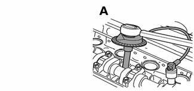
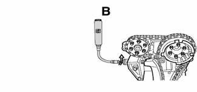
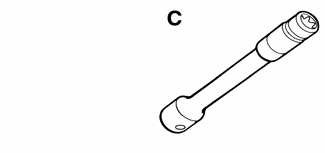
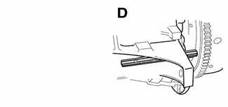
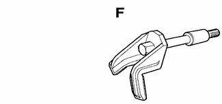
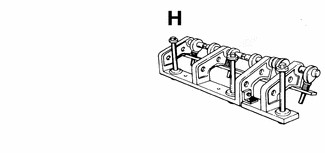
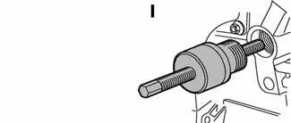
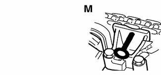

# General (Cylinder Head Removal and Installation)

> Source: BMW 3 Series (E46) Repair Manual, section 113-1, Cylinder Head Removal and Installation chapter (PDF pages 148–151 of 1252).

This group covers E46 cylinder head removal and installation as well as cylinder head/valve diagnosis procedures.

The information given in this repair group assumes that the engine is installed in the engine bay. In order to remove the cylinder head from the engine block, the VANOS control unit and the camshafts must be removed from the cylinder head. For cylinder head and valvetrain reconditioning information, see [116 Cylinder Head and Valvetrain].

> **Note:**
> - If a head gasket problem is suspected, a compression test or leak-down test will usually detect the fault. See [Diagnostic Testing] later in this group.

## Special tools

Special BMW service tools are required to properly remove and install the cylinder head on engines covered by this manual. The special tools are used to time the valvetrain to the crankshaft, to remove the VANOS control unit, the camshafts and the Torx (E12) head bolts. Read the entire procedure through before beginning the job.

Rotary angle dial gauge BMW special tool 00 9 120

Torque wrench w/ flex extension BMW special tool 00 9 250

E-12 Torx socket BMW special tool 11 2 250

Crankshaft locking tool BMW special tool 11 2 300

Camshaft locking tool BMW special tool 11 3 240

Camshaft locking tool bracket BMW special tool 11 3 244

Lifter retaining suction cup BMW special tool 11 3 250

Camshaft bearing cap removal tool BMW special tool 11 3 260 /11 3 270

Timing chain tensioner tool BMW special tool 11 4 220

VANOS adjustment plate BMW special tool 11 6 150

Secondary sprocket setup tool BMW special tool 11 6 180

Air line adapter BMW special tool 11 3 450

Secondary chain tensioner lock pin BMW special tool 11 3 292

