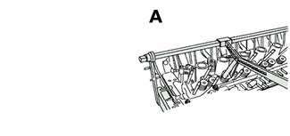
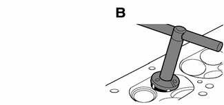
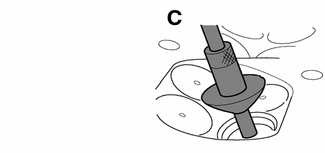
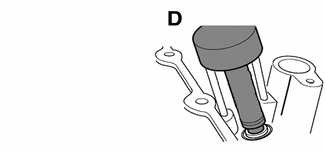
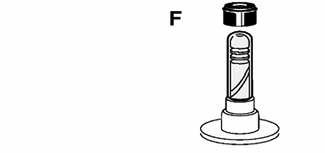

# General (Cylinder Head and Valvetrain)

> Source: BMW 3 Series (E46) Repair Manual, section 116-1, Cylinder Head and Valvetrain chapter (PDF pages 203–205 of 1252).

This repair group covers cylinder head and valvetrain service and repair. Procedures described here require that the cylinder head first be removed as described in [113 Cylinder Head Removal and Installation].

> **Note:**
> - For timing chain and VANOS repair information, see [117 Camshaft Timing Chains].
> - If it is determined that the cylinder head will require significant reconditioning work, a remanufactured cylinder head may be a good alternative. Remanufactured cylinder heads are available from an authorized BMW dealer.
> - The information given in this repair group is organized according to engine code. For engine application information, see [100 Engine–General].

## Special tools

BMW special tools are required for most cylinder head service described in this repair group. Many of these tools are expensive and only available through an authorized BMW dealer. If the special tools are not available, have the cylinder head disassembled and removed by an authorized BMW dealer. Be sure to read each procedure thoroughly before starting a job to determine which special tools and equipment will be necessary.

Most of the repairs to a cylinder head require precision machine work to specific tolerances. This type of work should be performed by an authorized BMW repair facility or an ASE certified machinist.

Cylinder head jig BMW 00 1 490

Valve seat grinder BMW 00 3 520

Valve guide reamer BMW 00 4 210

Valve stem seal driver BMW 11 1 200

Valve stem seal puller BMW special tool 11 1 480

Valve stem seal guide BMW special tool 11 1 960

