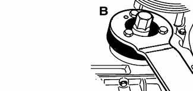
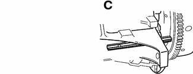
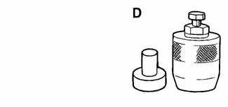
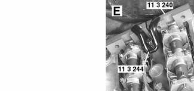
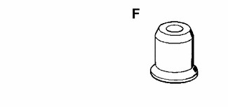
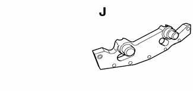
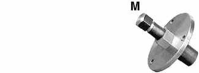

# General (Camshaft Timing Chain)

> Source: BMW 3 Series (E46) Repair Manual, section 117-1, Camshaft Timing Chain chapter (PDF pages 217–220 of 1252).

This repair group covers timing chain and Variable Camshaft Timing (VANOS) repair information.

The timing chains are lubricated by engine oil and do not require maintenance. Worn timing chains and sprockets can lead to noisy operation and erratic valve timing. A faulty tensioner can also cause timing chain noises.

> **Note:**
> - See [100 Engine–General] for engine code and application information.

## Special tools

Special BMW service tools are needed to remove and disassemble the timing chain, the VANOS control unit, the camshafts and the valvetrain. Many of these tools are expensive and only available through an authorized BMW dealer. Be sure to read each procedure thoroughly before starting a job to determine which special tools will be necessary.

In addition, VANOS system diagnosis can only be carried out by using BMW specific electronic scan tools, such as BMW DIS or MoDiC or equivalent.

> **CAUTION!**
> - The VANOS system must be removed and installed exactly as described later in this repair group.

Torque wrench w/ flex extension BMW 00 9 250

Crankshaft hub locking tools BMW 11 2 150 /11 2 410

Crankshaft locking tool BMW 11 2 300

Seal extractor tool BMW 11 2 380

Camshaft locking tools BMW 11 3 240/11 3 244

Installer bush BMW 11 3 280

Secondary chain tensioner locking pin BMW 11 3 292

Air line fitting BMW 11 3 450

Primary chain tensioner tool BMW 11 4 220

VANOS setup bracket BMW 11 6 150

Secondary sprocket tool BMW 11 6 180

Crankshaft hub locking tool BMW 11 8 190 /11 8 200

Puller for crankshaft hub BMW 11 8 210

