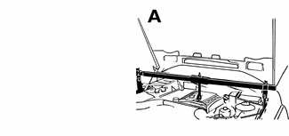
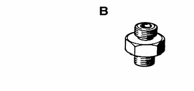

# General (Lubrication System)

> Source: BMW 3 Series (E46) Repair Manual, section 119-1, Lubrication System chapter (PDF pages 271–276 of 1252).

This repair group covers lubrication system troubleshooting as well as oil pan removal and oil pump replacement.

## Special tools

The engine needs to be properly supported while the front suspension subframe is removed to access the lubrication system. If BMW special tools 00 0 200 / 00 0 208 are not available, a device to support the weight of the engine from above would be suitable.

A standard oil pressure gauge may be used for measuring oil pressure. If the BMW DIS tester system is to be used, a special adapter is needed.

> **Note:**
> - Oil change procedure and oil filter replacement are covered in [020 Maintenance]

## Engine lubrication

Oil pressure is generated by a gear-type pump bolted to the bottom of the engine block. The oil pump is chain driven off the front of the crankshaft. Oil passages in the cylinder block and cylinder head connect the oil pump to components such as camshafts, crankshaft and valve lifters.

Engine oil capacity (includes filter replacement)

| Rear wheel drive | 6.5 liters (6.9 qt.) |
|---|---|
| All wheel drive | 7.5 liters (7.9 qt.) |

## Troubleshooting

The oil pressure warning system consists of an oil pressure switch mounted in the oil circuit and an instrument panel warning light. Other safety features include:

- Oil level warning system
- A filter bypass to provide lubrication should the oil filter become clogged
- An oil pump pressure relief valve to prevent excessive system pressure

> **CAUTION!**
> - If the red oil pressure warning light comes on or flashes on while driving, always assume that the oil pressure is low.

## Oil pressure, checking

In some engines access to the oil pressure warning switch port may be extremely restricted.

- Unscrew oil filter cap in order to allow engine oil to drain back down into oil pan.

- Disconnect harness connector from oil pressure switch (arrow) and remove switch.

> **CAUTION!**
> - Running the engine with the oil pressure switch disconnected may set a fault code (DTC).

> **Note:**
> - Thoroughly clean around the oil pressure switch before removing it. Be prepared to catch leaking oil with a shop towel.

Component location

| Oil pressure switch | base of oil filter housing |
|---|---|

- Install pressure gauge in place of switch.
- With gauge installed, start engine and allow to reach operating temperature. Check oil pressure both cold and hot.

> **Note:**
> - For the most accurate test results, the engine oil and filter should be new. The oil should be the correct grade.

Oil pressure

| Idle (minimum) | 0.5 bar (7 psi) |
|---|---|
| Regulated pressure (elevated engine speed) | 4.0 bar (59 psi) |

- Remove pressure gauge and reinstall pressure switch.

Tightening torque

| Component | Tightening torque |
|---|---|
| Oil pressure switch to oil filter housing | 27 Nm (20 ft-lb) |

- If testing shows low oil pressure, one or more of the following conditions may be indicated:
    - Worn or faulty oil pump
    - Worn or faulty engine bearings
    - Severe engine wear
- All of these conditions indicate the need for major repairs.

## Oil pressure warning system, testing

When the ignition is turned on, the oil pressure warning light comes on. When the engine is started and the oil pressure rises slightly, the oil pressure switch opens and the warning light goes out. Make sure the oil level is correct before making tests.

- Turn ignition switch on.
- Warning light on instrument panel must light up.
- Remove connector from oil pressure switch.
- Warning light on instrument panel must go out.

> **CAUTION!**
> - Running the engine with the oil pressure switch disconnected may set a fault code (DTC).

> **Note:**
> - If the light does not go out, the wiring to the switch is most likely grounded somewhere between the switch terminal and the warning light. See [Electrical Wiring Diagrams] at rear of manual for electrical schematics.

- If warning light does not light when ignition is on, remove connector from oil pressure switch and use a jumper wire to ground connector terminal to a clean metal surface.

> **Note:**
> - If the warning light comes on, check the switch as described in the next step. If the warning light does not come on, the wiring to the instrument cluster or to the light itself is faulty.

- To test switch, connect an ohmmeter between terminal in switch body and ground. With engine off, there should be continuity. With engine running, oil pressure should open switch and there should be no continuity.
- Replace a faulty switch.

> **CAUTION!**
> - Keep in mind that low oil pressure may be preventing the switch from turning the light out. If the light remains on while the engine is running, check the oil pressure as described earlier. Do not drive the car until the problem is corrected. The engine may be severely damaged.
