# General (Ignition System)

> Source: BMW 3 Series (E46) Repair Manual, section 120-1, Ignition System chapter (PDF pages 297–307 of 1252).

This repair group covers component replacement information for the ignition system.

When diagnosing engine management problems, including on-board diagnostics (OBD II) fault code analysis, also refer to these repair groups:

- [100 Engine–General]
- [130 Fuel Injection]
- [Electrical Wiring Diagrams] at the rear of this manual
- [OBD On Board Diagnostics] at the rear of this manual

## Special tools

Owing to the coil-per-cylinder configuration, system diagnosis and testing requires special test equipment.

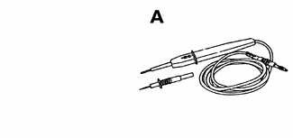

- LED test light Baum 1115 (Source: Baum Tools Unlimited)

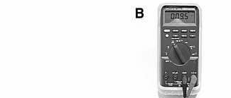

- Automotive digital multimeter Fluke 87

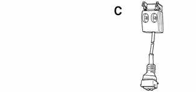

- Primary voltage test harness BMW 12 7 020

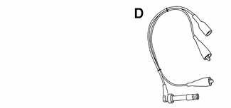

- Secondary voltage test harness BMW 12 7 030

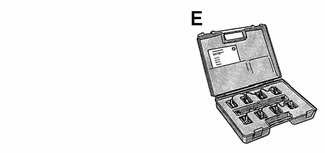

- Ignition coil test adapters BMW 12 7 040

## Engine management

BMW E46 engines use an advanced engine management system known as Digital Motor Electronics (DME). DME incorporates on-board diagnostics, fuel injection, ignition and other engine control functions. DME variants are listed in [Table a].

Second generation On-Board Diagnostics (OBD II) is incorporated into the engine management systems used on the cars covered by this manual. Using a BMW-specific electronic scan tool, it is possible to access Diagnostic Trouble Codes (DTCs) that pinpoint ignition and other engine management problems.

Additional information about DTCs and engine management system electronic system diagnosis is provided in [OBD On Board Diagnostics] at the rear of this manual.

Table a. Engine management systems

| Year: Engine | DME system |
|---|---|
| 1999 - 2000: M52 TU B25, M52 TU B28 | Siemens MS 42.0 |
| 2001: M54 B25, M54 B30 | Siemens MS 43.0 |

## Ignition system

All engines use a distributorless ignition system with individual ignition coils for each cylinder. There is no distributor cap or ignition rotor.

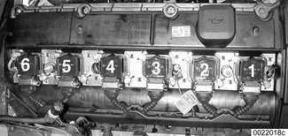

Each coil can be controlled by the Engine Control Module (ECM) on a cylinder-by-cylinder basis.

> **Note:**
> - Schematic diagram of ignition coil circuit is for MS 42.0 engine management system. On MS 43.0 system, ignition coil terminal 3 receives power from Fuse 1 (30 amp). See [Electrical Wiring Diagrams] for specific wiring information.

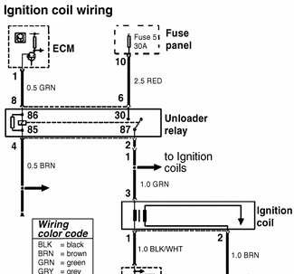

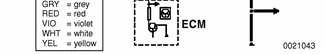

> **WARNING!**
> - Do not touch or disconnect any cables from the coils while the engine is running or being cranked by the starter.
> - The ignition system produces high voltages that can be fatal. Avoid contact with exposed terminals. Use extreme caution when working on a car with the ignition switched on or the engine running.
> - Connect and disconnect the DME system wiring and test equipment leads only when the ignition is OFF.
> - Before operating the starter without starting the engine (for example when making a compression test) always disable the ignition.

Knock sensors (arrows) monitor the combustion chamber for engine-damaging knock. Two sensors monitor three cylinders each. If engine knock is detected, the ignition point is retarded by the ECM.

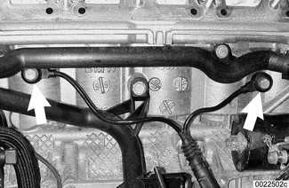

> **Note:**
> - When knock is detected, ignition timing will be retarded at the selective cylinder(s) by 3° increments. If knock is no longer detected, the timing will be advanced in 1° increments.

Ignition timing is electronically mapped and not adjustable. The ECM uses engine load, engine speed, coolant temperature, knock detection and intake air temperature as the basic inputs for timing control. A three dimensional map similar to the one shown is digitally stored in the ECM. The initial ignition point is determined by the crankshaft speed sensor during cranking. Once the engine is running, timing is continually adjusted based on operating conditions.

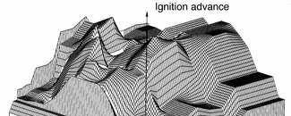

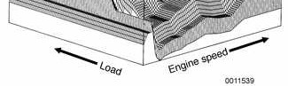

## Basic troubleshooting principles

Poor driveability may have a variety of causes. The fault may lie with the ignition system, the fuel system, parts of the emission control system, or a combination of the three. Because of these interrelated functions and their effects on each other, it is often difficult to know where to begin looking for problems.

For this reason, effective troubleshooting should always begin with an interrogation of the On-Board Diagnostics (OBD II) system. The OBD II system detects engine management malfunctions. When faults are detected, the OBD II system stores a Diagnostic Trouble Code (DTC) in the Engine Control Module (ECM) along with other pertinent fault information. In addition, the Malfunction Indicator Light (MIL) will come on if an emissions related fault is detected. Additional OBD II information, including a DTC lookup table can be found in the back of this manual under [OBD On Board Diagnostics].

> **Note:**
> - On model year 1999 and 2000 cars, the MIL is labeled Check Engine. On model year 2001 cars, the MIL is labeled Service Engine Soon.

An engine that starts and runs indicates that the ignition system is fundamentally working-delivering voltage to the spark plugs. A hard-starting or poor-running engine, however, may indicate a problem with how well the spark is delivered. Faulty or worn ignition components, such as old spark plugs, or an individual coil problem may be the cause.

> **WARNING!**
> - Inefficient combustion (rich air/fuel mixture) can cause elevated hydrocarbon exhaust emissions and catalytic converter damage. For this reason, if a severe misfire is detected, the fuel injector will be turned off to the specific cylinder and the MIL illuminated.

One way to diagnose a faulty coil on a car that is running is to use an oscilloscope to analyze spark quality. The illustrations show normal scope trace of spark at idle.

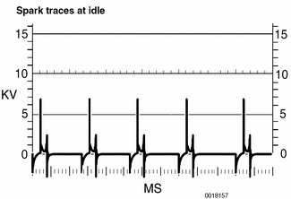

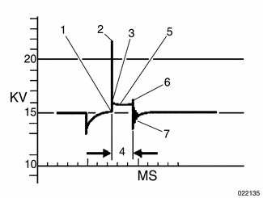

[Table b] lists common ignition coil voltage faults and related causes.

> **Note:**
> - Note the length of sparking period and the up-down voltage attenuations. A short sparking period and/or an irregular/low voltage attenuation usually indicates a faulty coil.

A normal oscilloscope pattern for a six cylinder engine.

1. Start of ignition voltage peak
2. Level of ignition voltage
3. Level of combustion voltage
4. Period of combustion
5. Combustion curve characteristics
6. Start of decay process
7. Termination oscillations

> **Note:**
> - See [Ignition coil assembly, testing and replacing] as described later.

Table b. Ignition trace diagnostics

| Parameter | Ignition voltage low | Ignition voltage high |
|---|---|---|
| Spark plug electrode gap | too small | too big |
| Spark plug electrode condition | - | worn/burnt |
| Spark plug electrode temperature | too high | too low |
| Engine compression | too low | too high |
| Spark plug wire(s) | - | faulty |
| Fuel air mixture | - | too lean |

## Misfire detection

Engine misfire, the result of inefficient combustion in one or more cylinders, may be caused by a variety of malfunctions in various subsystems. The OBD II system incorporated into the MS 42.0 and MS 43.0 engine management systems is designed to detect and warn of misfire faults during engine operation. Misfire fault codes are listed in [Table c]. Misfire fault codes. For a detailed list of fault codes see [OBD On Board Diagnostics].

Once engine misfire has been detected and the fault codes downloaded from the ECM, it is necessary to follow a diagnostic path to correct the problem. The ignition subset of the diagnostic path is shown in [Table d]. Ignition system problems

Table c. Misfire fault codes

| P code | BMW fault code | Fault code | Possible cause(s) |
|---|---|---|---|
| P0301 | 238 | Misfire cylinder 1 | Ignition fault: Defective or incorrect spark plug(s) or connector(s); defective ignition coil(s). Mechanical fault: Crankshaft pulse wheel loose or damaged; damaged piston(s), valve(s) or camshaft(s); oil pressure low. Catalyst fault: Excessive exhaust backpressure due to restricted catalyst. Fuel supply fault: Contaminated fuel; fuel delivery fault (blocked filter, low fuel in tank, defective fuel pump); running loss system fault; leaking or blocked fuel injector(s); fuel pressure regulator fault; evaporative system fault. ECM/sensor input fault: Implausible sensor signal; oxygen sensor(s) faulty; ECM faulty. (Causes apply to P0301 through P0306.) |
| P0302 | 239 | Misfire cylinder 2 | |
| P0303 | 240 | Misfire cylinder 3 | |
| P0304 | 241 | Misfire cylinder 4 | |
| P0305 | 242 | Misfire cylinder 5 | |
| P0306 | 243 | Misfire cylinder 6 | |
| P1396 | 244 | Crankshaft sensor adaptation at limit | Misfire detection fault: Varying pulse wheel tolerances or loose pulse wheel |

Table d. Ignition system problems

| Component | Condition | Test | Repair |
|---|---|---|---|
| Spark plug | Incorrect spark plug; Electrode gap too small; Electrode(s) missing; Oil or fuel fouled spark plug; Ceramic insulation cracked | Inspect spark plugs. | Verify correct spark plugs. Replace plugs if defective. Check crankcase ventilation and oil level. |
| Secondary circuit | Wet coil; Corroded coil connections | Secondary circuit | Check for water leak. Check resistance values (see [Table e]). |
| Ignition coil | Primary or secondary circuit open or shorted; Housing cracked, damaged | Primary and secondary circuits (see [Table e]) | Replace coil as necessary. |
| Ignition coil harness connector | Power supply, primary control circuit or ground (shunt signal) circuits impaired | Primary ignition and terminal 4A feedback preset measurements | Look for open, loose connector, corrosion, crossed or damaged connector pins. Inspect ignition unloader relay. Replace coils as necessary. |

## Warnings and cautions

The engine management system contains sensitive electronic components. To protect the system and for general safety, the following warnings and cautions should be observed during ignition system troubleshooting, maintenance or repair work.

> **WARNING!**
> - Do not touch or disconnect any cables from the coils while the engine is running or being cranked by the starter.
> - The ignition system produces high voltages that can be fatal. Avoid contact with exposed terminals. Use extreme caution when working on a car with the ignition switched on or the engine running.
> - Connect and disconnect the DME system wiring and test equipment leads only when the ignition is OFF.
> - Before operating the starter without starting the engine (for example when making a compression test) always disable the ignition.

> **CAUTION!**
> - Prior to disconnecting the battery, read the battery disconnection cautions given at the front of this manual on page viii.
> - Do not attempt to disable the ignition by removing the coils from the spark plugs.
> - Connect or disconnect ignition system wires, multiple wire connectors, and ignition test equipment leads only while the ignition is off. Switch multimeter functions or measurement ranges only with the test probes disconnected.
> - Do not disconnect the battery while the engine is running.
> - A high impedance digital multimeter should be used for all voltage and resistance tests. An LED test light should be used in place of an incandescent-type test lamp.
> - In general, make test connections only as specified by BMW, as described in this manual, or as described by the instrument manufacturer.
