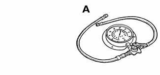
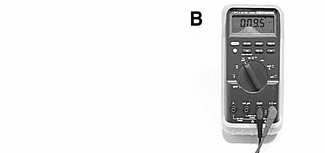
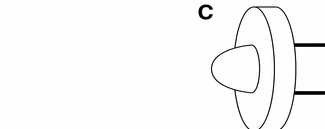
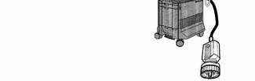
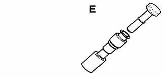
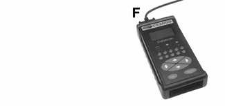
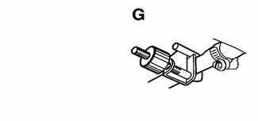
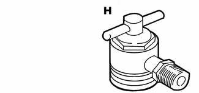
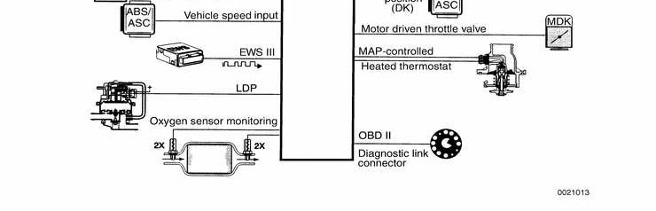

# General (Fuel Injection)

> Source: BMW 3 Series (E46) Repair Manual, section 130-1, Fuel Injection chapter (PDF pages 318–325 of 1252).

This repair group covers service and repair for the Siemens engine management systems used on the E46 models covered by this manual. Additional engine management information may also be found in the following repair groups:

- [100 Engine–General]
- [120 Ignition System]
- [160 Fuel Tank and Fuel Pump]
- [Electrical Wiring Diagrams]

> **Note:**
> - Fuel pressure testing and fuel pump repair information is covered in [160 Fuel Tank and Fuel Pump].

Table a. Engine management systems

| Model Year: Engine code | DME system |
|---|---|
| 1999 - 2000: M52 TU B25, M52 TU B28 | Siemens MS 42.0 |
| 2001: M54 B25, M54 B30 | Siemens MS 43.0 |

The Siemens systems are sophisticated self-diagnosing OBD II systems. These systems continuously monitor components and record and store valuable diagnostic information. When faults arise, or if the MIL (malfunction indicator lamp) in the instrument cluster is illuminated, begin troubleshooting by hooking up a BMW-compatible scan tool. The rich diagnostic capabilities of these systems have the potential to save hours of diagnostic time, incorrect component replacement and possible damage to system components. See [OBD On Board Diagnostics] at the back of this manual.

## Tools and test equipment

If the equipment required to do the job is unavailable, it is recommended that these repairs be left to an authorized BMW dealer or other qualified BMW repair facility.

- Fuel pressure gauge Baum 1318 (Source: Baum Tools Unlimited)

- Automotive digital multimeter Fluke 87

- Low current test light ("noid") Baum 1115a (Source: Baum Tools Unlimited)

- Factory DTC scan tool BMW DIS/MoDiC

- Fuel line plugs BMW 13 5 281 / 13 5 282

- Aftermarket DTC scan tool Baum CS2000 (Source: Baum Tools Unlimited)

- Fuel line clamp BMW 13 3 010

- Fuel rail to pressure gauge fitting BMW 13 5 220

> **Note:**
> - Professional diagnostic scan tools available at the time of this printing include the BMW factory tools (DISplus and MoDiC) and a small number of aftermarket BMW-specific tools. The `CS2000' from Baum Tools Unlimited, the `Retriever' from Assenmacher Specialty Tools, and the MT2500 from Snap-on are three examples of quality OBD scan tools.
> - In addition to the BMW professional line of scan tools, there are many inexpensive `generic' OBD II scan tool software programs and handheld units available. Although these tools have limited capabilities as compared to the dedicated tools, they are powerful diagnostic tools. These tools read live data streams, freeze frame information for DTCs (diagnostic trouble codes) and impending DTCs, as well as a host of other valuable diagnostic data.
> - For the DIY owner, simple aftermarket DTC readers are also available. These inexpensive BMW-only tools are capable of checking for DTCs as well as turning off the illuminated MIL, and resetting the service indicator lights.
> - See [020 Maintenance] for specialty tool manufacturer contact information.

## Principle of operation

The DME fuel injection system is completely electronic in operation. Intake air, engine coolant temperature, crank and camshaft positions, engine speed and many other engine operating parameters are measured electronically and the information is supplied to the engine control module (ECM).

Based on input information, the ECM controls the ignition coils, fuel injectors, motor driven throttle valve, double VANOS system, radiator cooling fan, electrically heated thermostat, as well as other outputs.

The illustration on the following page shows the MS 42.0 ECM inputs and outputs. The MS 43.0 system is similar in operation, with the main difference being the fully electronic `drive-by-wire' throttle valve. Additional system operational information can be found in [100 Engine–General].

DME MS 42.0

## Warnings and cautions

For personal safety, as well as the protection of sensitive electronic components, adhere to the warnings and cautions on the following pages.

> **WARNING!**
> - Gasoline is highly flammable and its vapors are explosive. Do not smoke or work on a car near heaters or other fire hazards when diagnosing and repairing fuel system problems. Have a fire extinguisher available in case of an emergency.
> - When working on an open fuel system, wear suitable hand protection, as prolonged contact with fuel can cause illnesses and skin disorders.
> - The ignition system produces high voltages that can be fatal. Avoid contact with exposed terminals. Use extreme caution when working on a car with the ignition switched on or the engine running.
> - Do not touch or disconnect any cables from the coils while the engine is running or being cranked by the starter.
> - Connect and disconnect the DME system wiring and test equipment leads only when the ignition is switched off.
> - Renew fuel system hoses, clamps and O-rings any time they are removed.
> - Before making any electrical tests that require the engine to be cranked using the starter, disable the ignition system as described in [120 Ignition System].

> **CAUTION!**
> - Prior to disconnecting the battery, read the battery disconnection cautions given at the front of this manual on page viii.
> - Do not connect any test equipment that delivers a 12-volt power supply to terminal 15 (+) of the ignition coil. The current flow may damage the ECM. In general, connect test equipment only as specified by BMW, or the equipment maker.
> - Only use a digital multimeter for electrical tests.
> - Only use an LED test light for quick tests.
> - Disconnecting the battery may erase fault code(s) stored in memory. Check for fault codes prior to disconnecting the battery cables.
> - Wait at least 40 seconds after turning off the ignition before removing the engine control module (ECM) connector. If the connector is removed before this time, residual power in the system relay may damage the control module.
> - Cleanliness is essential when working on an open fuel system. Thoroughly clean fuel line connections and surrounding areas before loosening. Avoid moving the car. Only install clean parts.
> - Fuel system cleaners and other chemical additives other than those specifically recommended by BMW may damage the catalytic converter, the oxygen sensor or other fuel supply components.
