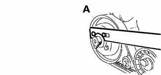
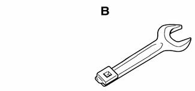
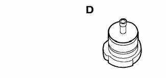
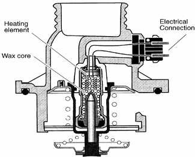
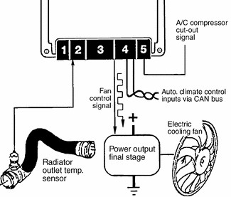

# General (Radiator and Cooling System)

> Source: BMW 3 Series (E46) Repair Manual, section 170-1, Radiator and Cooling System chapter (PDF pages 360–365 of 1252).

This section covers component repair information for the engine cooling system.

The E46 cooling system uses a centrifugal-type belt-driven coolant pump, an electric primary cooling fan, and an electrically heated thermostat. The cooling system is unique in that the cooling fan and the thermostat are controlled and monitored by the DME engine management system. Therefore, cooling system faults can be diagnosed using an appropriate scan tool.

## Special tools

Special tools are necessary for fan clutch removal and pressure testing the cooling system.

- Cooling fan counterhold wrench BMW 11 5 030

- Cooling fan wrench BMW 11 5 040

- Cooling system pressure tester BMW 17 0 002/17 0 005

- Expansion tank cap test adapter BMW 17 0 007

Cooling system (DME MS 42.0)

## Coolant pump

A centrifugal-type coolant pump is mounted to the front of the engine. The belt-driven pump circulates coolant through the system whenever the engine is running.

## Thermostat

An electrically heated thermostat regulates the engine coolant temperature and is controlled by the DME control module. The heated thermostat allows the engine to be operated at higher temperatures at idle and at part throttle. Having the ability to control the engine coolant temperature electronically results in improved emissions and performance. Problems with the heated thermostat can be diagnosed using a compatible scan tool.

## Radiator and expansion tank

The radiator is a crossflow design. An expansion tank provides for coolant expansion at higher temperatures and easy monitoring of the coolant level.

On cars with automatic transmission, ATF is circulated through an additional heat exchanger (ATF cooler).

## Cooling fan (primary)

There are two cooling fan configurations used on the cars covered by this manual, depending on transmission application.

On cars with automatic transmissions, the main fan is electric and mounted on the bumper side of the radiator. The fan is controlled by the DME control module via the output final stage. Additionally a belt-driven fan via a viscous fluid coupling (clutch) is attached to the front of the coolant pump. The fan clutch controls the speed of the fan based on engine compartment temperature.

On cars with manual transmissions, a single multi-speed electric cooling fan is used. The fan is mounted on the engine side of the radiator and controlled by the DME control module via the output final stage.

On both configurations, the output final stage is mounted on the fan housing, next to the fan motor. The fan is operated using a pulse width modulated (PWM) signal and is protected by a 50-amp fuse. Electric fan activation is based on the following inputs to the ECM:

- Radiator outlet temperature
- Catalyst temperature (calculated temperature)
- Vehicle speed
- Battery voltage
- A/C pressure (calculated pressure)

When the vehicle is first started, the ECM activates the electric fan briefly at 20% of its maximum speed, then switches off. This is for diagnostic monitoring. The voltage generated by the fan when it slows down (acting as a generator) must match the stored `rpm' values in the fan power output stage to confirm that the fan is operating correctly.

> **Note:**
> - If the ECM stored a cooling fan fault, check that the fan is not seized and that it spins freely.
> - When A/C is switched ON, the electric fan is not immediately turned on.
> - After the engine is switched OFF, the fan may continue to run at varying speeds for up to 10 minutes, based on calculated catalyst temperature.

## Warnings and cautions

The following warnings and cautions should be observed when working on the cooling system.

> **WARNING!**
> - At normal operating temperature the cooling system is pressurized. Allow the system to cool as long as possible before opening-a minimum of an hour-then release the cap slowly to allow safe release of pressure. Releasing the cooling system pressure lowers the coolant boiling point and the coolant may boil suddenly. Use heavy gloves and wear eye and face protection to guard against scalding.
> - Use extreme care when draining and disposing of engine coolant. Coolant is poisonous and lethal to humans and pets. Pets are attracted to coolant because of its sweet smell and taste. Consult a veterinarian immediately if coolant is ingested by an animal.

> **CAUTION!**
> - Avoid adding cold water to the coolant while the engine is hot or overheated. If it is necessary to add coolant to a hot system, do so only with the engine running and coolant pump turning.
> - To avoid excess silicate gel precipitation in the cooling system and loss of cooling capacity, use BMW coolant or equivalent low silicate antifreeze.
> - If oil enters the cooling system, the radiator, expansion tank and heating circuit must be flushed with cleaning agent. BMW recommends removal of the radiator and expansion tank to flush.
> - When working on the cooling system, cover the alternator to protect it against coolant drips.
> - Prior to disconnecting the battery, read the battery disconnection cautions given at the front of this manual on page viii.
