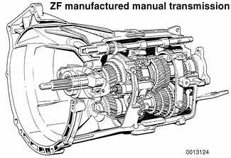
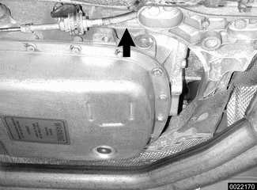
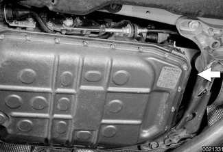

# General (Drivetrain)

> Source: BMW 3 Series (E46) Repair Manual, section 200-1, Drivetrain — General chapter (PDF pages 387–389 of 1252).

This section covers the repairs related to the clutch, manual and automatic transmissions, shift linkages, driveshafts, and transfer case (all wheel drive vehicles only). For repairs related to drive axles and front and rear final drive differentials, see [311 Front Axle Final Drive] and [331 Rear Axle Final Drive].

## Drivetrain

E46 models are equipped with a longitudinal drivetrain. The transmission is bolted directly to the rear of the engine. In rear wheel drive models, a driveshaft connects the output shaft of the transmission to the rear final drive. On all wheel drive models, a transfer case is mounted to the rear of the transmission, with drive shafts leading to front and rear final drive assemblies. Individual drive axles with integrated constant velocity joints transfer rotational power from the final drive units to the drive wheels.

## Manual transmission

Due to different power characteristics and performance requirements, three different manual transmissions are used in models covered by this manual. Manual transmission applications are given in [Table a]. Manual transmission applications.

> **Note:**
> - For transmission gear ratio information and repair information, see [230 Manual Transmission].

The manual transmissions use a single clutch disc with dual-mass flywheel. For further information, see [210 Clutch].

Manual transmissions have a metal ID plate mounted on the side of the transmission. Do not rely on numbers cast on the transmission case for identification.

Table a. Manual transmission applications

| Model | Year | Engine | Transmission |
|---|---|---|---|
| 323i/Ci | 1999 - 2000 | M52 TU | Getrag S5D 250G |
| 325i/Ci | 2000 - 2001 | M54 | Getrag S5D 250G |
| 328i/Ci | 1999 - 2000 | M52 TU | ZF S5D 320Z |
| 330i/Ci | 2000 - 2001 | M54 | ZF S5D 320Z |
| 325xi 330xi | 2000 - 2001 | M54 | ZF S5D 280Z |

Transmission cells are merged across model pairs in print; values repeated here.

## Automatic transmission

Two different automatic transmissions are used, depending on model and model year and/or production date. All of the automatic transmissions are electrohydraulically controlled with five forward speeds. Automatic transmission applications are given in [Table b]. Automatic transmission applications. For automatic transmission repair information, see [240 Automatic Transmission].

Transmission Identification codes for automatic transmissions are located on metal ID tags mounted to the body of the transmission.

> **Note:**
> - 323i/Ci and 328i/Ci models manufactured from 08/98 to 03/00 are equipped with the A5S 360R automatic transmission. Vehicles produced after 03/00 use the A5S 325Z transmission.

GM manufactured transmissions have the ID tag located on the left hand side of the transmission housing, behind the transmission selector cable, just above the transmission pan (arrow).

ZF manufactured transmissions have the ID tags mounted on the left side of the rear of the transmissions, just above the automatic transmission pan (arrow).

Table b. Automatic transmission applications

| Model | Year | Engine | Transmission |
|---|---|---|---|
| 323i/Ci | 1999 - 2000 | M52TU | GM A5S 360R |
| 328i/Ci | 2000 - 2001 | M52TU | ZF A5S 325 Z |
| 325i/Ci | 2000 - 2001 | M54 | ZF A5S 325 Z |
| 330i/Ci | 2000 - 2001 | M54 | ZF A5S 325 Z |
| 325xi | 2000 - 2001 | M54 | GM A5S 390R |
| 330xi | 2000 - 2001 | M54 | GM A5S 390R |

Engine and Transmission cells are merged across model pairs in print; values repeated here.

## Transmission lubricants

[No content for this heading appears in this scan; lubricant information is covered in the 230 Manual Transmission and 240 Automatic Transmission chapters.]
