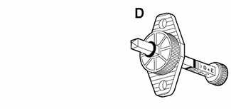
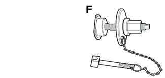
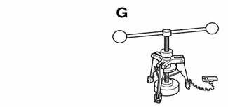
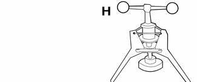
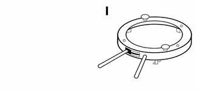

# General (Clutch)

> Source: BMW 3 Series (E46) Repair Manual, section 210-1, Clutch chapter (PDF pages 390–392 of 1252).

This repair group covers replacement of the clutch mechanical and hydraulic components. Read the procedure through before beginning a job.

> **Note:**
> - See [200 Transmission–General] for transmission application information.

## Special tools

The 3 Series BMW employs a traditional style clutch layout with a self adjusting clutch for manual transmission cars. BMW suggests some specific tools for fitting and removing the self adjusting clutch (SAC) assembly. These tools are required for aligning and assembling the clutch disk, as well as locking the flywheel in place and aligning the SAC assembly to the dual mass flywheel.

- Flywheel locking tool BMW 11 2 170

- Pilot bearing removal tool BMW 11 2 340

- Pilot bearing installation tool BMW 11 2 350

- Clutch lining gauge BMW 21 2 080

- Clutch centering mandrel BMW 21 2 142

- SAC clutch lock tool BMW 21 2 150

- Clutch diaphragm tensioning tool BMW 21 2 160

- SAC tensioning tool BMW 21 2 170

- SAC locating ring BMW 21 2 180
