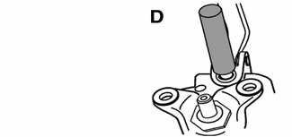
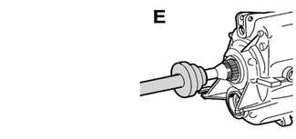

# General (Manual Transmission)

> Source: BMW 3 Series (E46) Repair Manual, section 230-1, Manual Transmission chapter (PDF pages 408–409 of 1252).

This repair group covers external transmission service, including removal and installation of the transmission unit. Internal transmission repair is not covered. Special press tools and procedures are required to disassemble and service the internal geartrain.

## Special tools

BMW specified tools are required for removal and installation of the manual transmission, as well as the removal and installation of seals at the transmission input, output, and selector shafts. If these tools are unavailable, equivalent tools may be substituted.

- Seal puller BMW 00 5 010

- Engine support bracket (lower) BMW 11 8 022

- Input shaft seal puller (slide hammer) BMW 23 0 490

- Selector seal drift BMW 23 0 22

- Output seal drift BMW 23 2 300

Manual transmissions used are based on engine application. Consult [200 Transmission–General] for transmission application information. [Table a]. Manual transmission gear ratios lists gear ratio specifications.

> **Note:**
> - Do not rely on forged casting numbers for transmission code identification.

Table a. Manual transmission gear ratios

Gear Ratios:

| Transmission | Getrag S5D 250G | ZF S5D 280Z | ZF S5D 320Z |
|---|---|---|---|
| 1st | 4.23 | 4.21 | 4.21 |
| 2nd | 2.52 | 2.49 | 2.49 |
| 3rd | 1.66 | 1.66 | 1.66 |
| 4th | 1.22 | 1.24 | 1.24 |
| 5th | 1.00 | 1.00 | 1.00 |
| reverse | 4.04 | 3.85 | 3.85 |
