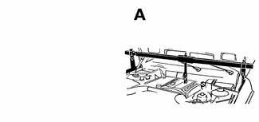
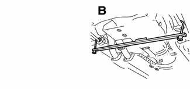
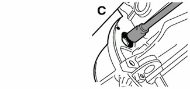
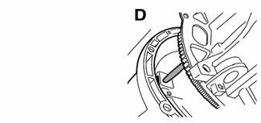
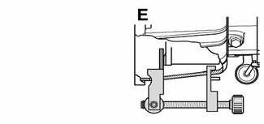

# General (Automatic Transmission)

> Source: BMW 3 Series (E46) Repair Manual, section 240-1, Automatic Transmission chapter (PDF pages 426–428 of 1252).

This section covers maintenance and replacement of the E46 automatic transmission. Internal repairs to the automatic transmission are not covered. Special tools and procedures are required to disassemble and service internal automatic transmission components.

Automatic transmissions are identified by code letters found on a data plate located on the side or rear of the transmission case. See [200 Transmission–General] for application information. For gear ratio specifications, see [Table a]. Automatic transmission applications.

> **CAUTION!**
> - ATF does not circulate unless the engine is running. When towing an automatic transmission vehicle, use a flat-bed truck or raise the rear wheels off the ground. All wheel drive vehicles equipped with automatic transmissions must be towed using a flat-bed truck only.

The electronic transmission control module (TCM) monitors transmission operation for faults and alerts the driver by illuminating the transmission fault indicator on the instrument panel. On-board diagnostic codes stored in the TCM must be downloaded and interpreted by trained technicians using special BMW diagnostic equipment.

## Special tools

Some special tools are required for the removal and installation of an automatic transmission on the E46 BMW models. While these tools are not absolutely necessary, they are especially helpful when dealing with the removal and replacement of the torque converter.

- Engine support bracket BMW 00 0 200 / 208

- Oil pan support bracket BMW 11 8 022

- Torque converter socket BMW 24 1 100

- Spline bore alignment tool BMW 24 2 300

- Torque converter clamp BMW 24 4 131 / 135

Internal repairs to the automatic transmission require special service equipment and knowledge. If it is determined that internal service is required, consult an authorized BMW dealer about a factory reconditioned unit or a transmission rebuild.

323i/Ci and 328i/Ci models manufactured from 08/98 to 03/00 are equipped with the A5S 360R automatic transmission. Vehicles produced after 03/00 are equipped with the A5S 325Z transmission.

Table a. Automatic transmission applications

| Model | Year | Engine | Transmission |
|---|---|---|---|
| 323i/Ci | 1999 - 2000 | M52TU | GM A5S 360R |
| 328i/Ci | 2000 - 2001 | M52TU | ZF A5S 325 Z |
| 325i/Ci | 2000 - 2001 | M54 | ZF A5S 325 Z |
| 330i/Ci | 2000 - 2001 | M54 | ZF A5S 325 Z |
| 325xi | 2000 - 2001 | M54 | GM A5S 390R |
| 330xi | 2000 - 2001 | M54 | GM A5S 390R |

Engine and Transmission cells are merged across model pairs in print; values repeated here. This table is reprinted from [200 Transmission–General]; wording of the 323 i/Ci–328 i/Ci note differs between the two printings.
