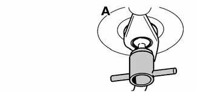

# General (Gearshift Linkage)

> Source: BMW 3 Series (E46) Repair Manual, section 250-1, Gearshift Linkage chapter (PDF pages 441 of 1252).

This repair group covers transmission gearshift and linkage service for both manual and automatic transmission equipped vehicles.

## Special tools

BMW suggests the use of one special tool in the removal of the gear shift lever for manual transmission equipped vehicles.

- Pin wrench BMW 25 1 110

To gain access to the complete gearshift mechanism it is necessary to remove the exhaust system and the driveshaft as described in [180 Exhaust System] and [260 Driveshaft].
