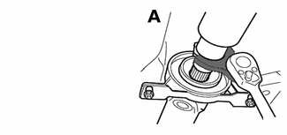
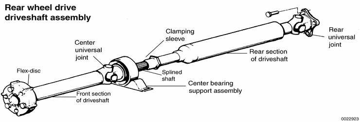
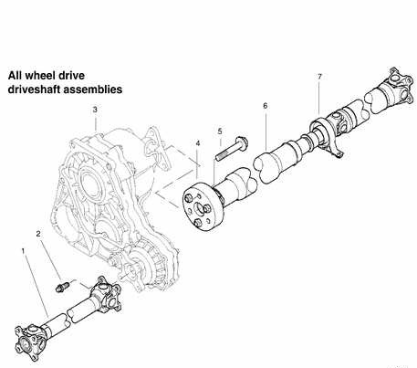
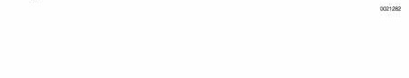

# General (Driveshafts)

> Source: BMW 3 Series (E46) Repair Manual, section 260-1, Driveshafts chapter (PDF pages 450–456 of 1252).

This repair group covers the repair and replacement of driveshafts and driveshaft components. Drive axles are covered in [311 Front Axle Final Drive] and [331 Rear Axle Final Drive].

## Special tools

BMW suggests the use of a special tool in the release of the clamping sleeve which acts as a grease seal for the splined shaft to the rear of the driveshaft center bearing.

- Clamping sleeve adjustment tool BMW 26 1 040

## Front and rear driveshafts

The rear driveshaft is a two-piece unit joined in the center by a sliding splined coupling. This coupling compensates for fore and aft movement of the drive line. The driveshaft is connected to the transmission by a rubber flex-disc and to the rear final drive by a universal joint. It is supported in the middle by a center support bearing. The bearing is mounted in rubber to isolate vibration.

All wheel drive models incorporate two driveshafts. The rear driveshaft is a two-piece unit with splined center coupling much like that of a rear wheel drive model, but it is shorter and connects the transfer case to the rear differential. A short, one-piece driveshaft runs from the transfer case to the front differential. The front driveshaft bolts to the transfer case and differential directly, using no flexible rubber disk.

| No. | Part |
|---|---|
| 1 | Front driveshaft assembly |
| 2 | Torx screw M10, tighten to 70 Nm (52 ft-lb) |
| 3 | Transfer case |
| 4 | Flex disc |
| 5 | Bolt M12, tighten to 100 Nm (74 ft-lb) |
| 6 | Rear driveshaft assembly |
| 7 | Driveshaft center bearing mount |

## Troubleshooting

The source of driveline vibrations and noise can be difficult to pinpoint. Engine, transmission, front and rear axle, or wheel vibrations can be transmitted through the driveshaft to the car body. Noises from the car may be caused by final drive problems, or by faulty wheel bearings, drive axles, or even worn or improperly inflated tires.

> **Note:**
> - For drive axle repair information, see [311 Front Axle Final Drive] or [331 Rear Axle Final Drive].

Driveshaft noise or vibration may be caused by worn or damaged components. Check the universal joints for play. With the driveshaft installed, pull and twist the driveshaft while watching the joint. The BMW specification for play is very small, so almost any noticeable play could indicate a problem.

Check the torque of the fasteners at the flange connections. At the rear driveshaft check the rubber of the flex-disc and center bearing for deterioration or tearing and check for preload at the center bearing with a visual inspection. Check the driveshafts for broken or missing balance weights. The weights are welded tabs on the driveshaft tubes. In addition to inspecting for faulty driveshaft parts, the installed angles of the driveshaft should also be considered.

Further inspection requires removal of the driveshafts. Check the front centering guide on the transmission output flange for damage or misalignment. Also check runout at the transmission or transfer case output flange and output shaft, and at the final drive input flange. Check the bolt hole bores in the flange for wear and elongation.

Driveshaft flange runout (max. allowable)

| Component | Max. allowable |
|---|---|
| Transmission / transfer case output flange, axial play | 0.10 mm (0.004 in.) |
| Transmission / transfer case output flange, radial play | 0.07 mm (0.003 in.) |
| Final drive input flange radial play (measured at driveshaft centering lip) | 0.07 mm (0.003 in.) |

Spin the rear driveshaft center bearing and check for smooth operation without play. Check that the splines of the sliding coupling move freely. Clean and lubricate the splines with molybdenum disulfide grease (Molykote® Longterm 2 or equivalent).

Check the universal joints for wear or binding. If any joint is difficult to move or binds, the driveshaft section should be replaced.

Universal joint play

| Maximum allowable | 0.15 mm (0.006 in.) |
|---|---|

Table a. Driveshaft troubleshooting lists symptoms of driveshaft problems and their probable causes. Most of the repair information is contained within this repair group.

> **Note:**
> - With the driveshaft installed, the actual amount that the universal joints pivot is limited. For the most accurate test, check universal joints in their normal range of movement.

If inspection reveals nothing wrong with the driveshaft, it may need to be rebalanced. This can be done by a speciality driveshaft repair shop. Also, check the alignment of the driveshaft as described below.

> **Note:**
> - Minor driveshaft vibrations can often be corrected simply by disconnecting the driveshaft at the final drive and repositioning it 90, 180 or 270 in relation to the final drive input flange.

Table a. Driveshaft troubleshooting

| Symptom | Probable cause | Corrective action |
|---|---|---|
| Vibration when starting off (forward or reverse). | Incorrect preload of center bearing. | Check preload of center bearing. Readjust preload. |
|  | Center bearing rubber deteriorated. | Inspect center bearing and rubber. Replace if necessary. |
|  | Flex-disc damaged or worn. | Inspect flex-disc. Replace if necessary. |
|  | Engine or transmission mounts faulty. | Inspect engine and transmission mounts. Align or replace, if necessary. |
|  | Front centering guide worn, or driveshaft mounting flanges out of round. | Check front centering guide and replace if necessary. Check runout of driveshaft flanges. |
| Noise during on/off throttle or when engaging clutch. | Universal joints worn or seized. | Check universal joint play and movement. Replace driveshaft if necessary. |
|  | Sliding coupling seized. | Remove driveshaft and check movement of sliding coupling. Clean coupling splines and replace parts as necessary. |
|  | Driveshaft misaligned. | Check driveshaft alignment. |
|  | Final drive components worn or damaged (excessive pinion-to-ring-gear clearance). | Remove final drive and repair. |
|  | Drive axle or CV joint faulty. | Inspect drive axles and CV joints. Repair or replace as necessary. |
| Vibration at 25 to 30 mph (40 to 50 km/h). | Front centering guide worn, or driveshaft mounting flanges out of round or damaged. | Check front centering guide and replace if necessary. Check runout of driveshaft mounting flanges. |
|  | Universal joints worn or seized. | Check universal joint play and movement. Replace driveshaft if necessary. |
|  | Flex-disc damaged or worn. | Inspect flex-disc. Replace if necessary. |
|  | Center bearing rubber deteriorated. | Inspect center bearing. Replace if necessary. |
|  | Sliding coupling seized. | Remove driveshaft and check movement of sliding coupling. Clean coupling splines and replace parts as necessary. |
|  | Misaligned installed position. | Check driveshaft alignment. |
| Vibration, audible rumble over 35 mph (60 km/h). | Front centering guide worn, or driveshaft mounting flanges out of round or damaged. | Check front centering guide and replace if necessary. Check runout of driveshaft mounting flanges. |
|  | Mounting flange bolts loose or holes worn. | Remove driveshaft and check transmission output flange and final drive input flange. Replace if necessary. |
|  | Driveshaft unbalanced. | Check driveshaft for loose or missing balance weights. Have driveshaft rebalanced or replace if necessary. |
|  | Universal joints worn or seized. | Check universal joint play and movement. Replace driveshaft if necessary. |
|  | Sliding coupling seized. | Remove driveshaft and check movement of sliding coupling. Clean coupling splines or replace parts as necessary. |
|  | Incorrect preload of center bearing. | Check preload of center bearing. Readjust if necessary. |
|  | Center bearing faulty. | Replace center bearing. |
|  | Final drive rubber mount faulty. | Inspect final drive rubber mount and replace if necessary. |
|  | Driveshaft misaligned. | Check driveshaft alignment. |
