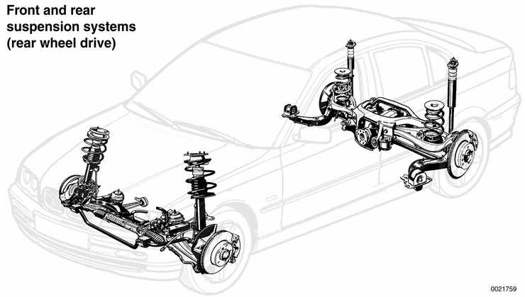
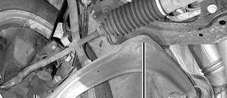
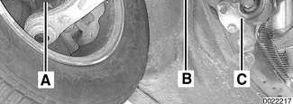
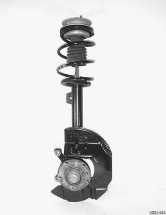
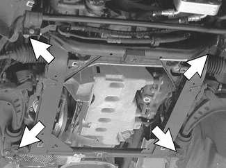
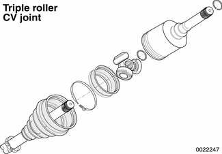
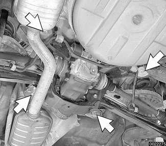

# General (Suspension, Steering and Brakes)

> Source: BMW 3 Series (E46) Repair Manual, section 300-1, Suspension, Steering and Brakes — General chapter (PDF pages 474–480 of 1252).

This section covers general information for front and rear suspension, steering system, and the electronic braking and stability control systems.

## Front suspension

In rear wheel drive cars, the control arm on each side connects the steering arm (A) to mounting points on the subframe (B) and the body frame rail (C). On all wheel drive cars the rear mounting of the control arm is to the subframe.

Each front strut assembly includes a tubular strut housing with an integrated shock absorber and a large coil spring. The upper strut mount includes a coil spring seat and strut bearing. A rubber bump stop limits suspension travel. The steering arm clamps the lower end of the strut assembly. The strut assembly pivots between the upper strut mount bearing and a ball joint on the control arm.

The front suspension is designed with minimum positive steering offset. This geometry contributes to stability when traction is unequal from side to side.

### Front suspension, rear wheel drive cars

The control arms are constructed of forged aluminum. This design lowers the overall weight of the car and reduces the amount of unsprung mass. By reducing unsprung mass, softer, more comfortable springs can be used and accurate handling is maintained.

The three point mounting of each L-shaped control arm precisely controls the front-to-rear and side-to-side position of the strut, while the flexibility of the joints and mounts also allows the movement necessary for suspension travel. The control arm mounting points are designed with anti-dive geometry. This design reduces the normal tendency for the front of the vehicle to dive under hard braking.

Control arm position is fixed, with no adjustment provisions on the control arms for altering front wheel alignment.

A stabilizer bar mounted to both strut housings helps to reduce body roll when cornering.

### Front suspension, all wheel drive

For model year 2001, the E46 Sedan and Sport Wagon are offered with optional all wheel drive. The all wheel drive models are known as 325xi or 330xi.

> **Note:**
> - The internal BMW designation of these models is E46/16.

The all wheel drive system adds approx. 100 kg (220 lbs.) to the weight of the car. Weight distribution is largely unaffected at 52.7% front, 47.3% rear.

The front suspension for all wheel drive vehicles has been redesigned to provide clearance for the front axle differential and drive shafts. All suspension components are constructed of steel. The front subframe consists of two square frame sections welded to two tubes to form a box structure. Four bolts (arrows) attach it to the undercarriage of the vehicle.

The steel control arms, smaller than the aluminum arms used on rear wheel drive models, attach at the rear to the subframe. The control arm inner ball joints are bolted to the subframe. The hydraulic engine mounts are different from the rear wheel drive version and have also been relocated to provide front axle clearance.

The front stabilizer bar has been increased in diameter to accommodate the additional weight. See [Table a].

The struts are shorter than the rear wheel drive version. Reinforcement plates have been added between the strut upper mounting and the strut towers to prevent sheet metal deformation when traveling on poor road surfaces. The spring travel of the E46 all wheel drive is approximately 20 mm (3/4 in.) less than the rear wheel drive version. The shorter front axle spring travel is due to the limited angle of deflection of the front axle shafts.

Each front drive axle shaft has a conventional constant velocity (CV) joint at the outboard end and a triple roller bearing CV joint at the inboard end. The right inner joint shaft is supported by a bearing pedestal bolted to the oil pan. The shaft extends through the engine oil pan into the front differential.

The front axle differential, bolted to the left side of the engine oil pan, is driven by a 40 mm (1.57 in.) single piece driveshaft. Universal joints are located at both ends of the driveshaft.

The sport suspension option is not available for all wheel drive models.

## Steering

The variable-assist power steering system consists of an engine-driven hydraulic pump, a rack-and-pinion type steering gear, and connecting linkage to the road wheels. E46 models utilize an engine-speed dependent variable effort steering system. At low speeds, maximum power assist is provided to ease parking and city driving. At high speeds, assist is reduced to ensure stability.

The steering linkage connects the rack-and-pinion unit through tie rods to the steering arms. The tie rod ends allow the wheels to pivot and react to suspension travel.

On all wheel drive models, the rack and pinion steering is constructed with a larger diameter piston than the rear wheel drive version. This is necessary to counter the additional drag of the all wheel drive system and the wider standard wheels and tires.

The lower steering column in all wheel drive models connects to the steering rack via a universal joint, whereas there is flexible ("guibo") joint on the rear wheel drive models. The turning radius of the all wheel drive vehicle is 35.8 feet, 1.4 feet greater than the rear wheel drive vehicle.

## Rear suspension

The rear suspension subframe (final drive carrier) is the main mounting point for the differential housing and rear suspension components. It is bolted to the vehicle undercarriage using four large rubber bushings (arrows).

Trailing arms locate the rear wheels and anchor the springs, shock absorbers and stabilizer bar. Drive axles with constant-velocity (CV) joints at both ends transfer power from the differential to the road wheels. The differential is mounted to the subframe through rubber mounts and bushings to help isolate drivetrain noise and vibration.

In all wheel drive models, the rear suspension and the rear differential have the same layout as the rear wheel drive version.

The rear suspension travel of the E46 all wheel drive is approx. 17 mm (0.67 in.) less than the rear wheel drive version. The reason for the reduced travel in the rear is to prevent excessive body roll as a result of the higher body profile.

The rear stabilizer bar diameter has been increased to accommodate the additional vehicle weight. See [Table a].

Table a. E46 stabilizer bars

| Model | Front diameter | Rear diameter |
|---|---|---|
| Rear wheel drive | 23.0 mm (0.906 in.) | 18 mm (0.709 in.) |
| All wheel drive | 23.5 mm (0.925 in.) | 20 mm (0.787 in.) |
| Sport suspension (n/a on awd) | 24.0 mm (0.945 in.) | 19 mm (0.748 in.) |

## Brakes

E46 cars are equipped with power disc brakes with integral antilock brakes (ABS). The parking brake is a dual-drum system integrated with the rear brake rotors.

Power assist is provided by a vacuum booster when the engine is running. The brake pedal pushrod is connected directly to the master cylinder, so failure of the vacuum booster does not normally result in total brake failure.

Each disc brake uses a caliper with a single hydraulic cylinder. Brake pads in the left front and right rear contain wear sensors. When the pads need replacement, the sensors illuminate a light on the dashboard.

## Tires and wheels

Tire size is critical to the proper operation of the anti-lock brake system and traction control system. Several different styles of wheels in 15, 16, and 17 inch diameters are available from an authorized BMW dealer.

On all wheel drive cars, standard wheel size is 17 x 7.0 to ensure there is enough room for the front axles and brakes. Tire size is 205/50 R17.

Tire and rim size applications are listed in [Table b]. Rim and tire sizes.

> **Note:**
> - Aftermarket wheels should be selected with care. Improperly fitted wheels can contact and damage suspension, brake or body components and may adversely affect vehicle stability.

Table b. Rim and tire sizes

| Model | Standard rim size | Standard tire size | Option rim size | Option tire size |
|---|---|---|---|---|
| 323i | 15 x 6.5 | 195/65R 15 | 16 x 7 | 205/55R 16 |
| 323Ci | 16 x 7 | 205/55R 16 | 17 x 8 | 225/45R 17 |
| 325i/Ci | 16 x 7 | 205/55R 16 | 17 x 8 | 225/45R 17 |
| 328i | 16 x 7 | 205/55R 16 | 17 x 8 | 225/45R 17 |
| 328Ci | 16 x 7 | 205/55R 16 | 17 x 7.5/8.5 | 225/45R 17, 245/45R 17 |
| 330i/Ci | 17 x 7 | 205/50R 17 | 17 x 7.5/8.5 | 225/45R 17, 245/45R 17 |
| 325xi | 17 x 7 | 205/50R 17 |  |  |
| 330xi | 17 x 7 | 205/50R 17 |  |  |

Value cells are merged in print across 323Ci/325i/Ci/328i and across 325xi/330xi; values repeated here (bbox-verified). Option cells empty for xi models in print.
