# General (Front Suspension)

> Source: BMW 3 Series (E46) Repair Manual, section 310-1, Front Suspension chapter (PDF pages 511–515 of 1252).

This repair group covers the repair and replacement of components that make up the front suspension of E46 cars. See [300 Suspension, Steering and Brakes-General] for a description of the front suspension and components, as well as specification for setting ride height.

## Special tools

Special service tools are required for most of the work described in this repair group. In addition to the tools depicted in the illustrations, a variety of press tools are necessary for control arm bushing replacement. Read the procedures through before beginning any job.

- Engine support bracket BMW 00 0 200/00 0 205

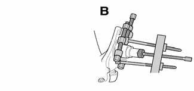

- Bearing puller BMW 00 7 500/31 2 106

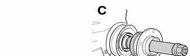

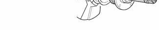

- Wheel bearing installation tool BMW 31 2 110

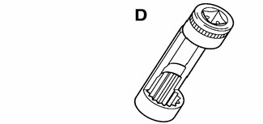

- Upper strut nut removal socket BMW 31 2 210

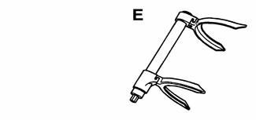

- Front coil spring compressor BMW 31 3 120

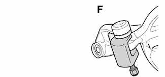

- Ball joint puller (all wheel drive) BMW 32 2 040

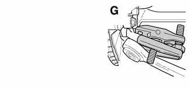

- Ball joint puller BMW 32 3 090

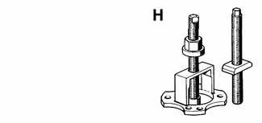

- Outer CV joint removal tool BMW 33 2 111/116/117

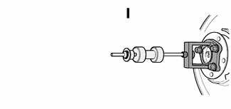

- Slide hammer with adapter BMW 33 4 201/202/203 33 2 116

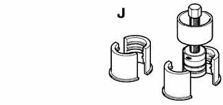

- Inner bearing race puller set BMW 33 4 400

## Front suspension construction

Some front suspension components are constructed of weight saving materials. For example, the control arms (in rear wheel drive models) are forged aluminum. This allows for weight reduction in the car, as well as a lower unsprung mass for better handling. However, the aluminum construction prevents removal or replacement of the pressed-in ball joints.

> **WARNING!**
> - Physical safety could be impaired if procedures described here are undertaken without the proper service tools and equipment. Be sure to have the right tools on hand before beginning any job.
> - Do not reuse self-locking nuts or bolts. They are designed to be used only once and may fail if reused. Always replace self-locking fasteners any time they are loosened or removed.
> - Do not install bolts and nuts coated with undercoating wax, as the correct tightening torque cannot be assured. Always clean the threads with solvent before installation, or install new parts.
> - Do not attempt to weld or straighten any suspension components. Replace damaged parts.

> **CAUTION!**
> - Due to the aluminum construction of the control arms, great care must be taken when working on and around the front suspension:
> - When replacing any damaged front end components, always check the condition of the control arms
> - Do not clean control arms with wire brushes made of brass or iron. Only use brushes made of stainless steel.
> - Do not expose control arms to temperatures exceeding 80°C (176°F); sparks created by grinding; battery acid or other highly corrosive materials; or steel welding splashes.

## Front suspension assembly (6 cylinder models)

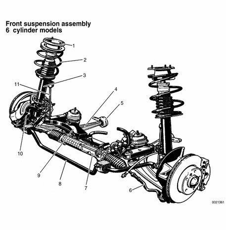

| No. | Part |
|---|---|
| 1 | Upper strut mount |
| 2 | Coil spring |
| 3 | Strut assembly |
| 4 | Control arm |
| 5 | Control arm bushing and mount |
| 6 | Tie rod |
| 7 | Steering rack |
| 8 | Front stabilizer bar |
| 9 | Front suspension subframe |
| 10 | Steering arm |
| 11 | Stabilizer bar link |
