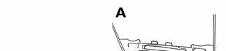
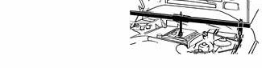
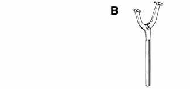
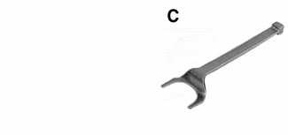
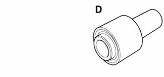
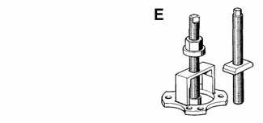
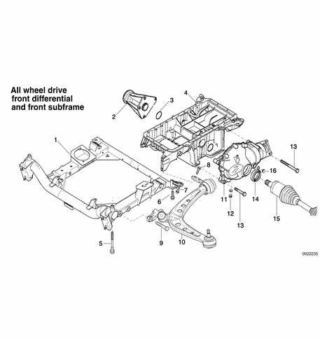

# General (Front Axle Final Drive)

> Source: BMW 3 Series (E46) Repair Manual, section 311-1, Front Axle Final Drive chapter (PDF pages 563–567 of 1252).

This repair group covers the service and replacement of components that make up the front drive axle for vehicles equipped with all wheel drive. This drive system is integrated into the front suspension of these models.

For a general description of the front suspension and components, see [300 Suspension, Steering and Brakes-General].

Some procedures will require you to also refer to the following repair groups:

- [260 Driveshaft]
- [270 Transfer Case]
- [310 Front Suspension]
- [340 Brakes]

Procedures involving the internal repairs of the front differential are not included in this manual.

## Special tools

BMW recommends special tools for the removal of the drive axles as well as the installation of the front differential input drive flange seal. Commonly available pullers and drifts can often be substituted for the specified tools. Read the procedures through before beginning any job.

- Engine support bracket BMW 00 0 200

- Transmission flange holder BMW 23 0 020

- Inner CV joint puller BMW 31 1 170

- Impact drift BMW 31 5 130

- Outer CV joint removal tool BMW 33 2 111/116/117

## System description

The front axle final drive unit is integrated into the engine oil pan on all wheel drive equipped models. The front differential and the right side bearing pedestal bolt to each side of a modified oil pan. Power is transmitted to the front differential from the transfer case via a driveshaft, and out to front drive hubs through two drive axles.

| No. | Part |
|---|---|
| 1 | Front subframe |
| 2 | Right axle bearing pedestal |
| 3 | Sealing O-ring |
| 4 | Oil pan |
| 5 | Bolt M12 (always replace), 8.8 grade tighten to 77 Nm (57 ft-lb), 10.9 grade tighten to 110 Nm (81 ft-lb), 12.9 grade tighten to 105 Nm (77 ft-lb) |
| 6 | Bolt M12 (always replace), tighten to 110 Nm (81 ft-lb) |
| 7 | Bolt M10 (always replace), tighten to 59 Nm (44 ft-lb) |
| 8 | Bolt M10 (always replace), tighten to 59 Nm (44 ft-lb) |
| 9 | Bolt M12, tighten to 77 Nm (57 ft-lb) |
| 10 | Front control arm with ball joint and rear mounting bracket |
| 11 | Front differential |
| 12 | Front differential drain plug, tighten to 65 Nm (48 ft-lb) |
| 13 | Bolt M10, tighten to 45 Nm (33 ft-lb) |
| 14 | Drive axle radial seal |
| 15 | Drive axle |
| 16 | Front differential fill plug, tighten to 65 Nm (48 ft-lb) |
