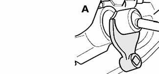
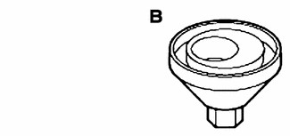
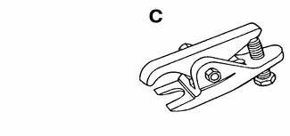
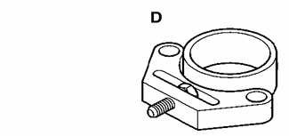
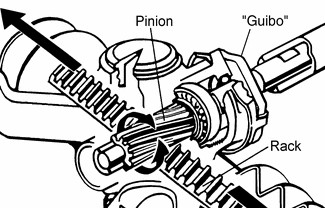
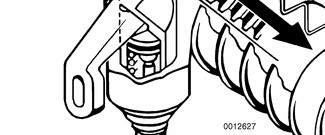

# General (Steering and Wheel Alignment)

> Source: BMW 3 Series (E46) Repair Manual, section 320-1, Steering and Wheel Alignment chapter (PDF pages 593–596 of 1252).

This repair group covers steering wheel and column removal and steering system service, including wheel alignment information.

> **Note:**
> - Ignition lock cylinder replacement is covered in this section.
> - For information on steering column mounted switches including the ignition switch, see [612 Switches].

## Special tools

Some special tools are necessary to carry out the repairs and adjustments required for steering service and wheel alignment. Be sure to read the procedures through before starting work on the vehicle.

- Inner tie rod removal tool BMW 32 2 110

- Rear toe adjusting tool BMW 32 3 030

- Tie rod end removal tool BMW 32 3 090

- Front camber adjusting tool BMW 32 3 140

## Steering system

The variable-assist power steering system consists of an engine-driven hydraulic pump, a rack-and-pinion steering rack assembly with an integral hydraulic control valve, and connecting linkage to the road wheels.

At low speeds, maximum power assist is provided to ease parking and city driving. At high speeds, assist is reduced to ensure stability. The power steering system varies assist based on engine speed.

Power assist is provided by a belt-driven pump on the lower left front of the engine, just below the alternator. The steering rack is bolted to the front subframe underneath the engine. The steering wheel connects to the rack via a telescoping column which incorporates a rubber coupling ("guibo") to dampen vibration and noise.

The power steering fluid is fed from the fluid reservoir to the pump and to the rack via rubber/metal hoses. The return line from the steering rack to the reservoir loops into the airstream in front of the vehicle and is used as a steering fluid cooler.

The steering rack and linkage require no maintenance other than alignment and periodic inspection for worn components. The rubber rack boots and tie-rod end boots should be inspected periodically for tears or damage and replaced if necessary.

> **WARNING!**
>
> - The BMW airbag system (MRS II) is complex. Special precautions must be observed when servicing the system. Serious injury may result if system service is attempted by persons unfamiliar with the BMW airbag system and its approved service procedures. BMW specifies that all inspection and service should be performed by an authorized BMW dealer.
> - The BMW E46 is equipped with an airbag mounted in the steering wheel. The airbag is an explosive device and should be treated with extreme caution. Always follow the airbag removal procedure as outlined in [721 Airbag System (SRS)].
> - BMW airbags are equipped with a back-up power supply inside the MRS II control module. A 5 second waiting period should be observed after the battery cable has been disconnected. This will allow the reserve power supply to discharge.
> - Do not reuse self-locking nuts. They are designed to be used only once and may fail if reused. Always replace them with new locking nuts.
> - Do not install bolts and nuts coated with undercoating wax, as correct tightening torque cannot be assured. Always clean the threads with solvent before installation, or install new parts.
> - Do not attempt to weld or straighten any steering components. Always replace damaged parts.

> **Note:**
> - The airbag system is traditionally referred to as Supplemental Restraint System (SRS). The BMW version of SRS used in 1999 to 2001 E46 models is known as the Multiple Restraint System (MRS II).
