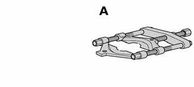
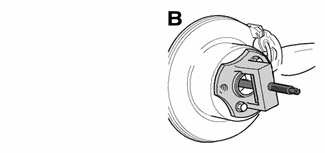
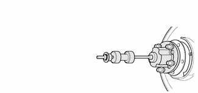
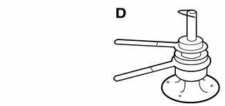
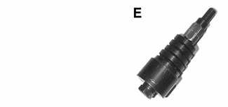

# Rear Suspension — General

> Source: BMW 3 Series (E46) Repair Manual, section 330-1, Rear Suspension chapter (PDF pages 623–625 of 1252).

This repair group covers removal and replacement of E46 rear suspension components.

A general description of the rear suspension, ride height specifications and a troubleshooting guide can be found in [300 Suspension, Steering and Brakes-General].

Additional component replacement information specific to all wheel drive models can be found in the following repair groups:

- [310 Front Suspension]
- [311 Front Axle Final Drive]
- [331 Rear Axle Final Drive]

Alignment information can be found in [320 Steering and Wheel Alignment].

## Special tools

Special service tools are required for some of the work described in this repair group. Most of these tools are specialized presses and pullers that might be replaced by standard pullers of various sizes.

Read the procedures through before beginning any job.

- Bearing splitter BMW 00 7 500

- Drive axle press BMW set 33 2 115/116/119

- Flange puller BMW set 33 2 116/4 201/4 202/4 203

- Inner bearing race puller BMW set 33 4 400

- Wheel bearing extractor B90 (Source: Baum Tools Unlimited)

## Rear suspension description

BMW uses an independent rear suspension consisting of an upper and a lower control arm and a trailing arm on each side. The weight of the car is supported by coil springs. There is a rear stabilizer bar attached to the upper control arms. Gas-pressure shock absorbers round out the rear suspension.

The rear subframe (final drive carrier) supports the rear differential and provides mounting points for the upper and lower control arms. The upper control arm on each side provide the lower spring perch for the coil spring. The upper and lower control arm on each side are attached to the trailing arm. The trailing arms contain the wheel bearings for the rear drive hubs. The rear brake calipers are bolted to the trailing arms.

E46 Rear suspension

1. Shock absorber
2. Differential housing
3. Rear subframe (final drive carrier)
4. Upper control arm
5. Trailing arm
6. Trailing arm bracket
7. Coil spring
8. Lower control arm
9. Stabilizer bar
