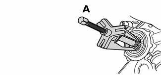
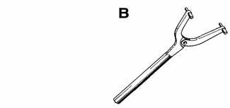
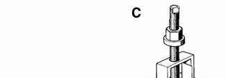
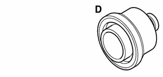
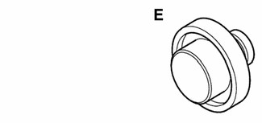

# Rear Axle Final Drive — General

> Source: BMW 3 Series (E46) Repair Manual, section 331-1, Rear Axle Final Drive chapter (PDF pages 656–657 of 1252).

This repair group covers removal and repair information for the rear drive axle shafts, CV joints and CV joint boots. Also covered is rear differential (final drive) removal procedures and seal replacement information.

Internal repairs of the differential assembly are not covered in this manual.

## Special tools

BMW recommends some special tools for the removal of the drive axles as well as the installation of rear differential input and output drive flange seals. Some common pullers and drifts can often be substituted for these tools.

- Radial seal puller BMW 00 5 010

- Flange counterhold tool BMW 23 0 020

- Drive axle puller BMW 33 2 110

- Output flange seal drift BMW 33 3 400

- Input flange seal drift BMW 33 3 430

