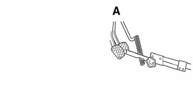
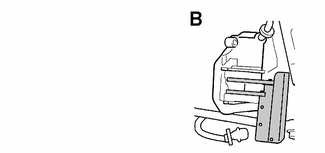
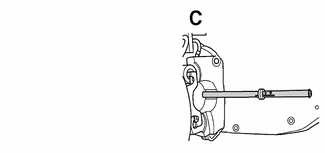
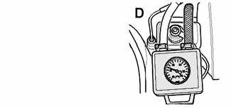
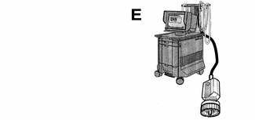
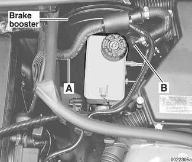

# Brakes — General

> Source: BMW 3 Series (E46) Repair Manual, section 340-1, Brakes chapter (PDF pages 675–683 of 1252).

This repair group covers brake service:

- Brake pads, calipers, and disks
- Master cylinder, brake booster, and parking brake
- ABS/ASC and ABS/DSC component replacement

ABS/ASC and ABS/DSC system descriptions are covered in [300 Suspension, Steering and Brakes-General].

## Special tools

BMW requires the use of either the DIS or the MoDiC diagnostic tool to safely and completely bleed the braking and traction control systems. Read all procedures through before beginning a job.

- Pedal prop

- Brake caliper piston tool BMW 34 1 050

- Brake pad lining gauge BMW 34 1 260

- Vacuum tester BMW 34 3 100

- Factory diagnostic tool DISplus or MoDiC

## E46 brake system

BMW E46 models are equipped with vacuum power-assisted four-wheel disc brakes with an integral Antilock Brake System (ABS). Single-piston calipers act on vented front and rear rotors. A brake pad wear sensor for each axle indicates when brake pads need replacement. The dual drum-type parking brake system is integrated with the rear brake rotors.

## Electronic braking and stability control

E46 models were introduced with Automatic Stability Control (ASC). ASC is a computer controlled traction control system that uses the ABS system in conjunction with engine management controls to control wheel spin and maintain vehicle stability while braking. Added midway through the 1999 model year was Dynamic Stability Control (DSC). This system uses ASC technology, but implements wheel speed modulation throughout all stages of driving. DSC is able to reduce understeer by applying differing amounts of braking force to each wheel, as well as overriding the engine management system during hard cornering.

A summary of distinguishing characteristics of the various systems is shown in [Table a]. E46 Electronic braking and stability control systems. For ABS system and component descriptions, see [300 Suspension, Steering and Brakes-General].

> **WARNING!**
> - A car with electronic stability control is still subject to normal physical laws. Avoid excessive speeds for the road conditions encountered.

Table a. E46 Electronic braking and stability control systems

| | Year (model) | System (manufacturer) | Identifiers |
|---|---|---|---|
| ASC | 1999 - 2000 | Automatic Stability Control (Teves MK 20) | Control module/hydraulic unit under master cylinder. No precharge pump |
| DSC | 1999 - 2000 | Dynamic Stability Control (Teves MK 20 DSC) | Control module/hydraulic unit in right rear compartment of engine bay. Precharge pump under master cylinder |
| DSC | 2001 (rear wheel drive) | Dynamic Stability Control (Teves MK 60 DSC) | Control module/hydraulic unit mounted under master cylinder. No precharge pump |
| DSC | 2001 (all wheel drive) | Dynamic Stability Control (Bosch DSC III 5.7) | Control module/hydraulic unit in right rear compartment of engine bay. Precharge pump under master cylinder |

## Troubleshooting

Brake performance is mainly affected by three things:

- Level and condition of brake fluid
- The system's ability to create and maintain hydraulic pressure
- Condition of friction components

Air in the brake fluid will make the brake pedal feel spongy during braking or will increase the brake pedal force required to stop. Fluid contaminated by moisture or dirt can corrode the system. Inspect the brake fluid inside the reservoir. If it is dirty or murky, or is more than two years old, the fluid should be replaced.

Visually check the hydraulic system starting at the master cylinder. To check the function of the master cylinder hold the brake pedal down hard with the engine running. The pedal should feel solid and stay solid. If the pedal slowly falls to the floor, either the master cylinder is leaking internally, or fluid is leaking externally. Check all brake fluid lines and couplings for leaks, kinks, chafing and corrosion. If no leaks can be found, the master cylinder is faulty and should be replaced.

Check brake booster:

- Remove vacuum hose (A) from brake booster and install BMW special tool 34 3 100 between connection and hose on non-return valve (B).
- Start engine and check build-up of partial vacuum. Switch engine off.
- Press brake pedal to set partial vacuum of no more than 0.8 bar (11.6 psi). Wait for vacuum value to stabilize.
- When pedal is released, partial vacuum should not drop by more than 0.06 bar (0.8 psi) over 1 hour.
- If vacuum values are not reached:
  - Check connections of vacuum hoses.
  - Replace vacuum non-return valve (B).
  - Check seal between brake booster and master cylinder.
  - If values still cannot be reached, brake booster must be replaced.

Worn or contaminated brake pads will cause poor braking performance. Oil-contaminated or glazed pads will cause stopping distances to increase. Inspect the rotors for glazing, discoloration and scoring. Steering wheel vibration while braking at speed is often caused by warped rotors, but can also be caused by worn suspension components.

When troubleshooting, keep in mind that tire inflation, wear and temperature can all have an effect on braking. See [300 Suspension, Steering and Brakes-General] for additional suspension and brake system troubleshooting.

[Table b]. Brake system troubleshooting lists symptoms of brake problems, probable causes, and suggested corrective actions. Unless it is noted otherwise, relevant repairs are described later in this repair group.

> **WARNING!**
> - All E46 cars require special BMW service equipment to properly bleed either the ABS/ASC or the ABS/DSC system. For safety reasons, the brake system on these cars must not be bled without the use of a factory diagnostic computer.
> - Semi-metallic and metallic brake friction materials in brake pads or shoes may produce dangerous dust.
> - Brake fluid is poisonous, corrosive and dangerous to the environment. Wear safety glasses and rubber gloves when working with brake fluid. Do not siphon brake fluid with your mouth. Immediately clean fluid spilled on painted surfaces and wash with water, as brake fluid will remove paint.
> - Always use new brake fluid from a fresh, unopened container. Brake fluid will absorb moisture from the air. This can lead to corrosion problems in the braking system, and will also lower the brake fluid's boiling point.
> - Dispose of brake fluid properly.
> - Do not reuse self-locking nuts, bolts or fasteners. They are designed to be used only once and may fail if reused. Always replace them with new self-locking fasteners.

Table b. Brake system troubleshooting

| Symptom | Probable cause | Repairs |
|---|---|---|
| Brake squeal | Incorrectly installed brake pads or parking brake shoes, or brake parts. | Check component installation. Check/replace anti-rattle springs. |
|  | Brake pad carriers dirty or corroded | Remove brake pads and clean calipers. |
|  | Brake pads heat-glazed or oil-soaked | Replace brake pads. Clean rotors. Replace leaking calipers as required. |
|  | Wheel bearings worn (noise most pronounced when turning) | Replace worn bearings. See [310 Front Suspension] or [330 Rear Suspension]. |
| Pedal goes to floor when braking | Brake fluid loss due to system leaks | Check fluid level and inspect for signs of leakage. |
|  | Master cylinder or electronic control system faulty | Replace master cylinder. Diagnose electronic control system using factory or compatible diagnostic tool. |
| Low pedal after system bleeding | Master cylinder faulty | Replace master cylinder. |
| Pedal spongy or brakes work only when pedal is pumped | Air in brake fluid | Bleed system using factory or compatible diagnostic tool. |
|  | Master cylinder or electronic control system faulty | Replace master cylinder. Diagnose system using factory or compatible diagnostic tool. |
| Excessive braking effort | Brake pads wet | Use light pedal pressure to dry pads while driving. |
|  | Brake pads heat-glazed or fluid-soaked | Replace brake pads and rotors. Replace leaking calipers. |
|  | Vacuum booster or vacuum hose connections to booster faulty | Inspect vacuum lines. Test vacuum booster and replace as required. Test vacuum non-return valve for one-way flow. |
| Brakes pulsate, chatter or grab | Warped brake rotors | Resurface or replace rotors. |
|  | Brake pads worn | Replace brake pads. |
|  | Brake pads heat-glazed or oil-soaked | Replace brake pads. Clean rotors. Replace leaking calipers. |
|  | Incorrect tire pressures or worn tires | Inspect tire condition. Check and correct tire pressures. |
| Uneven braking, car pulls to one side, rear brakes lock | Brake pads on one side of car heat-glazed or fluid-soaked | Replace brake pads. Clean rotors. Replace leaking calipers. |
|  | Caliper or brake pads binding | Clean and recondition brakes. |
| Brakes drag, bind or overheat | Worn suspension components | Inspect for worn or damaged suspension components. See [310 Front Suspension] or [330 Rear Suspension]. |
|  | Brake caliper or brake pads binding | Clean or replace caliper. |
|  | Master cylinder or electronic control system faulty | Replace master cylinder. Diagnose electronic control system using factory or compatible diagnostic tool. |
