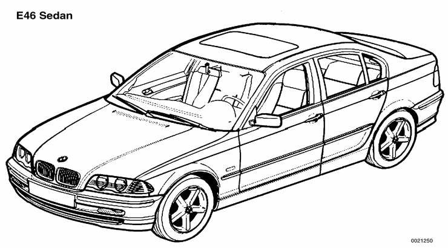

# General (Body)

> Source: BMW 3 Series (E46) Repair Manual, section 400-1, Body — General chapter (PDF pages 721 of 1252).

This section covers system descriptions and general information for the repair groups found in 4 Body and 5 Body Equipment.

