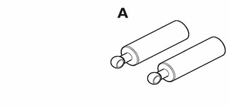

# Fenders, Engine Hood — General

> Source: BMW 3 Series (E46) Repair Manual, section 410-1, Fenders, Engine Hood chapter (PDF pages 742 of 1252).

This repair group covers replacement of the front fenders and removal and installation of the engine hood.

> **Note:**
> - The body is painted at the factory after assembly. Realignment of body panels may expose unpainted metal. Paint all exposed metal once the work is complete.

## Special tools

Most body repairs can be performed using regular automotive service tools. Some BMW special tools are required to set body pieces into the service positions.

Service position hood props BMW 51 2 160

