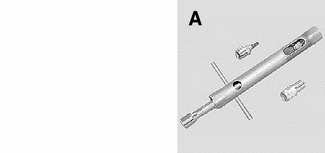
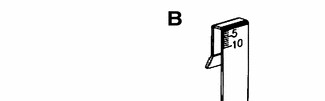
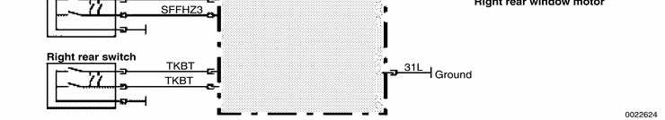
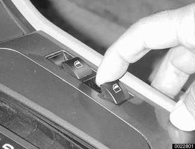
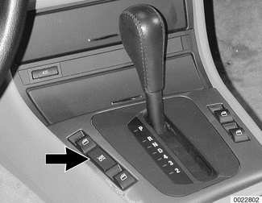
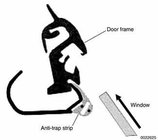
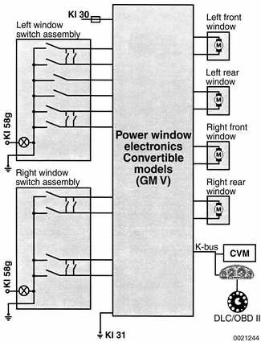

# General (Door Windows)

> Source: BMW 3 Series (E46) Repair Manual, section 512-1, Door Windows chapter (PDF pages 797–804 of 1252).

This repair group covers door glass, window regulator and power window motor repair information.

> **CAUTION!**
> - All E46 models are equipped with side-impact airbags in the front doors. Some models are also equipped with airbags in the rear doors. Be sure to read the airbag warnings and cautions in [721 Airbag System (SRS)].

Electric window switch replacement is covered in [612 Switches].

The windshield, rear window, fixed rear door glass, and cargo compartment glass (Sport Wagon only) are bonded using special adhesives and tools. It is recommended that bonded glass replacement be done by an authorized BMW service facility or an automotive glass installer.

## Special tools

Some window repair operations require the use of special tools.

2-door window adjustment tool BMW 41 6 120

Window height gauge BMW 51 3 080

## Power windows

Power window features in E46 models include:

- Control of the front and rear door window motors is carried out directly by the General Module (GM V).
- One-touch operation in both directions on all four windows, where applicable.
- Cable type window regulator used for all door windows.
- Anti-trap protection is provided by the pressure sensitive finger guard.
- The window switch is pulled up to raise the window and pushed down to lower.
- 4-door models: Each rear door has a single window switch located in the door handle trim. The rear window switches can be deactivated by pressing the child lock-out switch in the center console.
- Convenience closing/opening of the windows from the driver's lock cylinder or convenience opening only from the FZV remote key. FZV operation can be owner customized with the Car Memory function. See [515 Central Locking and Anti-theft].
- After the ignition is switched off, electric windows can be operated until a door is opened or until 16 minutes has elapsed.
- The GM V bases window motor end position on current draw (load). There is a maximum window motor run time of 8 seconds. The motor is then switched off even if the end position load sensor fails.

### Power window electronics (GM V) Sedan and Sport Wagon

## Window switches

The push-pull type window switch provides the GM V with a coded ground signal. Holding a switch at the first detent provides a single ground signal on one wire requesting the GM V to open the window. When released, the ground signal is removed and the window motor stops.

Momentarily pushing the switch to the second detent and releasing provides an additional ground signal on the second wire requesting "one touch mode". The GM V lowers the window automatically until it reaches the end position.

The switch functions in the same manner for window closing but the ground signal sequence is reversed.

> **Note:**
> - In Coupe models, the rear windows switches are used for operating the rear swing-out vent windows.

Electric window switch replacement is covered in [612 Switches].

## Rear window child lockout switch

In 4-door models, the rear window child lockout switch (**arrow**) is incorporated in the driver's window switch block to the left of the shifter. When activated, it provides a constant ground signal to the GM V, preventing the windows from being operated from the rear door switches.

The lockout switch ground signal is overridden by the GM V if a passive safety system (MRS) crash signal is received.

> **Note:**
> - In Convertible models the four-window control switch is in the position occupied by the rear window lockout switch in 4-door models.

## Power window motors

The window motors are mounted on cable regulators. The window motor control circuit consists of two wires for operating the motor in both directions. The motors are activated by relays in the GM V. The relays provide either power or ground depending on the direction of window travel. The GM V controls the polarity based on a request to run the window from a window switch or a convenience opening/closing signal.

## Convenience opening/closing

The GM V provides the convenience open/close feature, providing control of the power windows (and sunroof) from outside the vehicle with the key in the driver's door lock. The FZV (remote key) provides the same function for window opening only.

Anti-trap protection is active during convenience closing from the driver's door lock.

If the GM receives a request to operate convenience closing or opening for more than 110 seconds, the function is deactivated and a fault code is stored.

## Window anti-trap protection

In 4-door models, a rubber pressure guard located at the top edge of each door frame consists of two contact strips that close when subjected to pressure. When the contact strip closes (for example, a hand is trapped between the top of the window and the door frame), an anti-trap signal is sent to the GM V. The window immediately (within 10 milliseconds) reverses direction. This feature does not require initialization.

The E46 pressure sensor finger guard has a resistance of 3 KΩ and it is monitored for open circuit. When pressed, the monitored resistance changes to < 1KΩ. If anti-trap protection becomes faulty the one touch window closing will not function.

Window anti-trap protection is only active in the one touch and convenience close modes of operation. If the window switch is pulled and held, anti-trap protection will not function.

## Window motor limit stop function

If repeated window activation (up/down cycles) exceeds one minute, the GM V deactivates the internal relays and disregards any further up/down requests. The GM V provides motor activation after a short duration but not for the full one minute monitoring cycle. The GM V monitors the number of times a window motor is activated. It counts each cycle and stores the number in memory. After the stop function limit is reached and the window motor is deactivated, the GM V slowly reverses the stored count of activation until the stored number equals 0, thus allowing the window motor to cool down.

## Convertible windows

A central power window switch is located in the Convertible console between the left side window switches. This switch allows all four windows to be opened with one-touch operation and closed if the switch is held.

The Convertible is not supplied with window anti-trap protection. Therefore only the driver's window allows one touch closing.

When the convertible top is opened, the power windows are lowered for approx. 1.5 seconds to ensure clearance for the top. Once the top is stored in the storage compartment, the windows will close again if the top switch is held in the open position.

> **WARNING!**
> - Always wear hand and eye protection when working with broken glass.
> - If a window is broken, all of the glass bits should be vacuumed out of the door cavity. Use a blunt screwdriver to clean out any remaining glass pieces from the window guide rails.
> - When servicing the door windows, the harness connector to the window regulator should always be disconnected to prevent pinching fingers in the moving window mechanism.
