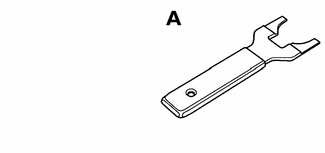
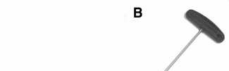

# General (Central Locking and Anti-Theft)

> Source: BMW 3 Series (E46) Repair Manual, section 515-1, Central Locking and Anti-Theft chapter (PDF pages 847–848 of 1252).

This section covers repair information for door, trunk and cargo compartment locks and central locking. Also covered are Electronic Immobilization System (EWS) and anti-theft alarm (DWA).

Keep in mind that E46 cars are equipped with sophisticated and self-diagnostic electrical systems. When experiencing malfunctions relating to central locking or anti-theft systems, it is recommended that the system be diagnosed using the BMW service tester DIS or MoDiC or equivalent. An advanced diagnostic scan tool can usually pinpoint electrical faults quickly and safely. Consult an authorized BMW dealer.

> **Note:**
> - Additional general electrical information can be found in [610 Electrical Component Locations and Electrical Wiring Diagrams].

## Special tools

A few special tools may be necessary for repairs in this section.

- Ring antenna removal tool BMW 61 3 300
- Front door lock adjustment tool 4 mm Allen wrench

