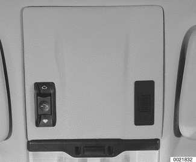
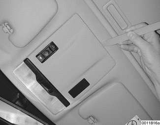
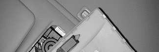
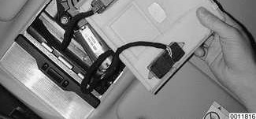
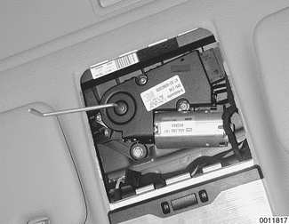
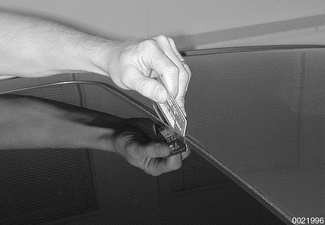
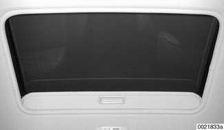
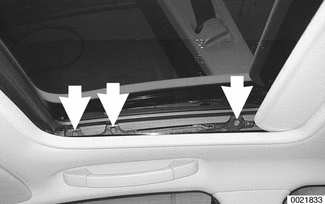

# General (Sunroof)

> Source: Bentley *BMW 3 Series (E46) 1999–2005 (M3) Repair Manual*, section 540-1 (PDF pages 911–915 of 1252).

This repair group covers the slide-tilt sunroof assembly. Component locations, initialization, sunroof panel replacement, and sunroof height adjustment are covered. Replacement of the cable assembly or frame require that the headliner be removed. Removal and repair of the sunroof assembly and other components inside the roof cavity is beyond the scope of this manual.

## Sunroof electronic controls, initializing

Initialize the sunroof in the following situations:

- Malfunctions such as lack of one-touch function, lack of comfort opening/closing or lack of safety (anti-trapping) features
- If sunroof motor has been removed and reinstalled
- If power supply to the sunroof has been interrupted
- If repairs have been performed on the slide/tilt mechanism

### Normalization

During normalization the mechanical end positions of the sunroof are detected and stored by the General Module (GM V).

- Press and hold sunroof switch in "lift" direction.

- After reaching end position, keep switch pressed for approximately 20 seconds longer.
- The sunroof motor will briefly jerk upwards, signalling normalization is complete.

### Characteristic curve

The characteristic resistance curve of the E46 sunroof is learned using coding software. This resets the safety (anti-trapping) feature. See your BMW dealer service department.

## Sunroof panel, emergency closing

- Remove access panel from below sunroof motor by gently prying at the rearmost edge with a plastic tool.

- Disconnect the electrical connections and lay switch panel aside.

- Insert hex key into drive in sunroof motor, and turn hex key to manually close sunroof.

> **Note:** The hex key for manually (emergency) closing the sunroof can be found in the tool kit located in the trunk lid (sedan, coupe and convertible) or under the cargo area floor panel (Sport Wagon).

## Sunroof panel, adjusting

> **Note:** Be sure to check drains in front corners of sunroof carrier if water is entering car through headliner.

The sunroof is controlled by a set of cables that move the sunroof panel along guide rails when the motor is operated. The sunroof can be adjusted without removing it from the car.

The sunroof panel should be adjusted under the following circumstances:

- Sunroof misaligned with roof
- Sunroof does not close squarely
- Wind noise at high speeds (sunroof closed)
- Sunroof has been removed

Whenever the top of the closed sunroof becomes misaligned with the roof of the car, if it does not close squarely, if there are wind noises at speed, if there are water leaks, or if the sunroof has been removed.

Correct sunroof alignment:

- Sunroof must be fully closed.
- Gap must be even all around edge of sunroof.

> **Note:** Use a credit card to measure the gap. The card should insert through the gap with equal resistance all around the perimeter.

- Front of sunroof must be flush to 1 mm (0.04 in.) below surface of roof.
- Rear of sunroof must be flush to 1 mm (0.04 in.) above surface of roof.

- To adjust sunroof height, shut sunroof fully.

- Slide sunroof liner back into roof cavity until approx. 90 mm (3.5 in.) is exposed.

The sunroof panel is retained by three Torx screws (arrows) on each side. To adjust sunroof height:

- Loosen Torx screws until sunroof can just be moved.
- Push sunroof panel forward.
- Push sunroof panel up or down until correct height is achieved.
- Tighten screws. Recheck height.
- Check sunroof function.

Sunroof height adjustment specifications

| Position | Height |
|---|---|
| Rear | flush/1 mm higher than roof top |
| Front | flush/1 mm lower than roof top |

Tightening torque

| Component | Torque |
|---|---|
| Sunroof panel to roof (Torx) | 4.5 Nm (40 in-lb) |
