# General (Convertible Top)

> Source: Bentley *BMW 3 Series (E46) 1999–2005 (M3) Repair Manual*, section 541-1 (PDF pages 920–930 of 1252).

This repair group covers the automatic electro-hydraulic convertible top. Information on the Rollover Protection System is also included here.

> **Note:**
> - The convertible top control module (CVM II) is located behind the left rear side trim panel. For the location of other convertible top electric components see [610 Electrical Component Locations].
> - The glass rear window in the Convertible is not replaceable separately.

**Convertible top controls**

## Convertible battery

BMW has designed a special battery tray for the Convertible which serves to dampen Convertible body flexing and vibration.

> **CAUTION!**
> - The E46 Convertible requires a special battery which is designed for constant vibration. A battery not designed for this will fail much earlier.

## Convertible top operation

The automatic E46 Convertible top system completely opens and closes the top using hydraulic cylinders and electric motors.

The convertible top system features:

- Convertible Top Module (CVM II) with fault memory storage.
- Electro-hydraulic operation
- Convenience opening using FZV (remote) key or door lock cylinder
- Convenience closing using door lock cylinder
- Glass rear window
- Top monitoring during operation using Hall sensors and angle Hall sensors

## Emergency operation

- Manually unlock top storage cover:
    - Remove center arm rest.
    - Lift seat upholstery below ski bag.
    - Press button on motor assembly to release motor from gear linkage.
    - Use hand crank (stored on assembly cover) to turn linkage assembly through access hole in motor assembly cover.
    - Unlock top cover and open.

- Switch off ignition. Hydraulic pressure will be released in steps after approximately 10 seconds until all pressure is drained from cylinders.

- Manually raise or lower top. Use handcrank to lock or unlock top at windshield top frame.

## Hydraulic fluid level, checking or filling

> **Note:** Make sure top is lowered into storage compartment and storage cover is closed.

- Working in trunk, remove trunk trim liner and soundproofing. If necessary, partially remove hydraulic unit to gain view of fill plug and fluid reference mark (circle). DO NOT detach hydraulic lines.

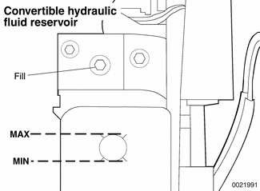

- To check:
    - Level must be between MAX and MIN marks.
    - Reference mark is circle in translucent reservoir.

- To fill:
    - Detach hydraulic unit and pull out without disconnecting fluid lines.
    - Lay unit on its side and fill through fill plug.
    - Turn unit upright and recheck level.
    - Install new fill plug seal.

- To drain:
    - Detach hydraulic unit and pull out without disconnecting fluid lines.
    - Lay unit on its side and allow to drain through fill plug.
    - Turn unit upright and recheck level.
    - Install new fill plug seal.

Convertible top fluid

| Fluid | Specification |
|---|---|
| Hydraulic fluid | Aral Vitamol |

Tightening torques

| Component | Torque |
|---|---|
| Filler plug to hydraulic unit | 10 + 1 Nm (89 + 9 in-lb) |
| Hydraulic unit to body | 10 Nm (89 in-lb) |

> **Note:** The convertible top hydraulic fluid is supplied in the spare parts kit. To restock fluid, check with an authorized BMW dealer parts department.

## Convertible top switch

The convertible top switch assembly is in the center console below the IHKA control panel. Two push buttons, one for each direction of travel, provide ground input signals to the Convertible Top Module (CVM II).

Two LEDs are positioned in the center of the switch assembly. The top LED will flash whenever the top is being operated and not locked to the windshield or stored completely in the storage compartment. The lower LED will illuminate if the top switch is pushed (open top signal) and the storage compartment floor is in the folded up position. See [Top storage compartment floor] later in this group.

The top ceases moving once the switch is released. The hydraulics hold the top in position and remain under pressure for approximately 20 minutes if the ignition key is left in the ON position.

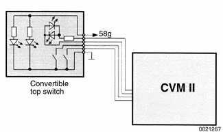

## Convertible Top Module (CVM II)

The CVM II is installed in the left rear of the car behind the side trim (next to the seat). It contains the processing, controlling and monitoring electronics for top operation.

The CVM II communicates with the General Module (GM V) over the K-bus for operation of top storage cover and windows.

The CVM II is fully self-diagnostic and is capable of storing monitored faults. Fault code access and diagnosis is carried out over the K-bus with BMW diagnostic scan tools DIS or MoDiC.

**Convertible top electronic control module (CVM II)**

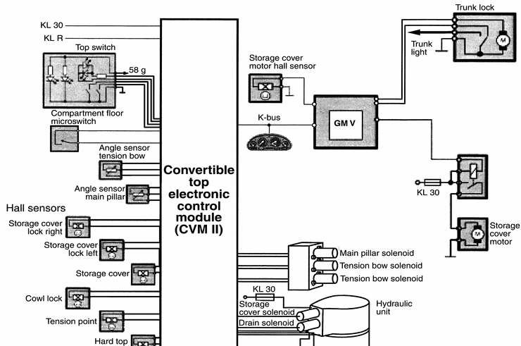

## Fault memory storage

Convertible Top Module (CVM II) fault memory is stored in NVRAM. Up to 16 fault codes can be stored in order of occurrence. A distinction is made between permanent and sporadic faults.

If a fault occurs during raising or lowering the top, all top movement will cease and a fault code will be stored in memory. Then the emergency closing procedure must be followed.

Depending on the location and type of the fault, it may be possible to raise or lower the top fully by pressing the switch in the opposite direction.

If the top switch is held on more than 20 seconds after the top is completely raised or lowered, a fault code will be set. CVM II assumes a fault to ground in the switch or electrical harness. The ignition switch must then be cycled OFF - ON to clear the fault before the top will function again. The fault will remain in memory until cleared with a scan tool (DIS, MoDiC or equivalent).

All sequenced movements of the convertible top have time-out limits preset in CVM II. If a time-out occurs before the end position is reached, movement will be switched off to prevent damage to any of the top components.

> **Note:** The temperature sensor in the convertible top system signals CVM II to cease operation if the hydraulic fluid temperature exceeds 95°C (203°F). However, any functions that have been started will be completed before the system is switched off. If the temperature exceeds 105°C (221°F) the system is immediately switched off. Close the top using the emergency closing procedure. Automatic operation can be resumed when the fluid temperature drops below 95°C.

## Comfort operation

Comfort closing of the top is possible by using the key in the driver door lock cylinder. Holding the key in the locking position will raise the top and close the windows.

Comfort opening is possible from either the driver door or remotely using the FZV key.

## Windshield frame lock

The windshield frame lock assembly consists of the top lock motor positioned in the center of the top frame and two lock drive mechanisms positioned on either side of the top frame.

The lock motor and drive mechanism unlock the top from the windshield and raise the front of the top past the tension point. Flexible drive shafts are used to activate the lock assemblies and drive the tension link rods.

## Convertible top sensor operation

Three Hall sensors that detect the position of the top frame are located on the left lock drive assembly. All three sensors receive power and ground from CVM II.

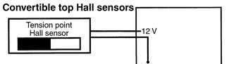

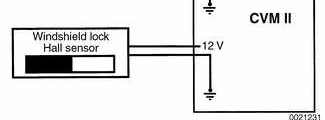

Windshield lock sensor provides low signal when top frame is unlocked from windshield. LED in convertible top switch will flash.

Tension point position sensor provides high signal when top frame is raised past tension point. The angle sensor provides a linear voltage signal input to CVM II (approx. 0.5 - 3.5 volts) as tension bow moves from a vertical to a horizontal position.

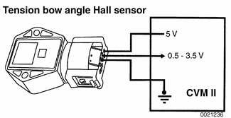

Main pillar Hall angle sensor is similar in function and output to tension point position sensor. It is mounted on left side top linkage by left main pillar hydraulic cylinder. The CVM uses input signal from main pillar angle sensor for top frame positioning.

## Top storage compartment cover

Top storage compartment cover position is detected and signalled to CVM II by a Hall sensor on left side storage cover hydraulic cylinder in trunk. The sensor provides a high signal when storage cover is fully open.

The CVM II uses this input as a switching signal:

- For activating tension bow solenoid during top lowering
- For activating main pillar solenoid during top raising.

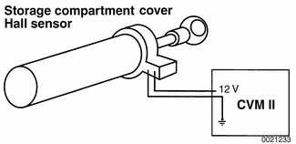

## Top storage compartment cover lock motor

The convertible top storage compartment cover lock motor is on driveshaft tunnel under rear seat. It consists of a motor with Hall sensor, gear assembly and two bowden cables connected to cover locks on two sides of cover. The Hall sensor detects locked/unlocked position of cover.

During convertible top operation (raising or lowering) CVM II signals General Module (GM V) over K-bus to unlock storage compartment. The lock motor runs 180° to unlock cover latches. The motor always turns in same direction to lock or unlock.

Once motor has turned 180°, the Hall sensor will signal GM V to switch off motor. At the same time, GM V will signal CVM II to continue top operation.

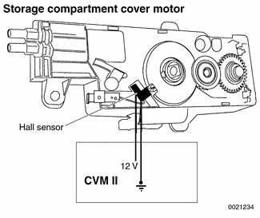

There are two storage compartment cover lock Hall sensors, one mounted on each storage cover latch. The switches receive power and ground from CVM II. Each switch input provides a high signal when cover is unlocked and raised far enough by cover hydraulic cylinders to clear latches.

When cover is completely lowered by hydraulic cylinders, the Hall sensors send a signal to CVM II which signals GM V to relock storage cover.

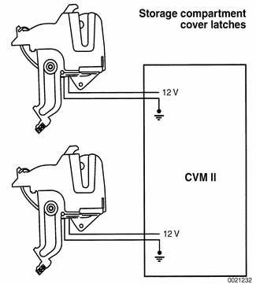

## Top storage compartment floor

The trunk of the E46 Convertible offers the variable convertible top storage compartment floor. This feature allows the luggage storage area to be enlarged by approximately 40 liters (1.5 cu. ft.) when soft top is raised or removed for hard top installation.

The plastic variable compartment floor is hinged at four points so that it can articulate and be rotated up into top storage space.

A lever on right side of variable floor actuates and locks floor into position.

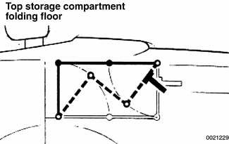

A dampening piston on right side maintains position of variable floor. The lower dampening piston hinge switches a microswitch on right side of variable floor when floor is in folded (raised) position. This signal to CVM II locks out operation of top.

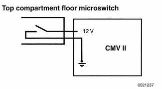
