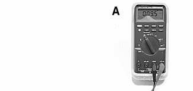
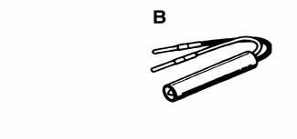
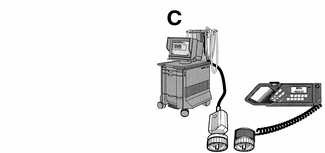
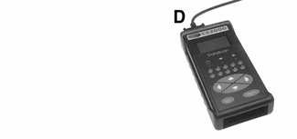

# General (Electrical System)

> Source: Bentley *BMW 3 Series (E46) 1999–2005 (M3) Repair Manual*, section 600-1 (PDF pages 941–942 of 1252).

A brief description of the principal parts of the electrical system is presented here. Also covered here are basic electrical system troubleshooting tips. See also [121 Battery, Alternator, Starter].

## Electrical test equipment

Many electrical tests described in this manual call for measuring voltage, current, or resistance using a digital multimeter. Digital meters are preferred for precise measurements and for electronics work because they are generally more accurate than analog meters. An analog meter (swing-needle) may draw enough current to damage sensitive electronic components.

An LED test light is a safe, inexpensive tool that can be used to perform many simple electrical tests that would otherwise require a digital multimeter. The LED indicates when voltage is present between any two test-points in a circuit.

The integrated safety, comfort, security and handling systems on E46 cars are designed with self-diagnostic capabilities. The quickest way to diagnose many problems is to start out with a scan tool read out of Diagnostic Trouble Codes (DTCs). See [OBD On Board Diagnostics] at rear of manual.

## Special Tools

Automotive digital multimeter Fluke 87

LED tester with thin spade probes Baum 1115 (Source: Baum Tools Unlimited)

Scan tools BMW DIS/MoDiC

Aftermarket scan tool Baum CS2000 (Source: Baum Tools Unlimited)

