# General (Wipers and Washers)

> Source: Bentley *BMW 3 Series (E46) 1999–2005 (M3) Repair Manual*, section 611-1 (PDF pages 1026–1036 of 1252).

This repair group covers repair information for windshield, headlight (optional) and rear window (Sport Wagon) wiper and washer systems. Replacement of the wiper/washer stalk switch assembly is covered in [612 Switches]. Electrical wiring diagrams and relays for the wiper/washer system are covered in [Electrical Wiring Diagrams].

## Special tools

Although most wiper system repairs can be carried out with normal shop tools, a few special tools may be necessary as well.

- Headlight washer nozzle aligning tool BMW 00 9 100
- Rear wiper drive aligning tool BMW 61 1 330
- Wiper arm removal tool BMW 61 6 060

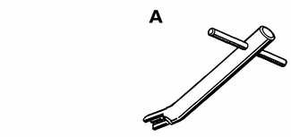

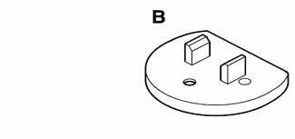

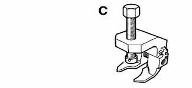

## Wiper and washer system

The wiper and washer functions in E46 vehicles are controlled by the ZKE V general module (GM V). Driver input to the system is via the multi-function stalk switch to the right of the steering column.

Operational faults in the wiper/washer system will set Diagnostic Trouble Codes (DTCs) which can be accessed through BMW scan tools DIS or MoDiC.

The components of the wiper/washer system are described below. Some functions or components are optional, as indicated.

**Wiper/washer stalk switch.** The system has four wiper settings for the windshield at the steering column stalk switch.

The settings are:

- A: Single wipe (hold stalk switch down)
- B: Off
- C: Interval (thumb wheel on stalk switch)
- D: Slow (automatically switches to interval when car is stopped.)
- E: Fast (automatically switches to slow speed when car is stopped.)

In "interval" setting, wiping intervals are dependent on road speed. See Table a. Wiper interval (seconds).

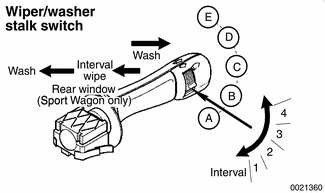

The windshield washer system is activated by pulling the stalk switch toward the driver.

In Sport Wagon models with rear wiper/washer, pushing the stalk switch one detent away from the driver activates the interval rear wiper. Pushing the stalk further forward activates the rear window washer.

**Windshield wiper double relay** is in E-box, left rear of engine compartment (arrow) under plastic cover.

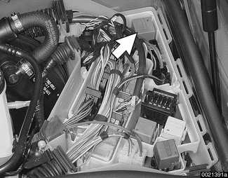

**Rain sensor (optional).** The infrared rain sensor and module switch on the windshield wipers automatically when water drops are detected on the windshield. The rain sensor system is described more fully below.

**Windshield/headlight washer fluid tank** is in right front of engine compartment.

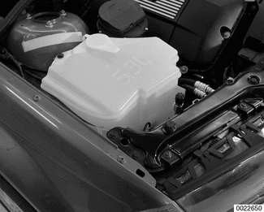

**Windshield washer pump** is in rear portion of front washer tank (arrow).

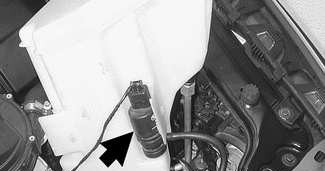

**Headlight washer pump** (optional) is in front portion of front washer tank.

**Windshield washer nozzle jets** are located on the engine hood. With the ignition ON, the washer jets are automatically heated. The nozzle heaters, being of the positive temperature coefficient (PTC) design, increase resistance as they heat up and automatically cut back on current consumption.

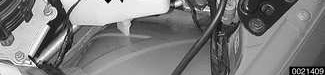

**Headlight washer system (optional).** Headlight washer nozzles are on top of the front bumper. The headlight washer pump uses fluid from the front washer tank. If headlights are on, they will be cleaned every fifth time the windshield washers are activated.

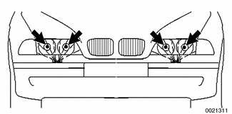

**Rear window wiper assembly** (Sport Wagon) is mounted to the tailgate and linked to the rear wiper shaft via a mechanical coupling.

**Rear washer fluid tank and pump** (Sport Wagon) is mounted in the right cargo compartment behind trim panel. Fill reservoir through cap in right side rear deck pillar.

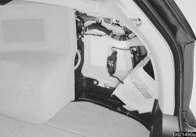

The rear window wiper/washer system is described more fully below.

Table a. Wiper interval (seconds)

Vehicle speed (mph)

| Thumb wheel position | <4 | 5 - 22 | 23 - 45 | 46 - 60 | 61 - 87 | >87 |
|---|---|---|---|---|---|---|
| 1 | 26 | 19 | 17 | 15 | 15 | 13 |
| 2 | 17 | 12 | 11 | 10 | 9 | 7 |
| 3 | 10 | 6 | 6 | 5 | 4 | 3 |
| 4 | 5 | 3 | 3 | 2 | 2 | 2 |

## Windshield wiper/washer system

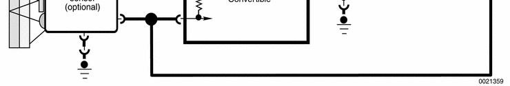

## Rain sensor system (optional)

The optional rain sensor system uses an infrared sensor, located at the top of the windshield in front of the rear view mirror, to detect the presence of water drops (or dirt) on the windshield. The signal from the sensor is communicated to the GM V, which activates the interval wipe cycle if the wiper stalk switch knurled knob (interval control) is in one of the four interval settings.

The rain sensor functions by aiming a beam of infrared light through the windshield at a set angle. The beam is reflected back and forth within the windshield until it is detected by the detector component of the rain sensor. Rain drops (or other impurities) on the outside of the windshield cause some of the infrared to be dissipated outside the windshield. As a result the detector "sees" less infrared intensity. This is interpreted as a need for the wiper to be turned on.

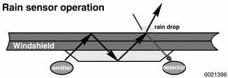

System components:

- An optical prism body attached to the top of the windshield
- Infrared emitter and detector diodes
- Optics heater (to prevent condensation from forming on diodes and prism)
- Control module (connected to GM V via K-bus)

The rain sensor is on-line as soon as it receives KL R (ignition on) operating power.

- When the windshield wiper stalk switch is placed in the intermittent position, the GM V signals the rain sensor control module via the K-bus of the request for intermittent wiping and the position of the knurled wheel (sensitivity).
- As an acknowledgment, the rain sensor sends a command via the K-bus to activate the wiper motor.
- If more than 12 seconds pass before the GM V receives the acknowledgment, it concludes the rain sensor has a defect and operates the intermittent wipe function as a system not equipped with a rain sensor. The wiper intermittent cycling is based solely on the knurled wheel setting.

The rain sensor continuously monitors the windshield for rain accumulation and signals the GM V to activate the wipers based on the knurled wheel position and how fast rain accumulates on the windshield.

The knurled wheel position signal (1 - 4) via the K-bus informs the rain sensor of the selected level of sensitivity:

- Position 1 (least sensitive) delays the wiper activation signal.
- Position 4 (most sensitive) sends the wiper activation signal to the GM V sooner.

Depending on the intensity of the rain the wipers can be operated continuously as if set in the normal wiper stalk switch position regardless of the knurled wheel setting. For this reason, the vehicle speed signal on the K-bus is not utilized on rain sensor equipped wiper systems.

If the ignition switch is turned off with the wiper switch in the intermittent position, the rain sensor will only become active after the ignition is switched back on and one of the following occurs:

- The stalk switch is moved from the intermittent position and then back.
- The knurled wheel setting is adjusted.
- The wash function is activated.

The reasoning behind this switching strategy is to have the driver make a conscious decision to activate the system.

The rain sensor control module adapts to the optics system environment as follows:

- Windshield aging: As the vehicle ages, windshield pitting in the rain sensor monitoring area may cause a loss of light in the optics system. The control module adapts for loss of light based on the intensity of the detected infrared light with a cleared windshield. Therefore, rain sensor function is not adversely affected due to windshield aging.
- Dirty windows: The rain sensor adaptation reacts less sensitively to a dirty windshield (dirt, road salt, wax residue) after a completed wipe cycle. A dirty windshield has a film on it that diminishes the ability of infrared to refract into water droplets that are present. This causes a delay in the rain sensor detection capabilities which lengthens the time intervals on an intermittent wipe.

> **CAUTION!**
>
> - On rain sensor equipped models, make sure the wiper blades are in perfect condition. Only use window cleaner to clean the windshield.

> **Note:** A dirty windshield can cause the rain sensor control module to set a fault due to approaching limits of its adaptation abilities.

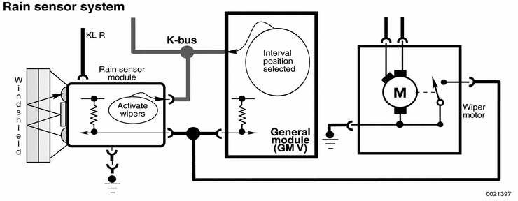

## Rear window wiper/washer system (Sport Wagon)

The rear wiper motor assembly in Sport Wagon models is mounted in the tailgate through a sound-insulating rubber bushing.

The rear wiper/washer is controlled by the wiper/washer steering column stalk switch via the ZKE V system. The functions of the system are:

- Normal interval wipe
- Programmed interval wipe
- Continuous wipe
- Washing

Normal operation is a timed interval of approx. 7 seconds. This is triggered by pressing the stalk switch forward to the first detent. Full sweep and park position of the wiper arm are recognized by two hall sensors on the motor assembly. If the wiper is switched OFF, the wiper arm will return to the park position.

Programmed interval wipe:

- Quickly switch rear wiper ON and OFF.
- Wait the needed interval time.
- Switch rear wiper ON again.

The OFF time will be the programmed interval, up to approx. 30 seconds.

Continuous wiping is activated any time the rear wiper is on and the transmission is in reverse. The signal is provided by the back-up light switch via the LSZ (light control module).

Rear window washing is activated when the stalk switch is pushed forward past the first detent:

- Wash cycle 1. Washer pump ON for 1.5 seconds. Wiper ON 1 second later.
- Wash cycle 2. Washer pump ON for 0.5 second after 0.8 second delay. Wiper continues.
- Wash cycle 3. Washer pump ON for 0.5 second after 0.8 second delay. Wiper ON for two wipe-dry cycles.

> **Note:** After washing, the rear wiper will remain in interval (normal) wiping mode until switched OFF.

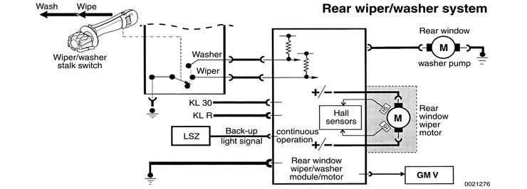
