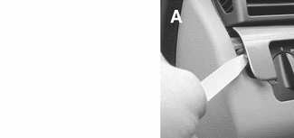
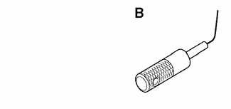
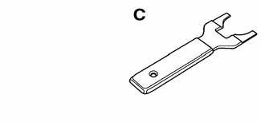

# General (Switches)

> Source: Bentley *BMW 3 Series (E46) 1999–2005 (M3) Repair Manual*, section 612-1 (PDF pages 1054–1055 of 1252).

This section covers replacement of electrical switches at the steering wheel, steering column, dashboard, pedal cluster, center console and other locations.

See also the following sections:

- [119 Lubrication System] for information on testing the oil pressure switch
- [250 Gearshift Linkage] for information about the gearshift lever
- [515 Central Locking and Anti-theft] for information about the electronic immobilization system (EWS 3.3)
- [520 Seats] for information about power seat controls
- [540 Sunroof]
- [541 Convertible Top]
- [610 Electrical Component Locations]
- [630 Lights]
- [Electrical Wiring Diagrams]

## Special tools

A few special tools are necessary for the repairs detailed in this section.

- Plastic prying tool BMW 00 9 321

- Ignition cylinder removal tool BMW 32 3 110

- Ring antenna removal tool BMW 61 3 300

> **CAUTION!**
>
> - When working on electrical switches or lights, always disconnect the negative (-) cable from the battery and insulate the cable end to prevent accidental reconnection.
> - Prior to disconnecting the battery, read the battery disconnection cautions given at the front of this manual on page viii.
> - To prevent marring the trim when working on interior components, work with plastic prying tools or wrap the tips of screwdrivers and pliers with tape before prying out switches or electrical accessories.
