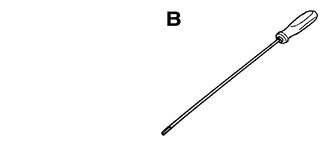
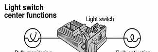
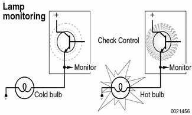
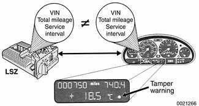

# General (Lights)

> Source: Bentley *BMW 3 Series (E46) 1999–2005 (M3) Repair Manual*, section 630-1 (PDF pages 1081–1086 of 1252).

This repair group covers interior and exterior lighting, including repairs to the light switch assembly.

## Special tools

Some special tools may be necessary to install or adjust lights and light fixtures.

**Plastic trim prying tool BMW 00 9 321**

**Foglight/headlight adjusting tool 4 mm/6 mm Allen**

## Bulb applications

For convenience, the bulb applications for E46 cars are listed in [Table a].

Table a. E46 bulb applications

| Location | Type & rating |
|---|---|
| **Headlights** |  |
| High beam | H7 12V 55W |
| Low beam (Halogen) | H7 12 V 55 W |
| Low beam (Xenon) | D2-S |
| **Foglights** |  |
| Front | HB4 |
| Rear (Euro only) | 12V 21W |
| **Turn signal and taillight** |  |
| Back-up | 12V 21W |
| Brake | 12V 21W |
| Brake/taillight | 12V 21/4W |
| Licence plate | 12V 5W |
| Side turn signal | W5W |
| Third brake light | LED |
| Turn signal (front or rear) | 12V 21W |
| **Interior lights** |  |
| Footwell | Softlite 5W |
| Glove compartment | Softlite 5 W |
| Passenger compartment, front or rear | Softlite 5W |
| Reading, front or rear | 6W |
| Trunk or tailgate | Softlite 10W |
| Visor vanity | Softlite 10W |

Note: Group rows (Headlights, Foglights, Turn signal and taillight, Interior lights) are full-width merged rows in print — rendered as bold rows. Table splits across pages 1081/1082 with repeated header — merged.

## Light switch center (LSZ)

The light switch center (LSZ), mounted in the left side of the dashboard, consists of the following components:

- Headlight/taillight/running light control switch
- Foglight switch
- Instrument dimmer control
- Light control module

In addition to normal light control, the LSZ provides the following functions:

- Hot and cold monitoring of the exterior bulbs
- Emergency lighting function
- Short circuit protection
- Redundant storage of mileage and service interval data
- Automatic headlight adjustment (LWR) programmed control (if equipped)

## Bulb monitoring

The light control module monitors the following bulbs in both hot and cold states:

- High/low beams
- Brake lights
- Turn signal lights
- Taillights
- Parking lights
- Side marker lights
- License plate lights

Hot and cold monitoring of light bulbs allows the LSZ to detect defective bulbs. Hot monitoring checks the continuity of circuits while the lights are switched on. Cold monitoring consists of a brief pulse of current which is too short for the lights to illuminate. If the module detects a defective bulb, a signal is sent to the instrument cluster and Check Control is illuminated with the appropriate warning.

## Home lighting

This convenience feature provides lighting for the driver and passengers to leave the vehicle and enter their house. The feature is switched on by activating the headlight flasher switch after the lights and ignition are switched OFF. The feature is switched off after the coded time delay or by switching the ignition ON.

## Redundant data storage

The light control module serves as the redundant storage module in parallel with the instrument cluster. This includes all data used for vehicle identification, encoded on the assembly line. In addition the total mileage and service interval data are also stored in the light control module. If either the instrument cluster or light control module has to be replaced, the data is taken from the remaining module and transferred to the replacement unit.

## Emergency (fail safe) lighting

The light control module provides emergency lighting in the event of an electronic module failure. Back up hardware allows the following lighting circuits to function:

- Low beam headlights
- Taillights
- Brake lights

The headlights and taillights come on as soon as the ignition is switched ON. The brake light operates when the brake pedal is pressed.

> **WARNING!**
> - When working on electrical systems, remove the fuse protecting the circuit under repair. See [610 Electrical Component Locations].

> **CAUTION!**
> - The headlight and foglight assemblies use halogen bulbs. To ensure the longevity of halogen bulbs, the bulb glass should not be handled. Dirt and skin oils may cause a bulb to fail prematurely. If necessary wipe bulb using a clean cloth dampened with rubbing alcohol. Use only original equipment replacement bulbs. Non-original equipment bulbs may cause false failure readings on the Check Control display.
> - To avoid marring car paint or trim, work with plastic prying tools or wrap the tips of tools with tape.
