# General (Heating and Air Conditioning)

> Source: Bentley *BMW 3 Series (E46) 1999–2005 (M3) Repair Manual*, section 640-1 (PDF pages 1113–1134 of 1252).

The repair information given under this heading applies to the heating and air conditioning system. Many of the procedures require that the A/C refrigerant charge be evacuated. See [A/C system warnings and cautions] later in this repair group.

For information on the engine cooling system, see [170 Radiator and Cooling System].

## Special tools

Some special tools are necessary for heating and A/C repair procedures.

A variety of A/C system evacuation and recharge equipment is available. Follow the equipment manufacturer's recommendations and instructions.

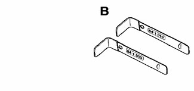

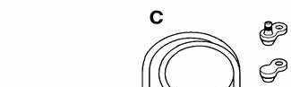

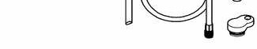

**Plastic tool for prying off interior trim BMW 00 9 321**

**IHKA control panel removal tools BMW 64 1 010**

**A/C line plug kit BMW 64 5 100**

**Note:**

*A/C system recharging procedures are beyond the scope of this manual.*

## Integrated heating and cooling system (IHKA)

The E46 integrated automatic climate control system (IHKA) offers powerful cooling and heating, effective ventilation, and smooth operation in A/C mode.

The E46 IHKA design includes the following:

- Use of R134a refrigerant only
- Single heater core for temperature regulation
- Maximum heating and cooling for defroster functions
- Rear window defogger operation integrated into the heating/cooling system
- Blower controlled through a final stage variable resistor
- Road speed dependent air distribution and fresh air volume
- Self-calibrating air distribution stepper motors controlled via M-bus
- Fresh air microfilter system
- Electronically regulated A/C compressor
- Heater control personalization via Car Memory/Key Memory

**E46 IHKA control**

![E46 IHKA control diagram — top part of a figure split across a page break: control panel buttons (temperature rocker 70°F, max defrost, A/C compressor, recirculation, rear defrost, defrost vent, face vent, footwell vent, automatic program, fan speed request), power supply KL 30/31/15, K-bus, water valve, washer jet heating, blower relay, blower motor and output stage (2-8 volt signal), M-bus five stepper motors (face vent flap, defrost, footwell, recirculation, fresh air), ECM, interior air temp/photo transistor, evaporator temperature and heater core temperature sensor. Continues in next image.](e46_640-1_fig05.jpg)

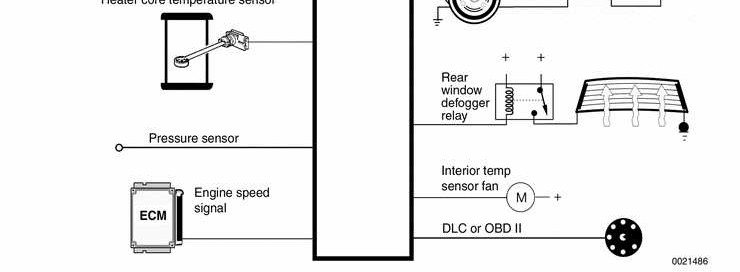

## Control panel and module

Heating and air conditioning functions are programmed via the center console mounted control panel. The control panel has large, easy to use soft touch controls, an LED display and a single temperature setting.

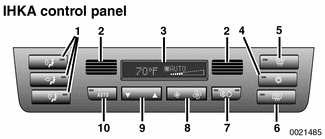

1 - Manual air distribution control buttons
2 - Interior temperature sensor intake/outlet
3 - LCD matrix
4 - A/C control ("snowflake")
5 - Windshield defrost control
6 - Rear window defogger control
7 - Recirculation control
8 - Blower control
9 - Temperature control
10 - Automatic air distribution

The IHKA control module, integral with the front panel, includes an EEPROM chip for storage of Diagnostic Trouble Codes (DTCs). Inputs to the module include:

- Heater core temperature sensor
- A/C evaporator temperature sensor
- Other programmed functions from Car Memory (such as rear window defrost timing).

The module can go into "sleep mode" to reduce power consumption when the ignition is switched OFF but still retain control panel settings and DTC information. If the control module is replaced it must be recoded using BMW scan tools DIS or MoDiC.

## Heat regulation

The E46 uses a single water valve and heater core to provide passenger compartment heat. The water valve is electrically pulsed to control the flow of coolant through the heater core.

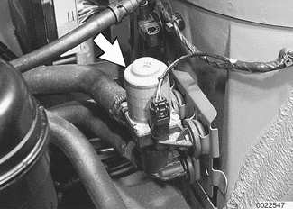

Temperature regulation is based on the following inputs:

- Temperature control switch setting
- Interior temperature sensor signal
- Ambient temperature signal
- Heater core temperature sensor signal
- Evaporator temperature signal
- Solar sensor input (if applicable)

A rocker switch is used to select the desired cabin temperature, shown in the display matrix of the control panel. The range for temperature display is from 15° to 32°C (60° to 90°F).

A "service station" feature is integrated into the E46 IHKA. This prevents the heater core from being flooded with hot coolant when refueling the vehicle.

## Blower control

The blower rocker switch on the IHKA control panel is the master switch for the entire system. Rocking the switch to select slower and slower fan speeds eventually results in the following:

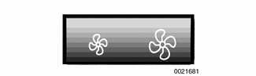

- Blower motor turns off.
- All air distribution valves are closed.
- LED and LCD displays are switched off.
- Rear window defroster is switched off.
- A/C compressor is switched off.

Even in the lowest setting, the interior temperature sensor blower continues to operate and the IHKA control panel continues to signal the heater water valve for heat.

## Regulated A/C compressor

The operation of the A/C compressor is modulated, eliminating noticeable on/off cycling. In order to reduce fuel consumption and improve vehicle performance, the system default is with the compressor OFF.

The A/C system uses a variable displacement compressor. The swash plate of the compressor is hinged so that it can vary piston travel based on output requirements of the system.

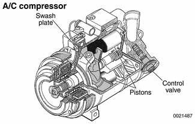

A/C compressor function is controlled by the Engine Control Module (ECM) based on inputs from the IHKA control panel. Pressing the "snowflake" button is a request for A/C activation. As long as the evaporator temperature is above 2°C (36°F), the IHKA signals the ECM to activate the compressor.

The IHKA control module sends the following signals to the ECM over the K-bus and CAN-bus via the instrument cluster:

- Request for A/C activation
- Load torque for switching the compressor
- Requested cooling fan speed

The IHKA determines the load torque for compressor activation and required engine cooling fan speed from the pressure sensor mounted on the receiver/dryer. The pressure sensor provides a linear voltage input signal (0 - 5 volts) to the IHKA control module. The module processes this signal and determines the load torque of the system (0 to 30 Nm with a variable displacement compressor). The higher the pressure in the system, the higher the voltage input signal to the IHKA module. The output signal to the ECM enables the ECM to modify the idle speed, timing and fuel injection amount based on the load that is imposed when the compressor is activated.

## Regulated engine cooling fan operation

The engine cooling fan (arrow) operates at variable speeds (15 stages) based on cooling system load. The ECM activates the fan through a pulse modulated final stage control. See [170 Radiator and Cooling System] for further details.

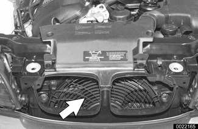

**Note:**

- *Automatic transmission models: The engine cooling fan is located in front of the radiator. A belt-driven fan and fan clutch assembly is installed at the rear of the radiator.*
- *Standard transmission models: The electric engine cooling fan is installed at the rear of the radiator.*

**A/C system**

## Maximum defrosting

Pressing the defrost button turns on maximum defrost functions:

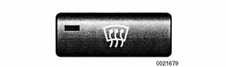

- Fresh air distribution valves are opened.
- Recirculation valves are closed.
- Windshield defrost vents are opened.
- All other air distribution vents are closed.
- Blower runs at maximum speed.
- Rear window defroster is switched on.

**Note:**

*When windshield defrosting is turned on, the A/C compressor does not run automatically, although it can be turned on manually.*

## Air distribution control via M-bus

Five stepper motors control fresh, heated and air conditioned air distribution.

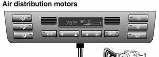

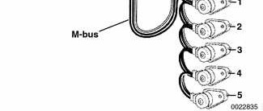

1 - Face vent
2 - Defrost
3 - Footwell
4 - Recirculation
5 - Fresh air

Two different types of air distribution motors are used in the system. Fast acting motors (**A**) are used for the fresh air/recirculation flaps. (Right side shown.)

- Slower acting motors (**B**) are used for the other operations.

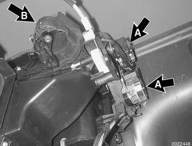

The center dashboard air outlet distribution motor (arrow) allows ventilation air temperature to be controlled by the driver or passenger.

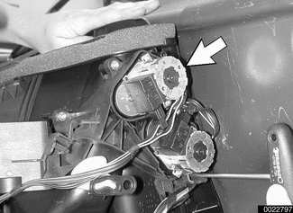

When fresh air is selected, the fresh air inlet distribution flaps are positioned according to road speed and blower motor speed. The motors close the air inlet flaps incrementally according to road speed but the motion is dampened to avoid closing and opening continually due to slight speed changes.

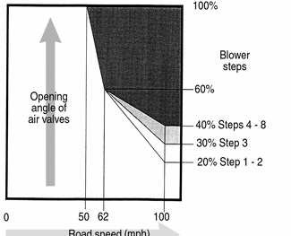

## IHKA personalization

Car Memory/Key Memory allows various functions and features of IHKA control to be tailored to the driver's wishes. The functions of IHKA that can be programmed by the driver include:

- Automatic activation of recirculation when the vehicle is started
- Blower speed adjustment (8-speed blower)
- Automatic opening of ventilation flaps with warm coolant
- Automatic closing of footwell flaps with A/C activation
- Automatic closing of defroster flaps with A/C activation
- Adjustments to set temperature
- Automatic activation of compressor control when the ignition is switched on
- Auto program for blower control when the ignition is switched on

These features are programmed using the coding/programming function of the DIS/MoDiC.

**Note:**

*See [515 Central Locking and Anti-theft] for an explanation of Car Memory/Key Memory.*

## Automatic air recirculation

As of model year 2000, automatic recirculation control is available. This system uses an air quality sensor (AUC) (arrow), located at the top right corner of the radiator, to detect high levels of air pollution and automatically switch the IHKA to recirculation of interior air. The recirculation button on the IHKA control panel can be toggled to allow automatic, manual or no recirculation.

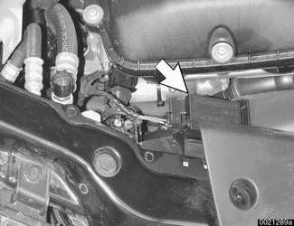

Once recirculation is turned on, it runs until it is turned off using the button. Once the ignition is turned off, the recirculation setting is saved for 15 minutes, after which the IHKA system reverts to fresh air mode. This feature can be over-ridden using the Car Memory feature, so that recirculating interior air is automatically selected on engine start-up.

## Fresh air micro filter system

A fresh air micro filter system is used in all E46 models. The filter is housed below the fresh air inlet at the rear of the engine compartment. The filter can be serviced by releasing three quick-release screws and removing a plastic cover.

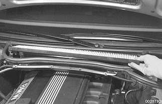

## Service

The heating system is part of the engine cooling system and is sealed. The only required service is periodic coolant flushing. See [170 Radiator and Cooling System].

Servicing the A/C system requires the use of specialized equipment. Follow the equipment manufacturer's instructions.

## Rear window defogger

The electric rear window defogger switch is integrated in the IHKA control panel. Pressing the rear window defogger button activates the rear window heating element for about 17 minutes, although this can be changed through Car Memory settings. Pressing the button again activates a cycle of 40 seconds on/80 seconds off for 5 minutes.

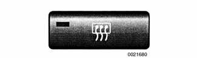

The defogger element in the rear glass is integrated with the radio antenna.

The rear window defogger relay (arrow) is located in the right side of the luggage or cargo (Sport Wagon) compartment behind the trim.

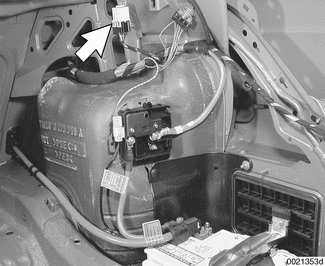

## Convertible heated rear window

In the E46 Convertible, both the soft top and the hard top are equipped with rear window defogger. Power is supplied by two relays located on the right side rear quarter panel behind the interior trim cover.

Rear defogger operation is controlled by the IHKA control module.

On hard top:

- Rear relay is energized.
- Power to hard top window is supplied through connector strip on hard top lock.

On convertible top:

- Rear relay is energized. It powers front relay.
- If convertible top control module (CVM) signals that convertible top is locked to windshield frame, front relay powers rear window heater grid.
- If convertible top is lowered, a signal from CVM to front relay prevents heated top operation.
- Front relay also signals sound system to switch stereo sound ON when top is up, stereo sound OFF when top is down.

## Solar sensor

The purpose of the solar sensor is to detect and relay information about the amount and intensity of solar heating to the IHKA control module. The settings of the climate control system are changed to compensate for this additional influence.

The solar sensor consists of a photoresistor installed in the right defroster outlet and a short harness.

The solar sensor receives power (5 volts) and ground from the IHKA control module. The module then calculates voltage drop across the photoresistor and determines the degree of solar heating based on the change in voltage. Voltage drop across the photoresistor increases as solar radiation increases. The IHKA control module processes the photoresistor input every 10 seconds and also checks it for plausibility based on mapped values. Values outside the limit indicate a malfunction and the solar sensor signal is ignored by the module.

The IHKA module regulates interior climate settings using the following:

- Blower. The blower activation curve is changed.
- Ventilation. The opening angles of air distribution flaps are changed.

Troubleshooting of the solar sensor is carried out through the IHKA diagnostic program incorporated in DIS or MoDiC. The IHKA control module may set codes indicating a short or an open circuit.

To access the solar sensor, remove the trim in front of the main dashboard panel, ahead of the dashboard vents.

## Troubleshooting

Trouble with the heating and A/C system can be broken down into one or more of the following categories.

### Mechanical problems

- Control head malfunction
- Blower motor malfunction
- Noisy or seized compressor
- Noisy compressor clutch
- Malfunctioning belt

Diagnosis of noisy engine compartment components is covered in [100 Engine–General]. A/C belt replacement is covered in [020 Maintenance].

### Cooling system problems

- Coolant problems
- Cooling fan problems

Cooling system pressure testing and other diagnosis is covered in [170 Radiator and Cooling System].

### Refrigerant leak

Use diagnostic equipment to pinpoint refrigerant leaks. Replace leaky components or seals.

**Note:**

*Diagnosis of A/C system components is beyond the scope of this manual. Follow the equipment manufacturer's instructions.*

### Odors

Mildew in the IHKA housing and in the evaporator fins can cause strong odors.

Working under right side of dash, remove blower fan resistor pack (arrow) as described later in this repair group.

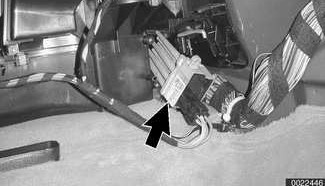

- Poke a spray wand through IHKA housing opening and spray commercially available cleaning agent on evaporator. Move wand back and forth to cover evaporator fins with liquid.
- Allow 5 minutes for liquid to drip through evaporator drain.
- Start car and run heater and A/C at maximum power for 5 minutes to dry out evaporator.

### Functional problems

IHKA self diagnostics monitors the inputs and outputs of the system. If a fault is detected, a Diagnostic Trouble Code (DTC) is initially entered in RAM and then in the EEPROM when the ignition is switched off. A maximum of six DTCs can be stored in the EEPROM when the ignition is switched off. The E46 IHKA module is connected to the Diagnostic Link Connector (DLC) via the K-bus/instrument cluster. Use DIS, MoDiC or other suitable scan tool to access DTCs.

When troubleshooting problems with the E46 IHKA, it is important to note that because the Car Memory/Key Memory feature can change the functionality of the system, a review of memory settings should be performed prior to condemning a component as faulty.

## Substitute value operation

If an input potentiometer, sensor or circuit fails or the signal from it is not plausible, the control module ignores the faulty signal and substitutes a programmed substitute value. See [Table a].

Table a. Substitute programmed values for IHKA component inputs

| Input | Working range | Substitute value |
|---|---|---|
| Heat exchanger sensor | 5° to 124°C (41° to 255°F) | 55°C (131°F) |
| Evaporator sensor | -10° to 30°C (14° to 86°F) | 0°C (32°F) |
| Interior temperature sensor | 10° to 40°C (50° to 104°F) | 20°C (68°F) |
| Exterior temperature | K-bus | 0°C (32°F) |
| Coolant temperature | K-bus | 100°C (212°F) |
| Specified temperature | 16° to 32°C (61° to 90°F) | 22°C (72°F) |

**Note:**

*The substitute value for the evaporator temperature sensor is below the A/C compressor cycling temperature (2°C/34°F). If the evaporator temperature sensor signal is not plausible, the substitute value will switch the A/C OFF.*

[Table b] lists resistance values and fault limits for IHKA temperature sensors.

Table b. Temperature sensor resistance values at 25°C (77°F)

| Sensor | Resistance | Fault limit |
|---|---|---|
| Heater core | 9 kΩ ± 2% | Temp > 125°C (257°F) |
| Evaporator | 9 kΩ ± 2% | Temp > 120°C (248°F) |
| Interior | 10 kΩ ± 2% | Temp ≤ -46°C (-51°F) |

Note: Table splits across pages 1130/1131 with repeated header — merged; the Heater core fault-limit cell is split by the page break.

[Table c] lists A/C evaporator temperature-dependent resistance values.

Table c. A/C evaporator temperature sensor resistance values

| Temperature °C/°F | Resistance range kΩ |
|---|---|
| -5/23 | 11.7 - 11.9 |
| 0/32 | 8.8 - 9.2 |
| 5/41 | 6.8 - 7.2 |
| 10/50 | 5.3 - 5.6 |
| 15/59 | 4.2 - 4.5 |
| 20/68 | 3.3 - 3.6 |
| 25/77 | 2.6 - 2.9 |
| 30/86 | 2.1 - 2.3 |
| 35/95 | 1.7 - 1.9 |

[Table d] lists A/C expansion valve pressure values.

Table d. Expansion valve pressure values

| Location | Value |
|---|---|
| Inlet pressure | 14 bar (203 psi) |
| Outlet pressure | 1.8 bar (26 psi) |
| Leak test with detector pressure | 1 - 2 bar (14.5 - 29 psi) |

## A/C system warnings and cautions

> **WARNING!**
> - Always wear hand and eye protection (gloves and goggles) when working around the A/C system. If refrigerant does come in contact with your skin or eyes: do not rub skin or eyes; immediately flush skin or eyes with cool water for 15 minutes; rush to a doctor or hospital; do not attempt to treat yourself.
> - Work in a well ventilated area. Switch on exhaust/ventilation systems when working on the refrigerant system.
> - Do not expose any component of the A/C system to high temperatures (above 80C/176F) or open flames. Excessive heat causes a pressure increase which could burst the system.
> - Keep refrigerant away from open flames. Poisonous gas is produced if it burns. Do not smoke near refrigerant gases for the same reason.
> - The A/C system is filled with refrigerant gas which is under pressure. Pressurized refrigerant in the presence of oxygen may form a combustible mixture. Never introduce compressed air into any refrigerant container (full or empty).
> - Electric welding near refrigerant hoses causes R-134a to decompose. Discharge system before welding.

> **CAUTION!**
> - As of January 1, 1992, any person who services a motor vehicle air conditioner must, by law, be properly trained and certified, and use approved refrigerant recycling equipment. Technicians must complete an EPA-approved recycling course to be certified.
> - It is recommended that all A/C service be left to an authorized BMW dealer or other qualified A/C service facility.
> - State and local governments may have additional requirements regarding air conditioning servicing. Always comply with state and local laws.
> - Do not top off a partially charged refrigerant system. Discharge system, evacuate and then recharge system.
> - Do not use R-12 refrigerant, refrigerant oils or system components in R-134a system. Component damage and system contamination results.
> - The mixture of refrigerant oil (PAG oil) and refrigerant R-134a attacks some metals and alloys (for example, copper) and breaks down certain hose materials. Use only hoses and lines that are identified with a green mark (stripe) or the lettering "R-134a".
> - Immediately plug open connections on A/C components and lines to prevent dirt and moisture contamination.
> - Do not steam clean A/C condensers or evaporators. Use only cold water or compressed air.
