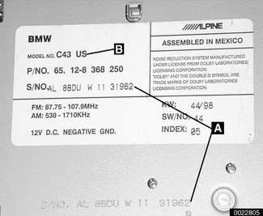
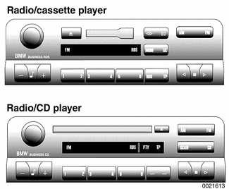

# General

> Source: Bentley *BMW 3 Series (E46) 1999–2005 (M3) Repair Manual*, section 650-1 (PDF pages 1169–1171 of 1252).

This section covers the BMW factoryinstalled sound system, including radio, amplifier and speaker removal. Radio antenna information is also included.

## Special tools

Use BMW special tool 00 9 321 or equivalent plastic prying tool to pry out plastic interior parts without damage or marring.

Plastic prying tool BMW 00 9 321

## General

A tag on the bottom of the radio contains the serial number (**A**) and model number (**B**).

## Sound system

The standard E46 radio features a cassette player. The optional radio has a single in-dash CD player. Both radios are prewired for the optional CD changer that mounts in the trunk. Another option, the On-Board Monitor, integrates GPS navigation with radio and IHKA controls. Basic radio controls are also incorporated in the steering wheel.

Sound system components are interconnected via K-bus. Theft proofing of the radio by code is no longer required as the radio will not function without the K-bus connection and a valid signal from the instrument cluster.

Other features of the sound system include:

- Autostoring of stations
- Speed dependent volume
- Telephone muting
- Diversity antenna, described later in this group, is optional on some models and standard on the Convertible and Sport Wagon.

## RDS

Radio Data System (RDS) is a transmit and receive system operated in the FM band. It is a data service offered by radio stations in which the information is transmitted inaudibly with the audio programs. The name of the station is displayed in the radio when the RDS system is active. Program identification, program service name and RDS quality are also displayed.

## Troubleshooting

Although electronic radio and sound system troubleshooting is beyond the scope of this manual, there are a number of self-tests that are possible with the standard BMW radio installed in E46 cars.

Radio test functions are activated by pressing the M button within 8 seconds of switching the radio on. Hold it pressed in for 8 seconds to start the tests.

The test functions include:

- Radio serial number
- Software version display
- Speed dependent volume control adjustment
- Station signal strength, including FM frequency set, signal strength and quality of signal received
- AM frequency set and signal strength

The test also checks antenna functions:

- Antenna signal strength (F number) indicates the quality of the signal received by the antenna. The scale ranges from 0 to 15, with the optimum value being 15. If the value falls below 10, radio stations can not be listened to in stereo.
