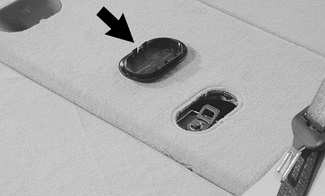
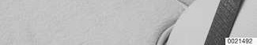

# General

> Source: Bentley *BMW 3 Series (E46) 1999–2005 (M3) Repair Manual*, section 720-1 (PDF pages 1183–1187 of 1252).

This section covers repairs to the seat belts.

Multiple Restraint System (MRS II) electronics integrate seat belt operations and airbag deployment. Airbag repair information is covered in [721 Airbag System (SRS)].

All E46 models are equipped with 3-point shoulder belts at four seating positions.

- Sport Wagon models are equipped with an additional 3-point shoulder belt in the center of the rear seat.
- Sedan and Coupe models are equipped with a lap belt in the center rear seat position.
- Convertible models are equipped with seat-integrated seat belt system (SGS) in the front seats.

## Child safety anchors

Sport Wagon models are equipped with three child safety harness anchors behind the rear seat in the cargo compartment floor. Remove plastic cover (arrow) to access safety anchor eye.

## Troubleshooting

The seat belt reel should lock when driving quickly through curves, during severe braking or in case of a collision. The automatic reel does not require any servicing and should never be opened.

In case of an accident, follow the seat belt troubleshooting procedures presented in [Table a].

**Note:**

*The rear bench seat belt strap may not retract fully due to increased friction between strap and seat cover. A small remaining loop in belt strap when fully retracted is acceptable.*

> **WARNING!**
> - For maximum protection from injury, seat belts should be replaced as a set (including all hardware), if they are subject to occupant loading in a collision.
> - Seat belts should not be modified or repaired. The seat belt mounting points should not be changed or modified.
> - Do not bleach or dye seat belt webbing. Webbing that is severely faded or re-dyed will not meet the strength requirements of a collision and must be replaced. Clean belts with a luke-warm soap solution only.
> - Seat belts should be periodically inspected for webbing defects such as cuts or pulled threads.
> - Immediately after replacing a damaged or worn seat belt, destroy the old belt to prevent it from being used again.

Table a. Troubleshooting the automatic seat belt system

| Problem | Probable cause | Repairs |
|---|---|---|
| Damage to seat belt: | Accident in which bumper impact absorbers were permanently deformed | Replace complete automatic seat belt. Also check and replace, if necessary: • Seat belt mounting on car body • Seat belt mounting on seat runner |
| Belt creased, unraveled, pinched, cut or melted | Seat belts aged or worn | Replace complete automatic seat belt. |
| Belt buckle or belt lock plastic casing worn, damaged or missing | Seat belts aged or worn | Replace complete automatic seat belt. |
| Seat belt buckle is not ejected with spring pressure when red button on seat belt lock is pressed | Seat belt lock mechanism worn or damaged | Replace seat belt lock. |
| Seat belt automatic reel does not lock when pulled out suddenly. | Automatic reel defective | Replace reel assembly. |
| Seat belt automatic reel jams when pulled out. | Automatic reel loose | Tighten reel mounting bolt. |
| Seat belt automatic reel jams when pulled out. | Return spring broken inside reel | Replace reel assembly. |
| Seat belt does not retract automatically. (See note.) | Automatic reel loose | Tighten reel mounting bolt. |
| Seat belt does not retract automatically. (See note.) | Return spring broken inside reel | Replace reel assembly. |
| Automatic belt squeaks when belt fastened or unfastened. | Excessive friction in belt guides | Replace reel assembly. |
| Automatic belt squeaks when belt fastened or unfastened. | Automatic reel loose | Tighten reel mounting bolt. |
| Automatic belt squeaks when belt fastened or unfastened. | Return spring broken inside reel | Replace reel assembly. |
| Seat belt pyrotechnic tensioner triggered | Accident triggered pyrotechnic deployment | Replace complete automatic seat belt. Also check retaining bracket of belt tensioner for twist. |
| **Convertible models only:** | | |
| Front seat back requires excessive force to lock or unlock | Accident damage to seat via seat belt | Replace front seat. |
| Seat back lock warning lamp on when seat back is locked; or warning lamp lights up when seat back is shaken | Seat back lock microswitch defective | Replace microswitch |
| Seat back lock warning lamp on when seat back is locked; or warning lamp lights up when seat back is shaken | Microswitch electrical harness connectors loose or defective | Repair electrical leads. |
| Seat back lock warning lamp on when seat back is locked; or warning lamp lights up when seat back is shaken | Seat back lock is damaged | If fault persists, replace front seat. |
| Contact surface of inertia reel warped | Accident damage | Replace front seat. |
| Seat back warped or deformed | Accident damage | Replace front seat. |
| Head restraint carrier not parallel | Accident damage | Replace front seat. |
| Seat movement sticky or sluggish at some point in its range; unusual noises | Accident damage (side) | Replace front seat. |
| Front seat shows evidence of contact with body structural part (e.g., door) | Accident damage (side) | Replace front seat. |
| Front seat shows evidence of contact with external objects | Accident damage (rollover) | Replace front seat. |

Note: The table splits across pages in the source with a repeated header (merged). Merged cells are rendered as repeated values: problems with multiple causes/repairs repeat the problem text, the six accident-damage rows share one merged "Replace front seat." repair cell, and "Convertible models only:" is a full-width group row.
