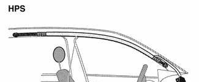
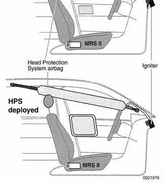
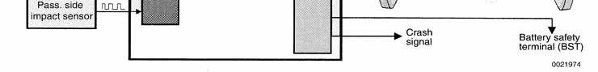

# General

> Source: Bentley *BMW 3 Series (E46) 1999–2005 (M3) Repair Manual*, section 721-1 (PDF pages 1203–1210 of 1252).

This repair group covers airbag components. Airbag system repair and fault diagnosis is not covered here. Diagnostics, component testing, and airbag system repair should be carried out by trained BMW service technicians.

**Note:**

- *Airbags are also known as the Supplemental Restraint System (SRS). In the E46 cars the occupant safety system is called the Multiple Restraint System (MRS).*
- *Special test equipment is required to retrieve airbag fault codes, diagnose system faults, and reset/turn off the airbag indicator light. The indicator light will remain on until any problem has been corrected and the fault memory has been cleared.*
- *Individual airbag system components can only be tested electronically when installed in the car. BMW service testers DIS or MoDiC or equivalent must be used for diagnostic work.*

## Special tools

Most airbag system repairs can be performed with normal shop tools. Use BMW special tool 00 9 321 or equivalent plastic prying tool to pry out plastic interior parts without damage or marring.

Plastic prying tool BMW 00 9 321

## Airbag system

The E46 airbag system consists of the following:

- Driver airbag in the center of the steering wheel hub
- Passenger airbag in the right side of the dashboard
- Front side-impact airbags, one in each front door
- Head Protection System (HPS) airbags, one in each front roof pillar (A-pillar)
- As an option, some cars may be equipped with:
    - Rear side-impact airbags, one in each rear door (4-door Sedan or Sport Wagon).

The airbags and seat belts are integrated into the Multiple Restraint System (MRS). The MRS control module is located on the center tunnel, underneath the rug below the parking brake handle.

E46 Airbags

1 - Driver air bag
2 - Passenger airbag
3 - Head Protection System (HPS) airbag
4 - Front door side-impact airbag
5 - Rear door side-impact airbag (optional)

## 2-stage airbag

Beginning in the 2000 model year (9/1999 production) the front airbags were changed to a 2-stage style airbag. This ensures that the force of airbag inflation is not greater than necessary to provide protection. The airbags are designed to provide "soft" deployment if the acceleration sensor detects a low-speed impact, with a "hard" deployment only in higher speed impacts.

## Head protection airbags (HPS)

This protective system covers a large area between the front roof pillar (A-pillar) and the rear section of the roof. A hollow flexible tube about 5 feet long and 1.5 inches in diameter is anchored inside the A-pillar and front roof rail and concealed by interior trim.

Upon severe side impact, a gas generator unit fills the Head Protection System (HPS) tube with inert gas. The expanding tube pops out of the trim to form a straight tube 5.1 inches in diameter and stretched in a straight line from the lower windshield pillar to above the rear door. The inflated tube is located to prevent the front occupant's head from contacting the A-pillar, the B-pillar, or side window. The tube's sloping position allows protection for both short and tall people. The inflated tube is stiff enough to retain much of its effectiveness even if the window is broken. The HPS tube remains inflated for approximately 7 to 8 seconds to extend protection time in case the vehicle encounters additional side impacts during the crash.

## Rear side-impact airbags

Similar to the standard-equipment front side-impact airbags, the rear airbags are built into the doors of sedan models. These were offered as a special order option on certain models only. They can be deactivated to protect infants or small children riding in the rear seat. Activation and deactivation can be performed by using either DIS or MoDiC BMW scan tools.

## MRS deployment logic

Main sensing and triggering functions for the front-impact airbags and seat belt tensioners are combined into a single MRS control module located above the center tunnel, under the rug, beneath the parking brake handle.

Side-impact and head protection airbags are controlled by separate sensors, one for each side of the vehicle.

MRS deployment logic provides two thresholds for the activation of the safety system, depending upon the severity of impact and whether or not occupants have fastened their seat belts:

- Belts fastened, low impact speed: Lower deployment threshold. Only seat belt pyrotechnic tensioners are deployed.
- Belts fastened, high impact speed: Higher deployment threshold. Tensioners and front-impact airbags are deployed.
- Belts not fastened, low or high impact speed: Airbags are deployed.
- Passenger seat not occupied: Neither belt tensioner nor airbag is deployed on that side.

MRS

## Airbag indicator light

The MRS control module detects and stores system status.

The airbag indicator light in the instrument cluster displays the status of the airbag system when the ignition key is in "accessory" or ON positions.

- System normal: Indicator light comes on briefly, then goes out.
- System malfunction: Indicator light fails to come on.
- System malfunction: Indicator light comes on briefly, goes out and lights up again.

The airbag indicator light also comes on if the seat belt pyrotechnic tensioners have been triggered.

## Warnings

When servicing airbag equipped cars, the following precautions must be observed to prevent personal injury.

> **WARNING!**
> - If the airbag indicator light is on, there is a risk that the airbags will not be triggered in case of an accident. Be sure to have the system inspected and repaired immediately.
> - Airbag(s) are inflated by an explosive device. Handled improperly or without adequate safeguards, the system can be very dangerous. Special precautions must be observed prior to any work at or near the airbags.
> - The airbag is a vehicle safety system. Serious injury may result if system service is attempted by persons unfamiliar with the BMW MRS II and its approved service procedures. BMW advises that all inspection and service be performed by an authorized BMW dealer.
> - Always disconnect the battery and cover the negative (-) battery terminal with an insulator before starting diagnostic, troubleshooting or service work not associated with the airbags, and before doing any welding on the car.
> - After disconnecting the battery, wait 5 seconds before beginning work on airbag components.
> - If an airbag has been activated due to an accident, BMW specifies that airbag components be replaced. For more information on post-collision airbag service, see an authorized BMW dealer.
> - Do not fire an airbag unit prior to disposal. It must be fired by a special disposal company or shipped back to BMW in the packaging of the new components.
> - When removing a fired airbag unit, avoid contact with the skin; wear gloves. In case of skin contact, wash with water.
> - Do not allow airbag system components to come in contact with cleaning solutions or grease.
> - Never subject airbag components to temperatures above 167F (75C).
> - When reconnecting the battery, no person should be inside the vehicle.
> - Always place an airbag unit that has been removed from its packaging with the padded side facing upward. Do not leave an airbag unit unattended.
> - If the airbag unit or airbag control module has been dropped from a height of meter (1 ft.) or more, the airbag unit should not be installed.
