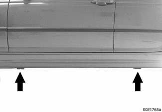
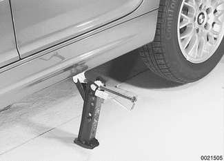

# Getting Started

> Source: BMW 3 Series (E46) Repair Manual, section 010-3 (PDF pages 1–4 of 1252).

Most of the necessary maintenance and minor repair that an automobile will need can be done with ordinary tools. Below is some important information on how to work safely, a discussion of what tools will be needed and how to use them.

## Safety

Although an automobile presents many hazards, common sense and good equipment can help ensure safety. Many accidents happen because of carelessness. Pay attention and stick to safety rules in this manual.

## Lifting the car

The proper jacking points should be used to raise the car safely and avoid damage. The jack supplied with the car can only be used at the four side points (arrows)—just behind the front wheels or just in front of the rear wheels.

> **WARNING!**
> - Never work under a lifted car unless it is solidly supported on jack stands that are intended for that purpose.
> - When raising the car using a floor jack or a hydraulic lift, carefully position the jack pad to prevent damaging the car body. Plastic pads are provided for this purpose by the manufacturer at the jacking points. Watch the jack closely. Make sure it stays stable and does not shift or tilt. As the car is raised, it may roll slightly and the jack may shift.

## Raising car safely

- Park car on flat, level surface.
- If changing a tire, loosen lug bolts before raising car. See [Changing a tire].

- Place jack into position. Make sure jack is resting on flat, solid ground. Use a board or other support to provide a firm surface for the jack, if necessary.

- Raise car slowly while constantly checking position of jack and car.
- Once car is raised, block wheel that is opposite and farthest from jack to prevent car from unexpectedly rolling.

> **WARNING!**
> - Do not rely on the transmission or the emergency brake to keep the car from rolling. They are not a substitute for positively blocking the opposite wheel.
> - Never work under a car that is supported only by a jack. Use jack stands that are designed to support the car. See [Tools].

## Working under car safely

- Disconnect negative (–) cable from battery so that no one can start car. Let others know what you will be doing.

> **CAUTION!**
> - Prior to disconnecting the battery, read the battery disconnection cautions given at the front of this manual on page viii.

- Raise car slowly as described above.
- Use at least two jack stands to support car. Use jack stands designed for the purpose of supporting a car. For more information on jack stands, see [Tools].

> **WARNING!**
> - A jack is a temporary lifting device and should not be used alone to support the car while you are under it.
> - Do not use wood, concrete blocks, or bricks to support a car. Wood may split. Blocks or bricks, while strong, are not designed for that kind of load, and may break or collapse.

- Place jack stands on firm, solid surface. If necessary, use a flat board or similar solid object to provide a firm footing.
- Lower car slowly until its weight is fully supported by jack stands. Watch to make sure that the jack stands do not tip or lean as the car settles on them.
- Observe all jacking precautions again when raising car to remove jack stands.
